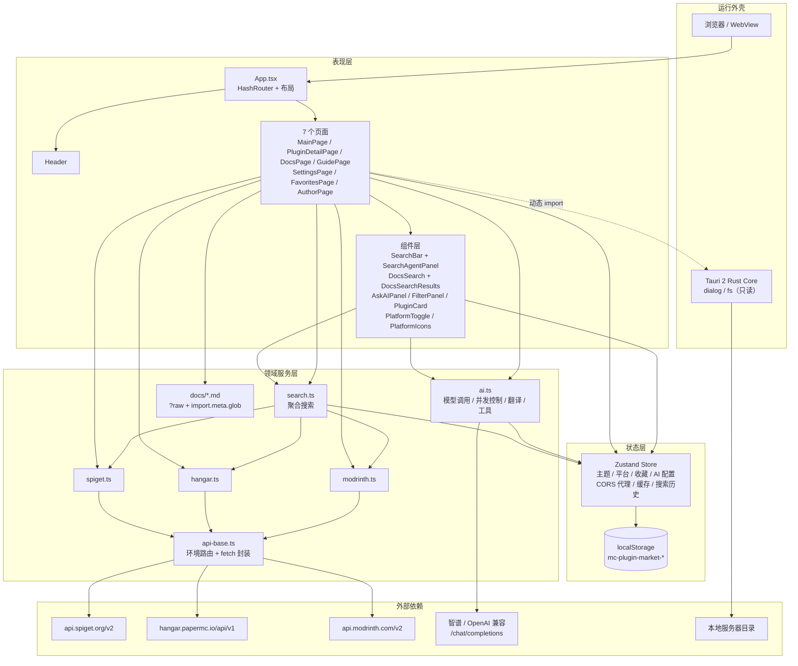
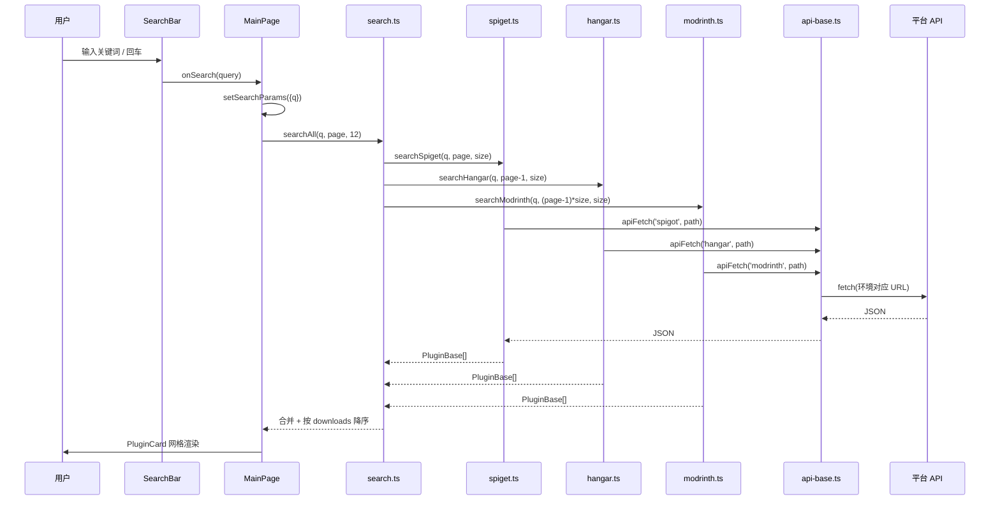
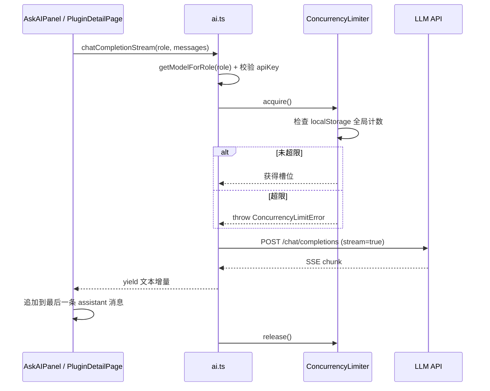

# 01 · 整体架构

## 1. 设计目标

项目要解决三件事：

1. **跨平台插件聚合搜索**：把 Spigot、Hangar、Modrinth 三个结构完全不同的 API 统一成 `PluginBase`。
2. **内置知识库**：把开服教程打包进应用，支持离线阅读、全文检索和 AI 问答。
3. **两套交付形态**：同一份前端代码既可部署为纯静态网站，也可由 Tauri 打包为桌面应用，并在桌面端扩展本地文件读取能力。

架构因此呈现为 **纯前端 SPA + 桌面外壳**：没有自建后端、没有数据库，所有状态在浏览器 `localStorage`（模型配置额外经 AES-GCM 加密），所有外部请求由前端直接发起（Web 生产环境通过 CORS 代理中转）。这带来了部署简单、零服务成本的优点，也带来密钥前端解密、跨域、限流等约束。

## 2. 三种运行形态

| 形态 | 启动方式 | 插件 API 访问方式 | 文件系统能力 | AI 调用 |
| --- | --- | --- | --- | --- |
| Web 开发 | `npm run dev` | Vite 代理 `/api/spiget`、`/api/hangar`、`/api/modrinth` | 无（浏览器 File API） | 浏览器直连模型服务 |
| Web 生产 | `npm run build` + 静态托管 | `corsProxy + encodeURIComponent(真实 URL)`，默认 `https://api.allorigins.win/raw?url=` | 无 | 浏览器直连（受模型服务 CORS 策略影响） |
| Tauri 桌面 | `npm run tauri dev` / `npx tauri build` | 直接请求 `https://api.spiget.org/v2` 等真实地址 | `plugin-fs` 只读、`plugin-dialog` 选择目录 | WebView 内直连 |

环境判定逻辑集中在 [api-base.ts](../../src/services/api-base.ts#L4-L38)：`isTauri()` 同时检测 `window.__TAURI__` 与 `window.__TAURI_INTERNALS__`，`import.meta.env.DEV` 区分开发/生产。`GuidePage` 的 Tauri 判定集中在 [guide/env.ts](../../src/pages/guide/env.ts)。

## 3. 分层架构



### 3.1 表现层

- [App.tsx](../../src/App.tsx) 负责路由、暗色模式副作用、全局页头页脚。
- [pages/](../../src/pages) 承担页面级状态与业务流程编排。
- [components/](../../src/components) 提供可复用 UI；`SearchBar` 保留搜索编排，AI 对话展示拆到 `SearchAgentPanel`；`DocsSearch` 保留检索逻辑，结果下拉拆到 `DocsSearchResults`；`MainPage` 的筛选面板拆到 `FilterPanel`。
- [pages/guide/](../../src/pages/guide) 承载“指导开服”的三个预设：`TranslatePreset`、`SimpleServerPreset`、`AgentPreset`，`PresetSelector` 负责入口与返回。

### 3.2 状态层

单例 Zustand Store 位于 [store/index.ts](../../src/store/index.ts)。所有需要跨页面共享、跨会话保留的数据都在这里：主题、启用的平台、收藏、AI 模型配置、角色分配、CORS 代理、AI 请求代理、插件缓存、搜索历史。Store 内部用 `loadFromStorage` / `saveToStorage` 做同步持久化，没有异步中间件。

### 3.3 领域服务层

- **平台适配器**（`services/spiget.ts`、`hangar.ts`、`modrinth.ts`）：各自理解上游 JSON 结构，输出统一 `PluginBase`。
- **聚合入口**（`services/search.ts`）：根据 Store 中启用的平台并发请求，统一分页语义，通过 `onError` 上报失败平台，再按下载量排序。
- **客户端筛选**（`services/filters.ts`）：对聚合结果做分类/服务端/版本/下载量过滤与排序。
- **文档数据源**（`data/docs.ts`）：eager glob 全部 72 篇文档，自动生成目录树、AI 索引与插件文档子集。
- **网络基础设施**（`services/api-base.ts`）：决定 base URL、拼接 CORS 代理、默认 15 秒超时、统一错误抛出。
- **AI 子系统**（`services/ai.ts`）：角色选模型、并发限流、流式解析、翻译分段、工具调用。
- **静态内容**（`src/assets/docs/`）：由 `src/data/docs.ts` 以 eager `import.meta.glob` 载入，生成目录树与索引。

### 3.4 外壳层

- Web 端只有浏览器环境，无额外能力。
- Tauri 端由 [src-tauri](../../src-tauri) 提供 Rust 入口与插件能力；前端通过动态 `import()` 调用 `@tauri-apps/plugin-fs`、`plugin-dialog`，因此 Web 构建不会因缺少 Tauri 环境而失败。

## 4. 核心数据流

### 4.1 插件搜索



关键点：

- 三个平台分页语义不同：Spigot 的 `page` 从 1 开始，Hangar/Modrinth 用 `offset`（从 0 开始），`searchAll` 内部做了换算。
- 任一平台失败不会影响整体：`searchAll` 通过 `onError` 上报并把该平台结果降级为空数组。
- 搜索模式与“热门插件”模式共用 `plugins` 状态，`loadedQueryRef` 与 `popularKeyRef` 避免重复请求，见 [MainPage.tsx](../../src/pages/MainPage.tsx#L58-L228)。

### 4.2 插件详情

`PluginDetailPage` 先按 `platform` 分派到对应适配器获取 **基础信息** 与 **完整描述**：

| 平台 | 详情函数 | 描述来源 | 描述格式 |
| --- | --- | --- | --- |
| spigot | `getSpigetResource(id)` | 详情响应内的 `description`（旧缓存缺描述时才补 `getSpigetResourceDescription`） | Base64 解码后的 HTML |
| hangar | `getHangarProject(owner, slug)` | `getHangarProjectDescription(owner, slug)`，失败回退 `plugin.description` | Markdown / HTML（pages 单次请求） |
| modrinth | `getModrinthProject(idOrSlug)` | 复用 `project.body` | Markdown |

详情页用 `getCachedPlugin` 尝试命中 1 小时缓存，加载成功后 `cachePlugin` 写回。渲染时 Spigot 走 `dangerouslySetInnerHTML`（经 DOMPurify 消毒），其余平台走 `ReactMarkdown` + `rehype-sanitize`，见 [PluginDetailPage.tsx](../../src/pages/PluginDetailPage.tsx#L330-L380)。

### 4.3 AI 对话



### 4.4 文档检索与 AI 问答

- `DocsPage` 用静态 `import` 把文档字符串装入 `docsTree`，侧边栏递归渲染；点击文档调用 `findDocContent`。
- `DocsSearch` 普通模式在 `getAllDocsFlat(docsTree)` 上做子串匹配评分；AI 模式让模型输出 `search_docs` 工具调用，再按文档路径/索引映射到树节点。
- `AskAIPanel` 把当前文档全文塞进 system prompt，用 `chat` 角色流式回答，并支持点击 AI 回答中的标题滚动到文档对应锚点。
- `GuidePage` 的 `SimpleServerPreset` / `AgentPreset` 通过 `read_docs` 工具按需加载文档，避免把全部文档塞进上下文。

## 5. 目录结构

```text
pluginmarket/
├── index.html                  # SPA 入口（#root + main.tsx）
├── package.json                # 前端脚本与依赖
├── vite.config.ts              # React 插件、@ 别名、base './'、开发代理
├── tailwind.config.js          # 暗色 class 模式、MC 主题色、动画
├── postcss.config.js
├── tsconfig.json               # strict、bundler 解析、@/* 路径
├── public/
│   ├── favicon.svg
│   └── 404.html                # GitHub Pages 的 hash 保留兜底
├── src/
│   ├── main.tsx                # createRoot + StrictMode
│   ├── App.tsx                 # 路由与全局布局
│   ├── index.css               # 字体、Markdown、动画、亮/暗主题
│   ├── vite-env.d.ts
│   ├── types/index.ts          # 全部数据模型
│   ├── store/index.ts          # Zustand Store + localStorage
│   ├── services/
│   │   ├── api-base.ts         # 环境路由、超时与 fetch 封装
│   │   ├── spiget.ts
│   │   ├── hangar.ts
│   │   ├── modrinth.ts
│   │   ├── search.ts           # 聚合搜索与分页/格式化
│   │   ├── filters.ts          # 客户端筛选与排序
│   │   ├── ai.ts               # AI 调用、限流、翻译、工具类型
│   │   └── secure-storage.ts   # API Key AES-GCM 加密存储
│   ├── data/
│   │   └── docs.ts             # 72 篇文档单一数据源
│   ├── utils/
│   │   ├── sanitize.ts         # DOMPurify HTML 消毒
│   │   └── markdown.ts         # 标题锚点 slug 与同名去重
│   ├── pages/
│   │   ├── MainPage.tsx        # 首页 + 浏览页
│   │   ├── PluginDetailPage.tsx
│   │   ├── DocsPage.tsx
│   │   ├── GuidePage.tsx       # 预设入口
│   │   ├── SettingsPage.tsx
│   │   ├── FavoritesPage.tsx
│   │   ├── AuthorPage.tsx
│   │   └── guide/
│   │       ├── PresetSelector.tsx
│   │       ├── TranslatePreset.tsx
│   │       ├── SimpleServerPreset.tsx
│   │       ├── AgentPreset.tsx
│   │       ├── env.ts / loadDocs.ts / types.ts
│   ├── components/
│   │   ├── Header.tsx
│   │   ├── SearchBar.tsx
│   │   ├── SearchAgentPanel.tsx
│   │   ├── DocsSearch.tsx
│   │   ├── DocsSearchResults.tsx
│   │   ├── AskAIPanel.tsx
│   │   ├── FilterPanel.tsx
│   │   ├── PluginCard.tsx
│   │   ├── PlatformToggle.tsx
│   │   └── PlatformIcons.tsx
│   └── assets/
│       ├── Minecraft-AE.ttf    # 历史字体资产，已不再引用/打包
│       └── docs/               # 72 篇开服手册 Markdown
├── src-tauri/
│   ├── Cargo.toml
│   ├── build.rs
│   ├── tauri.conf.json
│   ├── capabilities/default.json
│   ├── icons/
│   └── src/{main.rs, lib.rs}
└── .github/workflows/
    ├── deploy.yml              # main 分支部署 GitHub Pages
    └── release.yml             # v* 标签构建多平台 Release
```

## 6. 横切机制

| 机制 | 实现位置 | 作用 |
| --- | --- | --- |
| 环境自适应 | `api-base.ts`、`pages/guide/env.ts` | 开发 / 生产 / Tauri 三套 API 路由，兼容 `__TAURI__` 与 `__TAURI_INTERNALS__` |
| CORS 兜底 | `api-base.ts#L41-L72` | 生产 Web 端用用户可配置代理 |
| 数据归一化 | 三个平台适配器 | 上游差异被隔离在服务层 |
| 本地持久化 | `store/index.ts#L6-L32` | 主题、收藏、AI 配置、缓存、历史 |
| API Key 加密 | `services/secure-storage.ts` | AES-GCM 加密，密钥不可导出并存入 IndexedDB；旧明文自动迁移 |
| HTML 消毒 | `utils/sanitize.ts`、`rehype-sanitize` | Spigot HTML 与 Markdown 原始 HTML 在渲染前消毒 |
| 缓存降级 | `getCachedPlugin` | 缓存过期返回 `undefined`，调用方回源 |
| 错误隔离 | `searchAll` 的 `onError` + 单平台空数组降级 | 单平台失败不拖垮聚合结果，并向 UI 上报 |
| 并发协调 | `ConcurrencyLimiter` | 同一模型跨标签页共享并发额度 |
| 静态内容打包 | `data/docs.ts` 的 eager `import.meta.glob` | 目录树、检索与 Agent 共用同一份文档 |
| 请求超时 | `api-base.ts` 的 AbortController | 默认 15 秒超时，支持外部取消 |
| 客户端筛选 | `services/filters.ts` | 分类/服务端/版本/下载量过滤与排序 |
| 渐进式桌面能力 | 动态 `import()` Tauri 插件 | Web 端不引入、桌面端按需启用 |
| 桌面安全边界 | capabilities + CSP + 路径校验 | 只读文件、无 shell、限制目录穿越 |

## 7. 关键架构决策与权衡

1. **HashRouter + `base: './'`**：适配 GitHub Pages 子路径与 Tauri 本地 `file://`/自定义协议，避免 history 路由回退 404；代价是 URL 带 `#`，不利于 SEO。
2. **无后端**：部署零成本、隐私数据留在本地；代价是 API Key 虽加密存储但仍在前端解密、跨域依赖第三方代理、无法隐藏业务逻辑。
3. **适配器模式统一数据**：`PluginBase` 是 UI 的唯一输入契约，新增平台只需增加适配器与少量映射；代价是部分字段（评分、作者、分类）在不同平台语义不一致。
4. **AI 角色化配置**：允许“便宜模型做翻译、强模型做决策”，并支持 OpenAI 兼容服务；代价是配置复杂度和多模型并发协调。
5. **文档静态打包**：离线可用、搜索快；文档目录与 AI 索引由 `src/data/docs.ts` 自动生成，代价是包体随文档增长（见 [08](08-docs-content.md)）。
6. **桌面能力只补充文件系统**：Tauri 层几乎没有业务代码，降低 Rust 维护成本；代价是前端直接持有权限与路径拼接逻辑，安全边界依赖 capabilities 配置。

## 8. 架构层面的已知约束

- 所有平台请求默认 15 秒超时，但仍没有自动重试与退避。
- 生产 Web 版依赖 `api.allorigins.win` 等第三方 CORS 代理的可用性与速率限制，用户可在设置页替换。
- Tauri 已收紧为只读 FS + 限定 scope，并移除 shell 权限；但白名单外的服务器目录无法读取，详见 [09](09-tauri-desktop.md#6-安全模型与风险)。
- Web 端（GitHub Pages）无法设置响应头 CSP，安全主要依赖渲染前消毒；Tauri 端已配置 CSP。
- 页面直接调用平台适配器的现象存在（`MainPage`、`PluginDetailPage`、`AuthorPage`），聚合入口未被所有场景复用。
- 已有 ESLint 与 Vitest 单元测试；缺少 E2E 测试与依赖审计。

更完整的逐条问题清单见 [11 · 编码规范与已知问题](11-conventions-and-known-issues.md)。
