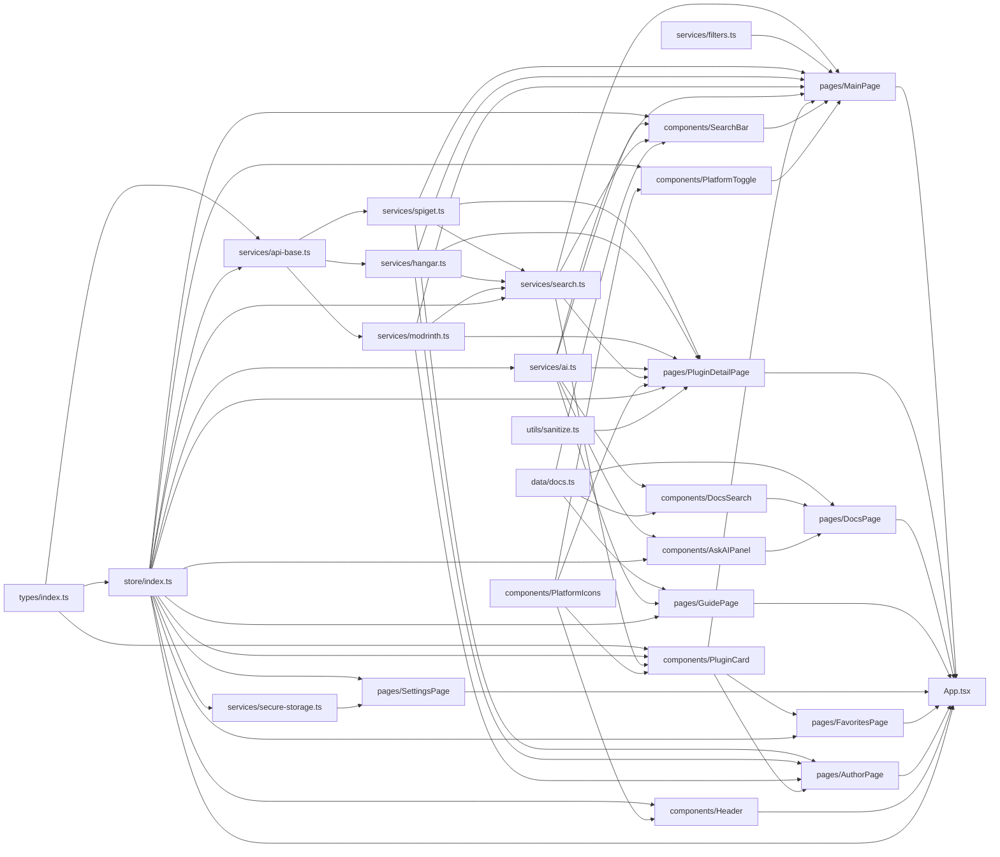
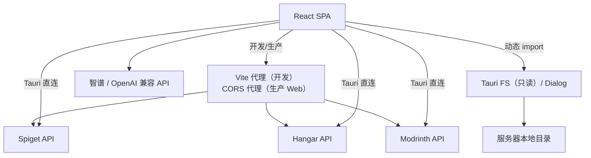

# 02 · 模块与依赖关系

## 1. 模块职责矩阵

| 模块 | 入口文件 | 核心职责 | 关键导出 | 主要依赖 | 主要使用方 |
| --- | --- | --- | --- | --- | --- |
| 应用入口 | `src/main.tsx`、`src/App.tsx` | 挂载 React、注册路由、全局布局、暗色模式 | `App` | React、Router、Store、所有 Page | 浏览器 / Tauri WebView |
| 类型层 | `src/types/index.ts` | 定义统一插件模型、上游 API 模型、AI 模型、设置与筛选类型 | `PluginBase`、`Platform`、`AIModelConfig`、`AIRole`、`ChatMessage` 等 | 无 | 全部模块 |
| 状态层 | `src/store/index.ts` | 全局状态、默认配置、localStorage 持久化、选中与派生逻辑 | `useAppStore` | Zustand、类型层 | 页面、组件、`api-base`、`ai`、`search` |
| 网络基础 | `src/services/api-base.ts` | 环境检测、API Base URL 解析、CORS 代理拼接、统一 `fetch` | `isTauri`、`apiFetch`、`getBaseUrl` | Store、类型层 | 三个平台适配器 |
| Spigot 适配器 | `src/services/spiget.ts` | Spiget v2 搜索、详情（含描述解码）、作者项目、热门 | `searchSpiget`、`getSpigetResource` 等 5 个函数 | `api-base`、类型层 | `search`、`MainPage`、`PluginDetailPage`、`AuthorPage` |
| Hangar 适配器 | `src/services/hangar.ts` | Hangar 项目搜索、详情、单次 pages 描述、热门、作者项目 | `searchHangar`、`getHangarProject` 等 5 个函数 | `api-base`、类型层 | `search`、`MainPage`、`PluginDetailPage`、`AuthorPage` |
| Modrinth 适配器 | `src/services/modrinth.ts` | Modrinth 搜索（facets 限定插件）、详情（团队补全作者）、热门、用户项目 | `searchModrinth`、`getModrinthProject` 等 4 个导出函数 | `api-base`、类型层 | `search`、`MainPage`、`PluginDetailPage`、`AuthorPage` |
| 聚合搜索 | `src/services/search.ts` | 按启用平台并发搜索、错误回调、分页语义统一、下载量排序、展示格式化 | `searchAll`、`getPlatformPage`、`formatDownloads`、`getPlatformName` | Store、三个适配器 | `MainPage`、`SearchBar`、`PluginCard`、`PluginDetailPage` |
| 客户端筛选 | `src/services/filters.ts` | 分类/服务端/版本/下载量过滤与排序 | `applyPluginFilters`、`sortPlugins`、`matchesCategory` | 类型层 | `MainPage`、测试 |
| 文档数据源 | `src/data/docs.ts` | eager glob 全部 72 篇，自动生成目录树、AI 索引与插件文档子集 | `docsTree`、`DOC_CATALOG`、`DOC_INDEX_TEXT`、`PLUGIN_DOCS`、`resolveDocEntry` | Vite glob | `DocsPage`、`DocsSearch`、`GuidePage`、`SearchBar` |
| AI 服务 | `src/services/ai.ts` | 角色→模型解析、并发限流（Web Locks）、普通/流式/工具调用、批量翻译、文档翻译、图片描述、AI 代理 | `ConcurrencyLimitError`、`chatCompletion`、`chatCompletionStream`、`chatCompletionWithTools`、`translateDocumentStream` 等 | Store、类型层、`BroadcastChannel`、`localStorage` | `SearchBar`、`DocsSearch`、`AskAIPanel`、`PluginDetailPage`、`pages/guide/*`、`MainPage` |
| 安全存储 | `src/services/secure-storage.ts` | AES-GCM 加密模型配置，密钥存 IndexedDB，明文旧数据迁移，重置清理 | `saveSecureModels`、`loadModelsWithMigration`、`clearSecureModels`、`isSecureStorageSupported` | Web Crypto、IndexedDB、localStorage | `store/index.ts`、`SettingsPage` |
| HTML 消毒 | `src/utils/sanitize.ts` | 使用 DOMPurify 消毒 Spigot 等外部 HTML | `sanitizeHtml` | DOMPurify | `PluginDetailPage` |
| Markdown 锚点 | `src/utils/markdown.ts` | 标题 slug、同名标题 id 去重 | `generateHeadingSlug`、`buildHeadingIdMap`、`stripMarkdownInline` | 无 | `DocsPage`、`DocsSearch`、`AskAIPanel` |
| 页面层 | `src/pages/*.tsx`、`src/pages/guide/*` | 路由级业务编排、页面状态、数据加载、AI 功能整合 | 7 个默认导出页面 + 3 个预设组件 | React、Router、Store、组件、服务层、文档资产 | `App` |
| 组件层 | `src/components/*.tsx` | 可复用交互与展示；部分组件承载 Agent/检索/对话逻辑 | `Header`、`SearchBar`、`SearchAgentPanel`、`DocsSearch`、`DocsSearchResults`、`AskAIPanel`、`FilterPanel`、`PluginCard`、`PlatformToggle`、`PlatformIcon` | React、Router、Store、服务层、AI、Markdown | 页面 |
| 文档资产 | `src/assets/docs/**/*.md` | 开服知识库原文（72 篇） | 被 `src/data/docs.ts` eager glob 成字符串 | 无 | `src/data/docs.ts` |
| 质量工具 | `eslint.config.js`、`*.test.ts` | 静态检查与单元测试 | ESLint flat config、Vitest 3 个测试文件 | ESLint、Vitest | `npm run lint` / `npm run test` |
| 字体资产 | `src/assets/Minecraft-AE.ttf` | Minecraft 风格字体 | `@font-face` | 无 | `index.css` |
| 桌面外壳 | `src-tauri/src/lib.rs`、`main.rs` | 初始化 Tauri Builder、注册插件、启动应用 | `run()` | tauri、dialog/fs 两个插件 | 桌面可执行文件 |
| 桌面配置 | `tauri.conf.json`、`capabilities/default.json` | 窗口、构建命令、bundle、权限范围 | — | — | Tauri 构建器 |
| CI/CD | `.github/workflows/*.yml` | GitHub Pages 部署、多平台 Release | — | Node、Rust、Tauri CLI | GitHub Actions |

## 2. 依赖关系图

### 2.1 源码依赖（按 import 方向）



> 说明：上图省略了 React、React Router、lucide-react 等第三方依赖，仅保留项目内部依赖。`types` 被几乎所有模块引用；`store` 被表现层、聚合搜索、AI、网络基础引用。

### 2.2 运行时外部依赖



## 3. 分层规则与现状

### 3.1 期望的依赖方向

```text
types  ←  store  ←  services  ←  components  ←  pages  ←  App  ←  main
```

规则：

- `types` 不依赖任何项目模块。
- `store` 只依赖 `types`。
- `services` 可以依赖 `types`、`store`、其他 `services`。
- `components` 可以依赖 `types`、`store`、`services`。
- `pages` 可以依赖 `components`、`services`、`store`。
- 服务层不得反向导入页面或组件。
- 组件不应直接操作浏览器存储，持久化统一经过 Store。

### 3.2 实际偏离

| 现象 | 位置 | 影响 |
| --- | --- | --- |
| 页面绕过聚合入口直接调用平台适配器 | `MainPage` 的热门加载、`PluginDetailPage`、`AuthorPage` | 平台相关分页/映射逻辑分散；新增平台需改多处 |
| `api-base` 依赖 Store | `api-base.ts#L10-L12` | 网络层与全局设置耦合，测试时需初始化 Store |
| 组件包含业务/Agent 逻辑 | `SearchBar.tsx`、`DocsSearch.tsx`、`AskAIPanel.tsx` | 展示层已拆到 `SearchAgentPanel` / `DocsSearchResults`，但 Agent 编排与检索逻辑仍在组件内，复用与测试成本偏高 |
| 文档索引曾分散在多处 | `DocsPage`、`DocsSearch`、`GuidePage`、`SearchBar` | 已由 `src/data/docs.ts` 统一；仅插件文档关键词命中仍是启发式 |
| `isTauri` 判定曾不一致 | `api-base.ts` 与 `pages/guide/env.ts` | 已统一为同时检测 `__TAURI__` / `__TAURI_INTERNALS__` |

### 3.3 循环依赖

当前没有发现运行时循环依赖：

- `store` 不导入 `ai`，`ai` 单向依赖 `store`。
- `search` 不导入页面/组件。
- `types` 是叶子节点。

`api-base → store → types` 与 `store → types` 不构成环。

## 4. 第三方依赖清单

### 4.1 npm 运行时依赖

| 包 | 版本 | 用途 | 使用位置 |
| --- | --- | --- | --- |
| `react` / `react-dom` | ^19.0.0 | UI 运行时 | 全局 |
| `react-router-dom` | ^7.1.0 | HashRouter、路由、`Link` | `App`、页面、组件 |
| `zustand` | ^5.0.0 | 全局状态 | `store/index.ts` |
| `react-markdown` | ^9.0.0 | Markdown 渲染 | 详情页、文档页、AI 面板、Guide |
| `remark-gfm` | ^4.0.1 | 表格、删除线等 GFM 语法 | 同上 |
| `rehype-raw` | ^7.0.0 | 允许 Markdown 中的原始 HTML | 详情页、文档页 |
| `rehype-sanitize` | ^6.0.0 | 对原始 HTML 做 HAST 消毒 | 详情页、文档页 |
| `react-syntax-highlighter` | ^16.1.0 | 代码块高亮 | `DocsPage`、`AskAIPanel`、`GuidePage` |
| `@types/react-syntax-highlighter` | ^15.5.13 | 代码高亮类型声明（声明在 dependencies） | 编译期 |
| `lucide-react` | ^0.469.0 | 图标库 | 全部 UI |
| `@tauri-apps/plugin-dialog` | ^2 | 目录选择 | `GuidePage`（动态导入） |
| `@tauri-apps/plugin-fs` | ^2 | 读取文件 / 列目录 | `GuidePage`（动态导入） |
| `dompurify` | ^3.2.0 | HTML 消毒 | `utils/sanitize.ts` |

### 4.2 npm 开发依赖

| 包 | 版本 | 用途 |
| --- | --- | --- |
| `vite` | ^6.0.0 | 开发服务器与构建 |
| `@vitejs/plugin-react` | ^4.3.0 | React 支持 |
| `typescript` | ~5.7.0 | 类型检查（`tsc -b`） |
| `tailwindcss` | ^3.4.17 | 原子化样式 |
| `postcss` / `autoprefixer` | ^8.4.49 / ^10.4.20 | 样式处理 |
| `@tauri-apps/cli` | ^2.0.0 | Tauri 开发/构建命令 |
| `eslint` / `@eslint/js` / `typescript-eslint` / `eslint-plugin-react-hooks` / `globals` | — | 静态检查 |
| `vitest` | ^5 | 单元测试 |
| `@types/react` / `@types/react-dom` / `@types/dompurify` | — | 类型声明 |

### 4.3 Rust 依赖

| crate | 版本 | 用途 |
| --- | --- | --- |
| `tauri` | 2 | 桌面框架 |
| `tauri-plugin-dialog` | 2 | 原生目录选择对话框 |
| `tauri-plugin-fs` | 2 | 文件读取与目录枚举 |
| `serde` / `serde_json` | 1 | 声明依赖，当前 Rust 业务代码未直接使用 |
| `tauri-build` | 2 | 构建脚本 |

### 4.4 构建期与 CI 依赖

- Node.js 20（GitHub Actions 固定）。
- Rust stable（`dtolnay/rust-toolchain@stable`）。
- Linux 桌面构建需要：`libwebkit2gtk-4.1-dev`、`librsvg2-dev`、`patchelf`、`libgtk-3-dev`、`libayatana-appindicator3-dev`。
- GitHub Actions：`actions/checkout@v4`、`actions/setup-node@v4`、`actions/configure-pages@v4`、`actions/upload-pages-artifact@v3`、`actions/deploy-pages@v4`、`actions/upload-artifact@v4`、`actions/download-artifact@v4`、`softprops/action-gh-release@v2`。

## 5. 模块级调用关系速查

| 调用方 | 被调用方 | 典型场景 |
| --- | --- | --- |
| `App` | 7 个 Page | 路由渲染 |
| `MainPage` | `searchAll`、`getSpigetPopularResources`、`getHangarPopular`、`getModrinthPopular`、`translatePluginInfos`、`isAIAvailable` | 热门、搜索、AI 翻译 |
| `PluginDetailPage` | `getSpigetResource`、`getHangarProject`、`getHangarProjectDescription`、`getModrinthProject`、`chatCompletionStream`、`translateDocumentStream`、`describeImages` | 详情、AI 对话/翻译、截图理解 |
| `SearchBar` | `chatCompletionWithTools`、`searchAll`、`isAIAvailable`、`PLUGIN_DOCS` / `getDocContentByPath` | AI 搜索 Agent |
| `DocsPage` | `findDocContent`、`findDocTitle`、`getAllDocsFlat`、`DocsSearch`、`AskAIPanel` | 文档浏览 |
| `DocsSearch` | `chatCompletionWithTools`、`getAllDocs` 回调 | 普通/AI 文档检索 |
| `AskAIPanel` | `chatCompletionStream`、`isAIAvailable` | 文档 AI 问答 |
| `pages/guide/*` | `chatCompletion`、`chatCompletionWithTools`、`chatCompletionStream`、Tauri 插件、`getDocContentByPath` | 翻译/开服指导/Agent |
| `SettingsPage` | Store（模型、角色、CORS） | 配置管理 |
| `AuthorPage` | 三个平台的作者项目函数 | 作者作品 |
| `PluginCard` | Store（收藏）、`formatDownloads`、`PlatformIcon` | 卡片展示 |
| `PlatformToggle` | Store（启用平台） | 平台开关 |
| `Header` | Store（主题） | 导航与主题 |

## 6. 依赖维护建议

1. 新增平台时，按 [04 · 扩展新平台](04-services-and-api.md#7-扩展新平台) 同时修改类型、适配器、`searchAll`、`api-base`、Vite 代理与 UI 图标/颜色。
2. 新增页面时，先在 `App.tsx` 注册路由，再在 06 文档补充状态与依赖。
3. 新增 AI 能力时，优先复用 `chatCompletion*` 与 `translateDocumentStream`，不要在页面里直接 `fetch` 模型接口。
4. 不要让 `store` 导入 `ai`、`pages` 或 `components`，否则会形成环并破坏状态层的可测试性。
