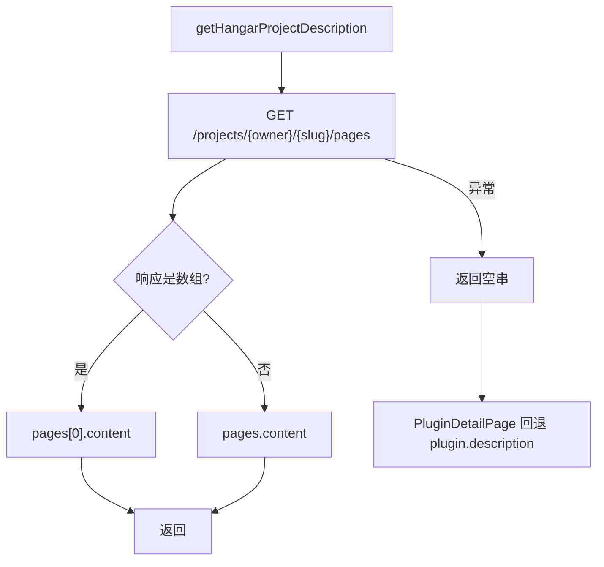

# 04 · 服务层与 API 适配

服务层位于 `src/services/`，由四部分组成：网络基础设施（`api-base.ts`）、三个平台适配器、聚合搜索（`search.ts`）、AI 服务（`ai.ts`，单独见 [05](05-ai-subsystem.md)）。

## 1. 网络基础设施 `api-base.ts`

文件：[src/services/api-base.ts](../../src/services/api-base.ts)

### 1.1 环境检测

```ts
export function isTauri(): boolean {
  return !!(window as any).__TAURI__ || !!(window as any).__TAURI_INTERNALS__
}
```

Tauri 2 默认注入 `__TAURI_INTERNALS__`，`withGlobalTauri` 配置才会注入 `__TAURI__`；两者都检测可避免桌面端被误判为 Web。`pages/guide/env.ts` 使用相同的双检测逻辑。

### 1.2 Base URL 解析 `getBaseUrl`

| 环境 | Spigot | Hangar | Modrinth |
| --- | --- | --- | --- |
| Tauri | `https://api.spiget.org/v2` | `https://hangar.papermc.io/api/v1` | `https://api.modrinth.com/v2` |
| Vite 开发（`import.meta.env.DEV`） | `/api/spiget` | `/api/hangar` | `/api/modrinth` |
| 生产 Web | `${corsProxy}${encodeURIComponent(真实 base)}` | 同左 | 同左 |

开发代理在 [vite.config.ts](../../vite.config.ts#L13-L30) 中配置：

```ts
server.proxy = {
  '/api/spiget':   { target: 'https://api.spiget.org/v2',   rewrite: p => p.replace(/^\/api\/spiget/, '') },
  '/api/hangar':   { target: 'https://hangar.papermc.io/api/v1', rewrite: ... },
  '/api/modrinth': { target: 'https://api.modrinth.com/v2', rewrite: ... },
}
```

### 1.3 统一请求 `apiFetch`

签名：

```ts
async function apiFetch<T>(
  platform: Platform,
  path: string,
  init?: RequestInit,
  timeoutMs = 15000,
): Promise<T>
```

行为：

1. 调用 `getBaseUrl(platform)` 取得基础地址。
2. 开发或 Tauri 环境：`url = base + path`。
3. 生产 Web 环境：忽略 `base`，重新读取 `corsProxy`，拼接 `proxy + encodeURIComponent(directUrl + path)`。
4. 创建内部 `AbortController`，默认 **15 秒超时**；同时监听调用方传入的 `init.signal`。
5. `fetch` 默认头 `Accept: application/json`，允许 `init.headers` 覆盖。
6. 非 2xx 抛 `Error("API Error: <status> <statusText>")`。
7. 超时抛 `API Error: 请求超时（15000ms）`，外部取消抛 `API Error: 请求已取消`。
8. 成功返回 `res.json()`，不做运行时结构校验。

注意事项：

- 生产分支重复计算了 base 逻辑，`getBaseUrl` 在该分支的返回值未被使用。
- 没有重试、退避或速率限制。
- 没有响应缓存；缓存只在 `PluginDetailPage` 经 Store 做一层。
- `corsProxy` 必须是“前缀 + 完整 URL 编码”的形式，例如 `https://api.allorigins.win/raw?url=`。

### 1.4 请求 URL 示例

以 Spigot 搜索 `essentials` 为例：

```text
开发：/api/spiget/search/resources/essentials?size=12&page=1&sort=-downloads
Tauri：https://api.spiget.org/v2/search/resources/essentials?size=12&page=1&sort=-downloads
生产：https://api.allorigins.win/raw?url=https%3A%2F%2Fapi.spiget.org%2Fv2%2Fsearch%2Fresources%2Fessentials%3Fsize%3D12...
```

## 2. Spigot 适配器 `spiget.ts`

文件：[src/services/spiget.ts](../../src/services/spiget.ts)

### 2.1 内部转换

| 函数 | 作用 |
| --- | --- |
| `spigetIconUrl(resource)` | 将 `icon.url` 拼成 `https://www.spigotmc.org/<icon.url>`；无图标返回空串 |
| `toPluginBase(resource)` | `SpigetResource → PluginBase`，ID 前缀 `spigot-`，`lastUpdate = updateDate * 1000`，`sourceUrl = https://www.spigotmc.org/resources/<id>/` |
| `decodeBase64(str)` | URL-safe Base64 转标准 Base64，`atob` 后用 `decodeURIComponent(escape(...))` 处理 UTF-8；失败返回原文 |

### 2.2 导出函数

| 函数 | 签名 | API 路径 | 说明 |
| --- | --- | --- | --- |
| `searchSpiget` | `(query, page = 1, size = 10) => Promise<PluginBase[]>` | `/search/resources/<query>?size&page&sort=-downloads` | page 从 1 开始 |
| `getSpigetResource` | `(id: string) => Promise<PluginBase>` | `/resources/<id>` | 详情基础信息，同时把 `description` 解码后写入 `PluginBase.description`（一次请求拿到详情 + 描述） |
| `getSpigetResourceDescription` | `(id: string) => Promise<string>` | `/resources/<id>` | 仅作为旧缓存缺少描述时的补充回退 |
| `getSpigetAuthorResources` | `(authorId, page = 1, size = 10)` | `/authors/<id>/resources?...` | 作者页 `AuthorPage` 使用 |
| `getSpigetPopularResources` | `(page = 1, size = 10)` | `/resources?...&sort=-downloads` | 首页热门、换一批 |

### 2.3 映射要点

- `author`：优先 `author.name`，否则 `contributors`，否则 `"未知"`。
- `authorId`：`author.id` 存在时转字符串。
- `rating`：`rating.average`（0–5 小数）。
- `categories`：固定 `[]`，即使上游有 `category` 也未映射。
- `version`：`testedVersions` 最后一项（这是兼容服务端版本，不一定是插件版本）。
- `lastUpdate`：`updateDate` 为秒级时间戳。

## 3. Hangar 适配器 `hangar.ts`

文件：[src/services/hangar.ts](../../src/services/hangar.ts)

### 3.1 转换函数

`toPluginBase(p: HangarProject)`：

| 字段 | 映射 |
| --- | --- |
| `id` | `hangar-<owner>-<slug>` |
| `platformId` | `<owner>/<slug>` |
| `author` / `authorId` | `namespace.owner` |
| `icon` | `avatarUrl` |
| `downloads` | `stats.downloads` |
| `categories` | `[category, ...(settings?.tags || [])]` |
| `lastUpdate` | `new Date(lastUpdated).getTime()` |
| `sourceUrl` | `https://hangar.papermc.io/<owner>/<slug>` |
| `rating` | `undefined` |
| `description` | `p.description`（项目简介，作为 pages 失败时的回退） |
| `version` / `images` | 未设置 |

### 3.2 导出函数

| 函数 | 签名 | API 路径 | 说明 |
| --- | --- | --- | --- |
| `searchHangar` | `(query, page = 0, size = 10)` | `/projects?q&limit&offset&sort=-downloads` | `offset = page * size`，page 从 0 开始 |
| `getHangarProject` | `(owner, slug)` | `/projects/<owner>/<slug>` | 详情 |
| `getHangarProjectDescription` | `(owner, slug) => Promise<string>` | `/projects/<owner>/<slug>/pages` | 只请求一次：数组取第一条 `content`，对象取 `content`；失败返回空串，由调用方回退项目 `description` |
| `getHangarPopular` | `(page = 0, size = 10)` | `/projects?limit&offset&sort=-downloads` | 首页热门 |
| `getHangarAuthorProjects` | `(author, page = 0, size = 10)` | `/projects?owner&limit&offset&sort=-downloads` | 作者页 |

### 3.3 描述兜底流程



详情页总请求数为 2：项目详情 + pages；pages 失败时直接复用已获取的项目简介，不再重复请求详情。

## 4. Modrinth 适配器 `modrinth.ts`

文件：[src/services/modrinth.ts](../../src/services/modrinth.ts)

### 4.1 转换函数

| 函数 | 输入 | 要点 |
| --- | --- | --- |
| `hitToPluginBase(h)` | 搜索命中 | `id = modrinth-<project_id>`、`platformId = project_id`、`author = h.author`、`version = versions 最后一项`、`lastUpdate = date_modified`、`images = gallery`、`sourceUrl = https://modrinth.com/plugin/<slug>` |
| `projectToPluginBase(p)` | 项目详情 | `id = modrinth-<id>`、`author = ''`（详情接口不直接给作者名，`getModrinthProject` 再补全）、`lastUpdate = updated`、`images = gallery.map(url)`、`sourceUrl` 同上 |

### 4.2 导出函数

| 函数 | 签名 | API 路径 | 说明 |
| --- | --- | --- | --- |
| `searchModrinth` | `(query, page = 0, size = 10)` | `/search?query&limit&offset&index=relevance&facets` | facets 限定 `project_type:plugin` 且服务端可用 |
| `getModrinthProject` | `(idOrSlug)` | `/project/<idOrSlug>` | 详情；`body` 直接作为描述，团队接口仅补全作者 |
| `getModrinthPopular` | `(page = 0, size = 10)` | `/search?...&index=downloads&facets` | 只限定 `project_type:plugin` |
| `getModrinthUserProjects` | `(userId)` | `/user/<userId>/projects` | 作者页 |

搜索 facets：

```ts
const facets = JSON.stringify([
  ['project_type:plugin'],
  ['server_side:required', 'server_side:optional'],
])
```

### 4.3 作者补全

搜索命中包含 `author`，但详情 `ModrinthProject` 不含作者名。`getModrinthProject` 在映射后调用 `getModrinthTeamMembers(p.team)`，取第一个带 `username` 的成员补全 `author` 与 `authorId`：

```ts
const plugin = projectToPluginBase(p)
if (p.team) {
  const members = await getModrinthTeamMembers(p.team)
  const owner = members.find(m => m.user?.username)?.user
  if (owner) {
    plugin.author = owner.username
    plugin.authorId = owner.id
  }
}
```

- 团队接口失败时保持空作者，不阻塞详情。
- `getModrinthUserProjects` 仍不补全作者名（作者页卡片可能显示空作者）。

## 5. 聚合搜索 `search.ts`

文件：[src/services/search.ts](../../src/services/search.ts)

### 5.1 `searchAll`

```ts
export async function searchAll(
  query: string,
  page = 1,
  size = 10,
  options: SearchAllOptions = {},
): Promise<PluginBase[]>
```

流程：

1. 从 `useAppStore.getState().enabledPlatforms` 读取启用平台。
2. 用 `getPlatformPage(platform, page)` 统一分页语义：
   - Spigot：1 基页码，返回 `page`
   - Hangar / Modrinth：0 基页码，返回 `page - 1`
3. 对每个启用平台构造 Promise，失败时调用 `options.onError(platform, error)` 并返回 `[]`。
4. `Promise.all` 合并结果。
5. 按 `downloads` 降序排序，**不做跨平台去重**。

### 5.2 分页语义

| 平台 | `getPlatformPage` | 适配器内部 offset | 实际效果 |
| --- | --- | --- | --- |
| Spigot | `page` | `page`（1 基） | 正确 |
| Hangar | `page - 1` | `(page-1) * size` | 正确 |
| Modrinth | `page - 1` | `(page-1) * size` | 正确 |

`MainPage` 的热门“换一批”同样传 0 基页码：

```ts
getHangarPopular(p - 1, 10)
getModrinthPopular(p - 1, 10)
```

该逻辑由 `src/services/search.test.ts` 覆盖。

### 5.3 客户端筛选 `filters.ts`

文件：[src/services/filters.ts](../../src/services/filters.ts)

| 导出 | 作用 |
| --- | --- |
| `matchesCategory(plugin, category)` | 按名称/简介/描述/分类关键词匹配分类 |
| `matchesServerType(plugin, serverType)` | 匹配 paper/spigot/folia 等服务端关键词 |
| `matchesVersion(plugin, version)` | 匹配 MC 版本 |
| `sortPlugins(plugins, sortBy)` | 支持 popular/newest/updated/downloads/rating/name/relevance |
| `applyPluginFilters(plugins, filters)` | 组合过滤 + 排序，供 MainPage 使用 |

### 5.4 工具函数

| 函数 | 签名 | 行为 | 使用方 |
| --- | --- | --- | --- |
| `formatDownloads` | `(n: number) => string` | ≥1,000,000 输出 `1.2M`；≥1,000 输出 `12.3K`；否则原样 | `PluginCard`、`PluginDetailPage` |
| `getPlatformName` | `(platform: Platform) => string` | `Spigot` / `Hangar` / `Modrinth` | `PluginCard`、`PluginDetailPage`、`MainPage` |

## 6. API 端点总表

| 平台 | 用途 | 方法与路径 |
| --- | --- | --- |
| Spiget | 搜索 | `GET /search/resources/{query}?size&page&sort=-downloads` |
| Spiget | 详情（含描述） | `GET /resources/{id}` |
| Spiget | 作者资源 | `GET /authors/{id}/resources?size&page&sort=-downloads` |
| Spiget | 热门 | `GET /resources?size&page&sort=-downloads` |
| Hangar | 搜索/热门/作者 | `GET /projects?q/owner/limit/offset/sort` |
| Hangar | 详情 | `GET /projects/{owner}/{slug}` |
| Hangar | 页面内容 | `GET /projects/{owner}/{slug}/pages` |
| Modrinth | 搜索 | `GET /search?query&limit&offset&index&facets` |
| Modrinth | 详情 | `GET /project/{idOrSlug}` |
| Modrinth | 团队成员（作者补全） | `GET /team/{teamId}/members` |
| Modrinth | 用户项目 | `GET /user/{id}/projects` |

## 7. 扩展新平台

以接入 `Example` 平台为例，完整改动清单：

1. **类型**：在 `types/index.ts` 扩展
   ```ts
   export type Platform = 'spigot' | 'hangar' | 'modrinth' | 'example'
   ```
   并补充 `ExampleProject` / 搜索结果类型。
2. **适配器**：新增 `services/example.ts`，实现 `searchExample`、`getExampleProject`、`getExampleProjectDescription`、`getExamplePopular`、`getExampleAuthorProjects`，统一返回 `PluginBase`。
3. **网络路由**：在 `api-base.ts` 的 `getBaseUrl` 与 `directUrls` 增加分支，真实 base 形如 `https://api.example.com/v1`。
4. **开发代理**：在 `vite.config.ts#L13-L30` 增加 `/api/example` 代理与 rewrite。
5. **聚合搜索**：在 `search.ts` 的 `searchAll` 增加启用判断与 Promise。
6. **首页热门**：在 `MainPage.loadPopular` 增加 `getExamplePopular`。
7. **详情页**：在 `PluginDetailPage.loadPlugin` 增加分支与描述获取；注意 Spigot 的 HTML 渲染分支是特例。
8. **作者页**：在 `AuthorPage.loadAuthorPlugins` 增加分支。
9. **UI**：在 `PlatformIcons.tsx` 增加图标与 `PlatformIcon` 分支；在 `PlatformToggle.tsx` 增加平台项；在 `tailwind.config.js` 增加 `example` 颜色；更新 `PluginCard` 的 `platformColors` / `platformBgColors`。
10. **设置与文档**：更新 03/04/05/06/11 文档以及 README 的功能说明。

## 8. 错误处理现状

| 场景 | 当前行为 | 用户感知 |
| --- | --- | --- |
| 单平台搜索失败 | `searchAll` 通过 `onError` 通知调用方，返回空数组 | MainPage 显示失败平台提示 |
| 详情请求失败 | `loadPlugin` catch 后仅 `console.error` | 页面显示“插件未找到” |
| 描述请求失败 | Hangar 有兜底；Spigot/Modrinth 直接抛出，被详情页 catch | 描述为空 |
| HTTP 非 2xx | 抛 `API Error` | 详情页兜底；搜索展示平台失败提示 |
| 网络超时 | 默认 15 秒后 abort | 抛出超时错误并进入失败提示 |
| CORS 代理不可用 | 请求失败 | 结果为空或详情缺失 |

服务层没有统一日志、错误码或重试策略。`apiFetch` 已提供超时与 `AbortSignal`，如需进一步增强可增加有限重试与错误码。
