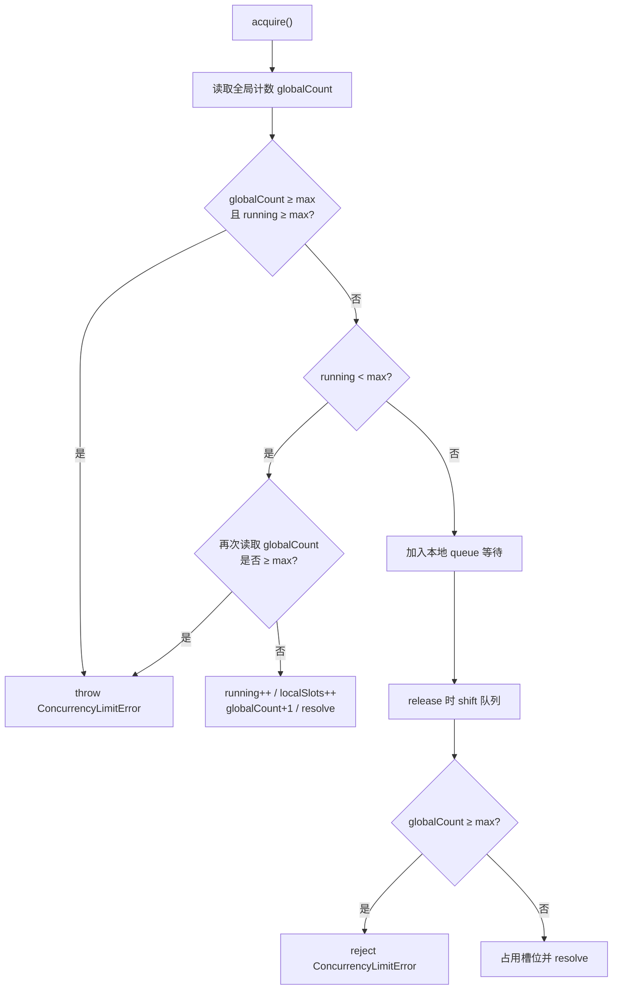
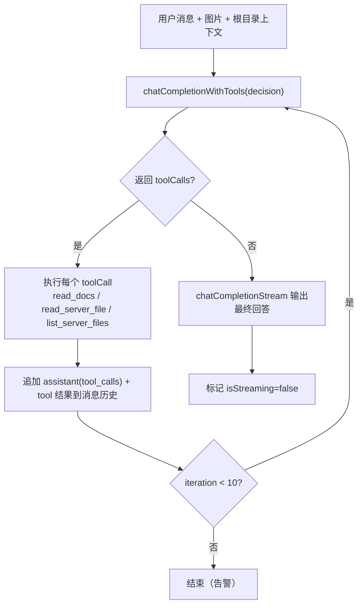

# 05 · AI 子系统

AI 子系统集中在 [src/services/ai.ts](../../src/services/ai.ts)（1025 行），负责：角色到模型的解析、跨标签页并发限制、OpenAI 兼容接口调用（普通 / 流式 / 工具）、插件信息翻译、文档翻译、图片理解和 Agent 工具协议类型。调用方分布在 `MainPage`、`PluginDetailPage`、`SearchBar`、`DocsSearch`、`AskAIPanel`、`GuidePage`。

## 1. 角色与模型

### 1.1 角色定义

`AIRole = 'search' | 'translate' | 'chat' | 'vision' | 'decision'`（[types/index.ts#L149](../../src/types/index.ts#L149)）。

| 角色 | 用途 | 使用位置 | 默认模型 |
| --- | --- | --- | --- |
| `decision` | 决策、Agent 主循环、开服指导、上下文压缩 | `GuidePage`、`SearchBar`（AI 搜索工具调用） | GLM-4.7-Flash |
| `search` | 文档 AI 检索、插件搜索初筛 | `DocsSearch` | GLM-4.5-Flash |
| `translate` | 插件信息、描述、配置文件翻译 | `MainPage`、`PluginDetailPage`、`GuidePage` | GLM-4-Flash（默认并发 200） |
| `chat` | 插件详情对话、文档问答 | `PluginDetailPage`、`AskAIPanel` | GLM-4.7-Flash |
| `vision` | 插件截图理解、Agent 图片分析 | `PluginDetailPage`、`GuidePage` | GLM-4V-Flash |

### 1.2 模型解析

```ts
export function getModelForRole(role: AIRole): AIModelConfig | undefined
export function isAIAvailable(role: AIRole): boolean
```

- `getModelForRole` 从 Store 的 `roleAssignments` 找 `modelId`，再从 `models` 找模型。
- `isAIAvailable` 要求模型存在、`enabled === true` 且 `apiKey` 非空。
- 可用性检查是 **同步** 的，只影响 UI 是否显示入口；真正调用时仍会再次校验。
- 角色未分配、模型被删除或 Key 为空时，相关 UI 显示“需要配置 API Key”提示。

### 1.3 请求地址

```ts
function buildUrl(model: AIModelConfig): string {
  const base = model.baseUrl.replace(/\/$/, '')
  return `${base}/chat/completions`
}
```

因此 `baseUrl` 应为 OpenAI 兼容的版本根路径（如 `https://open.bigmodel.cn/api/paas/v4`），而不是完整的 `/chat/completions`。

## 2. 并发控制 `ConcurrencyLimiter`

### 2.1 目标

同一模型可能配置了并发上限（例如免费模型只允许 1–2 路并发）。由于用户可能打开多个标签页，限制需要 **跨标签页共享**。实现位于 [ai.ts#L13-L127](../../src/services/ai.ts#L13-L127)，采用：

- `localStorage` 键 `ai-concurrency-<modelId>` 保存全局占用数。
- `BroadcastChannel('ai-concurrency')` 在计数变化时通知其他标签页。
- 每个标签页一个 `ConcurrencyLimiter` 实例，保存在模块级 `Map<string, ConcurrencyLimiter>`（按 `model.id` 缓存）。
- 每实例维护本地队列 `queue`、本地运行数 `running`、本地持有槽位 `localSlots`。

### 2.2 类结构

| 成员 | 说明 |
| --- | --- |
| `constructor(modelId, maxConcurrency)` | 初始化 storageKey、tabId、BroadcastChannel，并注册 `beforeunload` 清理 |
| `getGlobalCount()` | 读取 localStorage 中的全局计数，异常返回 0 |
| `setGlobalCount(count)` | 写入或删除键，并 `postMessage({ type: 'sync', modelId, count })` |
| `acquire()` | 获取一个槽位；可能立即成功、排队等待或抛出 `ConcurrencyLimitError` |
| `release()` | 释放槽位，减少全局计数，唤醒本地队列下一个任务 |
| `cleanup()` | 页面卸载时归还本标签页持有的所有槽位并关闭频道 |

### 2.3 `acquire` 判定流程



### 2.4 错误类型

```ts
export class ConcurrencyLimitError extends Error {
  constructor(public maxConcurrency: number) {
    super(`由于并发数量限制为 ${maxConcurrency}，并且存在其他对话，当前无法继续会话`)
    this.name = 'ConcurrencyLimitError'
  }
}
```

调用方（`AskAIPanel`、`SearchBar`、`GuidePage`）会 `instanceof` 判断并展示友好提示；其他错误直接显示 `err.message`。

### 2.5 已知缺陷

| 问题 | 说明 |
| --- | --- |
| 并发上限不随配置更新 | `limiters` 以首次创建时的 `maxConcurrency` 固化；设置页修改后需刷新页面才生效 |
| 竞态窗口 | 读取全局计数与写入之间没有锁，多个标签页同时 `acquire` 可能短暂超限 |
| `BroadcastChannel` 无降级 | 不支持该 API 的 WebView/旧浏览器会在构造时报错，且没有 `try/catch` |
| 监听器未移除 | `beforeunload` 匿名监听器无法在运行时移除；单页应用生命周期内影响有限 |
| `cleanup` 只在 `localSlots > 0` 时归还 | 若计数被异常清零，可能残留全局计数；`release` 与 `cleanup` 的并发也可能重复归还 |
| 本地队列可无限增长 | 队列没有上限或超时，极端情况下请求会长时间等待 |

## 3. 调用 API

### 3.1 函数总表

| 函数 | 签名 | 请求模式 | 返回 | 说明 |
| --- | --- | --- | --- | --- |
| `chatCompletion` | `(role, messages, options?: { temperature? })` | 非流式 | `Promise<string>` | 最常用；取 `choices[0].message.content` |
| `chatCompletionWithTools` | `(role, messages, tools, options?: { temperature?, toolChoice? })` | 非流式 + tools | `Promise<{ content?, toolCalls? }>` | 解析 `tool_calls` 的 `arguments` JSON |
| `chatCompletionStream` | `(role, messages, options?: { temperature?, signal? })` | 流式 | `AsyncGenerator<string>` | 逐段 `yield` 文本增量 |
| `chatWithModel` | `(model, messages, options?: { temperature? })` | 非流式 | `Promise<string>` | 绕过角色，直接用指定模型 |
| `translateLines` | `(lines: string[])` | 非流式并发 | `Promise<string[]>` | 按行翻译，跳过结构行 |
| `describeImage` | `(imageUrl: string)` | 非流式 | `Promise<string>` | `vision` 角色描述单图 |
| `describeImages` | `(imageUrls: string[])` | 非流式串行 | `Promise<string[]>` | 名称中的“并发”并未实现，实际 `for` 循环 |
| `translatePluginInfos` | `(plugins: {id,name,tag}[])` | 非流式并发 | `Promise<Map<string, PluginTranslation>>` | 翻译名称与简介 |
| `translateDocumentStream` | `(content, onProgress?)` | 流式分段 | `AsyncGenerator<{index, translated}>` | 文档逐段翻译 |
| `translateDocument` | `(content, onProgress?)` | 流式分段 | `Promise<string>` | 将分段结果拼回完整文档 |

### 3.2 请求体

普通调用：

```json
{
  "model": "GLM-4-Flash",
  "messages": [...],
  "temperature": 0.7,
  "stream": false
}
```

工具调用额外字段：

```json
{
  "tools": [...],
  "tool_choice": "auto" | "none" | { "type": "function", "function": { "name": "..." } }
}
```

流式调用设置 `stream: true`，并传入可选 `AbortSignal`。

### 3.3 鉴权与错误

- Header：`Authorization: Bearer <apiKey>`。
- 非 2xx：读取响应文本并抛 `Error("AI 调用失败: <status> <body>")`。
- 超时、重试、代理均未实现。
- 每次调用都在 `try/finally` 中 `release()`，流式生成器在消费者提前 `return` 时也会执行 `finally`（`for await ... break` 会触发）。

### 3.4 SSE 解析

`chatCompletionStream` 的解析规则（[L315-L343](../../src/services/ai.ts#L315-L343)）：

1. `TextDecoder` 逐块读取。
2. 按 `\n` 切分，保留最后一个不完整行到 `buffer`。
3. 只处理以 `data: ` 开头的行。
4. `data === '[DONE]'` 时结束。
5. `JSON.parse` 后读取 `choices[0].delta.content`，非空则 `yield`。
6. 单行解析失败被静默忽略。

不支持 `\r\n` 之外的复杂 SSE 事件（`event:`、`id:` 等被忽略）。

### 3.5 工具协议类型

| 类型 | 结构 |
| --- | --- |
| `JSONSchemaProperty` | `{ type, description?, enum?, items?, properties?, required? }` |
| `ToolDefinition` | `{ type: 'function', function: { name, description, parameters: { type: 'object', properties, required? } } }` |
| `ToolCallResult` | `{ id, name, arguments: Record<string, unknown> }` |
| `ToolChoice` | `'auto' \| 'none' \| { type: 'function', function: { name } }` |

`chatCompletionWithTools` 把 `message.tool_calls` 映射为 `ToolCallResult[]`，并对 `arguments` 做 `JSON.parse`。模型返回非法 JSON 时会抛出异常，没有兜底。

## 4. 翻译流水线

### 4.1 `translateLines`：按行翻译

用途：没有 UI 调用（当前主要保留给通用场景/历史实现）。流程：

1. 遍历每一行，跳过：
   - 空行；
   - 纯 HTML 标签行；
   - 图片标签/图片 Markdown；
   - SVG 相关标签；
   - 纯链接行；
   - 代码块围栏。
2. 其余行加入 `translateTasks`。
3. 使用 `translate` 模型的 `maxConcurrency`，每个任务 `acquire` 后调用 `chatWithModel`（`temperature: 0.2`）。
4. 去掉 HTML 标签后只翻译纯文本。
5. 尝试保留 Markdown 标题、列表、粗体格式。
6. 失败时保留原文。

### 4.2 `translatePluginInfos`：插件名称与简介

用于首页“AI 翻译”开关（[MainPage.tsx#L168-L184](../../src/pages/MainPage.tsx#L168-L184)）：

- 每个插件一个请求，prompt 同时包含 `name` 与 `tag`，要求按“名称: / 简介:”格式输出。
- 解析正则 `/名称[:：]\s*(.+)/i`、`/简介[:：]\s*(.+)/i`。
- 失败或解析失败时回退原文。
- 返回 `Map<plugin.id, PluginTranslation>`。

### 4.3 文档翻译：内容类型识别

`detectContentType`（[L626-L661](../../src/services/ai.ts#L626-L661)）按以下顺序判断：

1. JSON：以 `{`/`[` 开头结尾且 `JSON.parse` 成功。
2. YAML：存在 `key: value` 行且不含 HTML 标签。
3. Properties：存在 `key=value` 行。
4. HTML：包含 `<...>` 标签。
5. Markdown：标题、粗体、列表、代码围栏。
6. 其他为 `text`。

`extractTextSegments` 分派到：

| 内容类型 | 提取函数 | 可翻译对象 |
| --- | --- | --- |
| YAML | `extractYamlSegments` | 带引号/不带引号的 `key: value`、列表项 `- value` |
| JSON | `extractJsonSegments` | `"key": "value"`、数组中的字符串 |
| HTML / Markdown | `extractHtmlMarkdownSegments` | 普通文本行、标题内容、列表项内容、HTML 内文本 |
| text | `extractHtmlMarkdownSegments` | 同上 |

`TextSegment` 结构：

```ts
interface TextSegment {
  index: number       // 原始行号
  text: string        // 待翻译文本
  original: string    // 原始行（含缩进/格式）
  isTranslatable: boolean
  prefix: string      // YAML/JSON key、Markdown 标题/列表前缀等
  suffix: string      // 引号、逗号等
}
```

### 4.4 `translateDocumentStream`：分批翻译

```ts
export async function* translateDocumentStream(
  content: string,
  onProgress?: (progress: number) => void
): AsyncGenerator<{ index: number; translated: string }>
```

执行步骤：

1. 解析段落并过滤 `isTranslatable`。
2. 每 **10** 个段落一批（`batchSize = 10`）。
3. 批内文本用 `\n%%\n` 连接后发送给 `translate` 模型。
4. system prompt 要求：只输出译文、保持格式、专有名词/代码不译、出现 `%%` 也要保留、每行译文用 `%%` 分隔。
5. 响应按 `/\n?%%\n?/` 切分。
6. 逐段重组：
   - 有 `prefix`/`suffix`：`缩进 + prefix + 译文 + suffix`
   - 否则：`缩进 + 译文`
7. 每段 `yield { index, translated }` 并回调进度百分比。
8. 批次请求失败时，整批回退原文并继续。
9. 每批 `finally` 释放并发槽位。

`translateDocument` 将 yield 结果写回原始行数组并 `join('\n')`。

### 4.5 翻译质量与限制

- 按“行/段落”独立翻译，丢失跨行上下文。
- `%%` 分隔符依赖模型严格遵守；切分数量不足时回退该段原文。
- JSON/YAML 只翻译值，不处理嵌套结构中的键名。
- HTML 行内标签被移除后再翻译，可能丢失内联标记。
- 翻译失败静默回退原文，用户只看到“部分未翻译”。
- `GuidePage` 的“汉化配置文件”另有一套实现：15 行一块、200 并发信号量、`chatCompletion('translate')`，与 `translateDocumentStream` 不同。

### 4.6 图片理解

- `describeImage(imageUrl)`：`vision` 角色，prompt 要求详细描述 Minecraft 插件截图，`temperature: 0.3`。
- `describeImages(imageUrls)`：名称暗示并发，实际 **顺序** 执行，每次 `acquire/release`；单图失败返回空串；prompt 限制 50 字。
- 插件详情页只描述前 3 张截图（[PluginDetailPage.tsx#L130-L135](../../src/pages/PluginDetailPage.tsx#L130-L135)）。
- 图片 URL 直接交给模型服务，要求该 URL 可被模型侧访问；Base64 data URL 在 Agent 模式中作为 `image_url.url` 传入。

## 5. Tool Calling 与 Agent

四种调用场景的工具与循环策略不同：

| 场景 | 文件 | 角色 | 工具 | 循环 |
| --- | --- | --- | --- | --- |
| AI 插件搜索 | `SearchBar.tsx` | `decision` | `search_plugins`、`ask_user` | 单轮工具调用 + 前端循环执行关键词搜索 |
| 文档 AI 检索 | `DocsSearch.tsx` | `search` | `search_docs`（强制 tool_choice） | 单轮 |
| 简单开服指导 | `GuidePage.tsx` | `decision` | `read_docs` | 单轮：读文档后流式回答 |
| 服务器运维 Agent | `GuidePage.tsx` | `decision` | `read_docs`、`read_server_file`、`list_server_files` | 最多 10 轮 |

### 5.1 AI 插件搜索工具

```ts
{
  name: 'search_plugins',
  parameters: {
    keywords: string[],          // 最多 3 个英文关键词
    category: enum(categoryMap), // 15 个分类
    serverType: enum(serverTypes),
    version: enum(mcVersions),
  },
  required: ['keywords']
}
```

`ask_user` 只在需求不清晰时使用。前端只处理 `result.toolCalls[0]`，其余工具调用被忽略。搜索流程见 [SearchBar.tsx#L323-L424](../../src/components/SearchBar.tsx#L323-L424)。

### 5.2 Agent 循环（`GuidePage.AgentPreset`）



关键实现：

- `MAX_TOOL_ITERATIONS = 10`（[GuidePage.tsx#L1499-L1503](../../src/pages/GuidePage.tsx#L1499-L1503)）。
- 工具结果消息格式：`{ role: 'tool', tool_call_id, content }`。
- `read_server_file` 超过 10,000 字符时只保留最后 10,000 字符。
- `read_docs` 可一次读多篇文档，`loadDoc` 遍历 `import.meta.glob` 模块匹配路径。
- 根目录内容在确认路径后预加载（最多 30 项），注入 system prompt。
- 图片以 Base64 data URL 放入 `image_url`，与文本组成多模态 `content` 数组。
- 上下文超过 150,000 **字符** 时触发压缩：保留最近 5 条，其余由 `decision` 模型生成摘要，摘要作为 assistant 消息插入；压缩失败则继续使用原消息。
- 失败时保存 `retryData`（用户消息 + 历史），UI 显示“重试”按钮，调用 `handleRetry`。
- 工具执行状态通过消息字段 `readingDocs`、`readingFiles`、`listingDir`、`analyzingImage` 实时展示。

### 5.3 工具执行与本地文件

`readServerFile` / `listServerFiles`（[GuidePage.tsx#L959-L1019](../../src/pages/GuidePage.tsx#L959-L1019)）：

1. 非 Tauri 环境直接返回错误文案。
2. 路径用 `$"{serverPath}/{filePath}".replace(/\//g, '\\')` 强制转换为 Windows 风格。
3. 优先 `@tauri-apps/plugin-fs` 的 `readTextFile` / `readDir`。
4. 失败时回退 `@tauri-apps/plugin-shell` 执行 `cmd /c type` / `cmd /c dir /b`。
5. 所有错误都转成文本返回给模型，而不是抛出。

这套逻辑实际只适用于 Windows；在 macOS/Linux 上 `\` 路径和 `cmd` 都不可用，`plugin-fs` 对反斜杠路径大概率失败。

### 5.4 文档读取

- `SimpleServerPreset` 与 `AgentPreset` 使用 `loadDoc(path)`，在 `import.meta.glob('../assets/docs/**/*.md')` 的结果中按 `endsWith` 匹配。
- 文档路径必须与 `DOC_INDEX` 中的相对路径一致（如 `core/paper.md`）。
- 文档全文直接进入 system prompt，没有长度上限；Agent 模式可能因此占用大量上下文，随后触发压缩。

## 6. 失败与降级策略

| 失败点 | 行为 |
| --- | --- |
| 模型未分配 / 模型被删除 | 抛出 `未配置 <role> 角色的模型` |
| API Key 为空 | 抛出 `模型 <name> 未设置 API Key` |
| HTTP 非 2xx | 抛出带状态码与响应文本的错误 |
| 并发超限 | `ConcurrencyLimitError`，UI 显示友好提示 |
| 流式读取失败 | 抛错，调用方在消息列表中插入错误消息 |
| 工具参数 JSON 非法 | `JSON.parse` 抛错，Agent 会显示错误并可重试 |
| 文档未找到 | `loadDoc` 返回 `文档 <path> 未找到` 文本，模型继续回答 |
| 文件读取失败 | 返回错误文本，模型据此继续诊断 |
| 翻译批次失败 | 该批回退原文，不中断整体任务 |
| 图片描述失败 | 返回空串，聊天继续 |

## 7. 安全与隐私

| 风险 | 说明 | 建议 |
| --- | --- | --- |
| API Key 明文 | 存于 `localStorage` 的 `mc-plugin-market-models`，XSS 可直接读取 | 引入系统密钥链（Tauri）或后端代理；至少加密存储 |
| 请求直连模型服务 | Key 会出现在浏览器网络面板；第三方服务可被 CORS 拦截 | 桌面端可接受；Web 生产建议自建代理 |
| 提示词注入 | 插件描述、服务器日志、文档内容会进入 system/user 上下文 | 对文件/日志内容做明确分隔与指令隔离；限制工具范围 |
| 本地文件读取 | Agent 可读取用户指定目录；capabilities 的 `fs:scope` 还包含 `**` | 收紧 scope，增加二次确认与只读白名单 |
| 命令执行 | 兜底使用 `cmd` / `powershell`，参数可控性依赖实现 | 避免字符串拼接命令；优先只用 `plugin-fs` |

## 8. 扩展 AI 能力建议

1. **新增角色**：在 `AIRole`、`defaultRoleAssignments`、`SettingsPage.roleLabels` 同步增加；否则设置页不会展示。
2. **新增工具**：在 `ToolDefinition` 中声明 JSON Schema，并在调用方的 `executeToolCall` / 工具分发中实现；注意 Agent 循环需要处理 `role: 'tool'` 消息。
3. **新增翻译格式**：在 `detectContentType` 与 `extractTextSegments` 增加分支，保持 `prefix/suffix` 重组能力。
4. **统一并发**：所有模型调用都应经过 `getLimiter`，不要在页面直接 `fetch`。
5. **流式中断**：长对话建议传入 `AbortSignal`，并在组件卸载时 abort；`AskAIPanel` 已实现，`GuidePage` 未实现。
