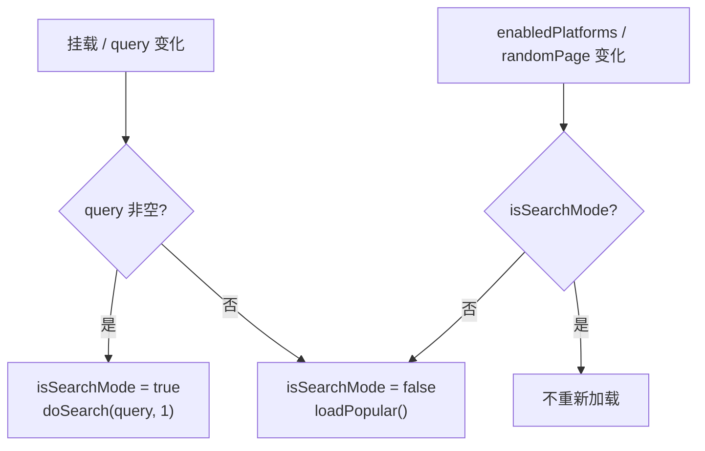

# 06 · 页面说明

## 1. 路由总表

路由注册在 [App.tsx](../../src/App.tsx#L14-L35)，使用 `HashRouter`。

| 路径 | 组件 | 说明 |
| --- | --- | --- |
| `/` | `MainPage` | 首页（热门插件 + 搜索） |
| `/browse` | `MainPage` | 浏览页，与首页同一组件；通常带 `?q=` |
| `/docs` | `DocsPage` | 开服手册浏览、全文检索、AI 问答 |
| `/guide` | `GuidePage` | 指导开服：配置文件汉化 / 简单开服 / Agent 模式 |
| `/plugin/:platform/:id` | `PluginDetailPage` | Spigot、Modrinth 详情 |
| `/plugin/:platform/:id/:subId` | `PluginDetailPage` | Hangar 详情（`id=owner`、`subId=slug`） |
| `/favorites` | `FavoritesPage` | 收藏列表 |
| `/author/:platform/:authorId` | `AuthorPage` | 作者作品列表 |
| `/settings` | `SettingsPage` | 设置：CORS 代理、AI 模型、角色分配 |

`AnimatedRoutes` 对非主页路由添加 `animate-fade-in`，主页与 `/browse` 不播放进入动画。`/browse` 没有独立逻辑，完全复用 `MainPage`。

## 2. 应用外壳 `App.tsx`

- 读取 `darkMode`，在挂载和变化时同步 `document.documentElement.classList`。
- 布局：固定 `Header` + `main` 路由内容 + 页脚。
- 页脚文案：`MC 插件市场 — Spigot · Hangar · Modrinth - Little_100`。

## 3. `MainPage`

文件：[src/pages/MainPage.tsx](../../src/pages/MainPage.tsx)（516 行）

### 3.1 职责

- 首页展示三平台热门插件（每平台 10 条，合并排序）。
- 搜索模式展示聚合搜索结果，支持“加载更多”。
- 展示筛选侧边栏、平台开关、AI 翻译开关、换一批。

### 3.2 状态

| 状态 | 类型 / 初值 | 说明 |
| --- | --- | --- |
| `query` | 来自 `useSearchParams().get('q')` | URL 查询词 |
| `isSearchMode` | `!!query` | 首页/搜索模式切换 |
| `plugins` | `PluginBase[]` | 当前展示数据 |
| `loading` | `true` | 加载态 |
| `page` | `1` | 搜索分页 |
| `selectedCategory` | `'all'` | 分类筛选（**未接入请求**） |
| `selectedServer` | `'all'` | 服务端筛选（**未接入请求**） |
| `selectedSort` | `'popular'` | 排序（**未接入请求**） |
| `selectedDownloads` | `'all'` | 最低下载量（唯一生效的筛选） |
| `sidebarOpen` | `false` | 移动端侧边栏 |
| `serverCollapsed` / `downloadsCollapsed` / `sortCollapsed` | `true/false/true` | 折叠面板 |
| `translations` | `Map<string, PluginTranslation>` | AI 翻译结果 |
| `translating` | `false` | 翻译中 |
| `translateEnabled` | `false` | 是否显示译文 |
| `randomPage` | `1` | 热门随机页 |
| `refreshing` | `false` | 换一批中 |

### 3.3 核心函数

| 函数 | 行为 |
| --- | --- |
| `loadPopular()` | 根据 `enabledPlatforms` 并发请求 Spigot/Hangar/Modrinth 热门；结果按下载量排序；若开启翻译且有模型则调用 `translatePlugins` |
| `doSearch(q, p)` | `searchAll(q, p, 12)`；`p === 1` 替换列表，否则追加；更新 `page` |
| `handleSearch(q)` | 空词清空 URL 并退出搜索模式；否则写入 `?q=`、清空列表、从第 1 页搜索 |
| `handleRandomRefresh()` | 随机 `randomPage`（1–10），触发 `loadPopular` |
| `translatePlugins(list)` | 取 `id/name/tag` 调 `translatePluginInfos`，合并进 `translations` |
| `toggleTranslate()` | 切换译文显示；首次开启立即翻译当前列表 |
| `getDisplayInfo(plugin)` | 返回原文或 `中文名 — 原名` + 中文简介 |
| `filteredPlugins` | 仅按 `selectedDownloads` 过滤 |

### 3.4 数据加载时序



注意：`randomPage` 变化只在非搜索模式触发加载。

### 3.5 交互与展示

- Hero 区域用 `grid-rows-[0fr/1fr]` 做高度折叠动画。
- 搜索框容器宽度从 `max-w-2xl` 过渡到 `max-w-full`。
- 平台开关在两种模式下位置不同。
- 侧边栏在搜索模式显示，首页模式在桌面端淡出/位移隐藏；移动端通过“筛选条件”按钮展开。
- 卡片网格：1 / 2 / 3 列（`sm` / `lg`），逐个 `stagger-item` 延迟 50ms。
- “加载更多”仅搜索模式，且 `plugins.length >= page * 12` 时显示。
- 空态区分“未找到相关插件”与“暂无插件数据”。

### 3.6 已知限制

- 分类、服务端、排序三个筛选 **只改变本地 UI 状态**，没有传入 `searchAll` 或 URL；搜索请求始终使用平台默认排序（Spigot/Hangar 按下载量，Modrinth 按相关度）。
- `selectedCategory` / `selectedServer` / `selectedSort` 是“装饰性筛选”。
- 搜索模式仍会展示平台开关与筛选侧边栏，但侧边栏不影响请求。
- 热门“换一批”存在 offset 二次乘法问题（见 04）。
- 翻译开启后每批插件都会重新请求，未做缓存；翻译失败静默保留原文。
- `loadPopular` 的 `useCallback` 依赖包含 `translateEnabled`，切换翻译会重新拉取热门。
- 首次挂载时两个 `useEffect` 都会调用 `loadPopular`；`handleSearch` 直接搜索的同时，`setSearchParams` 又会触发 query effect 再次搜索，存在重复请求。

## 4. `PluginDetailPage`

文件：[src/pages/PluginDetailPage.tsx](../../src/pages/PluginDetailPage.tsx)（470 行）

### 4.1 路由参数语义

```ts
const { platform, id, subId } = useParams()
const fullId = subId ? `${id}/${subId}` : id
```

| 平台 | `id` | `subId` | `fullId` |
| --- | --- | --- | --- |
| spigot | 数字 ID | 无 | `123` |
| hangar | owner | slug | `owner/slug` |
| modrinth | project id/slug | 无 | `abc123` |

### 4.2 状态

| 状态 | 说明 |
| --- | --- |
| `plugin` | 插件详情 |
| `description` | 完整描述（HTML/Markdown） |
| `loading` | 加载中 |
| `activeTab` | `description` / `chat` / `translate` |
| `chatMessages` | 对话消息（仅 user/assistant） |
| `chatInput` / `chatLoading` | 输入与发送态 |
| `translatedDesc` / `translating` / `translateProgress` | 翻译结果与进度 |

### 4.3 `loadPlugin()`

1. `cacheId = ${platform}-${fullId}`，尝试 `getCachedPlugin(cacheId)`。
2. 按平台分派：
   - Spigot：`getSpigetResource(fullId)` + `getSpigetResourceDescription(fullId)`
   - Hangar：`getHangarProject(id, subId || '')` + `getHangarProjectDescription(...)`
   - Modrinth：`getModrinthProject(fullId)` + `getModrinthProjectDescription(fullId)`
3. 基础信息优先使用缓存。
4. `cachePlugin(pluginData)` 写回。
5. 异常只 `console.error`，最终 `plugin` 为 `null` 时显示“插件未找到”。

> 缓存键不一致：Hangar 的 `cacheId` 是 `hangar-owner/slug`，而缓存写入键是 `plugin.id`（`hangar-owner-slug`），因此 Hangar 永远无法命中缓存。

### 4.4 `handleChat()`

1. 拼接 system prompt：插件名、平台、作者、下载量、分类、描述前 3000 字符。
2. 若配置了 `vision` 且有 `plugin.images`，对前 3 张截图调用 `describeImages`，把描述追加到 system prompt。
3. 把历史消息（user/assistant）与当前输入加入 `ChatMessage[]`。
4. `chatCompletionStream('chat', messages)` 流式输出，逐 chunk 更新最后一条 assistant 消息。
5. 异常时插入 `❌ 错误: ...` 消息。

### 4.5 `handleTranslate()`

- 按行拆分 `description`，先以原文填充 `translatedDesc`。
- 调用 `translateDocumentStream(description, setTranslateProgress)`。
- 每个 yield 更新对应行并重新 `join('\n')`，实现边翻译边刷新。
- 失败显示 `❌ 翻译失败: ...`，进度置 100。

### 4.6 渲染差异

| 平台 | 描述渲染 | 原因 |
| --- | --- | --- |
| spigot | `dangerouslySetInnerHTML` | Spiget 描述是 Base64 HTML |
| hangar / modrinth | `ReactMarkdown` + `rehypeRaw` + `remarkGfm` | 描述是 Markdown/HTML 混合 |

Spigot 的 HTML **没有经过 DOMPurify 消毒**（依赖已声明但未使用），存在 XSS 风险，详见 11。

### 4.7 UI 结构

- 返回按钮。
- 头部卡片：图标（失败隐藏）、名称、简介、星级（仅 `rating` 有值）、下载量、作者链接、收藏按钮、原始页面按钮、下载按钮。
- Tab 栏：描述 / AI 对话 / AI 翻译。
- `ApiKeyWarning`：当对应角色未配置时显示设置入口与智谱申请入口。
- 聊天区高度 500px，消息自动滚动到底部，assistant 支持 Markdown 与代码块，等待时显示三个 `typing-dot`。
- 翻译区显示进度条与结果，Spigot 仍用 HTML 渲染。

### 4.8 依赖

`useAppStore`（收藏与缓存）、三个平台适配器、`formatDownloads`、`getPlatformName`、`isAIAvailable`、`chatCompletionStream`、`translateDocumentStream`、`describeImages`、`PlatformIcon`。

## 5. `DocsPage`

文件：[src/pages/DocsPage.tsx](../../src/pages/DocsPage.tsx)（564 行）

### 5.1 职责

- 侧边栏展示开服手册目录树。
- 主区域渲染选中的 Markdown 文档。
- 顶部 `DocsSearch` 支持普通搜索与 AI 检索。
- 右侧 `AskAIPanel` 提供当前文档的 AI 问答。

### 5.2 文档树

`docsTree`（[L60-L184](../../src/pages/DocsPage.tsx#L60-L184)）有 8 个一级节点：

| 一级节点 | 子节点 |
| --- | --- |
| Java 环境 | Java 环境配置、JVM 启动参数 |
| 服务端核心 | 选择指南；插件端（Paper/Spigot/Purpur/Folia/Pufferfish/Leaves）；模组端（Forge/NeoForge/Fabric/Quilt）；混合端（Mohist/CatServer/Arclight/Banner）；代理端（BungeeCord/Velocity）；跨平台（Geyser） |
| 服务器配置 | 权限管理、世界管理、性能优化 |
| 网络配置 | 概述、IPv4、IPv6、云服务器、域名、FRP、P2P |
| 运维管理 | Linux、Windows、备份、安全 |
| 插件 | 插件推荐、反作弊 |
| 模组 | 模组推荐 |
| 常见问题 | FAQ |

共 **38** 篇文档进入侧边栏。仓库实际有 72 篇，`core/config/` 下的 33 篇配置文件详解与 `目录.md` **未**进入 `docsTree`（详见 08）。

### 5.3 工具函数

| 函数 | 作用 |
| --- | --- |
| `findDocContent(tree, id)` | 递归按 id 查 `content` |
| `findDocTitle(tree, id)` | 递归按 id 查标题 |
| `getAllDocsFlat(tree, path)` | 扁平化所有含内容的节点，附带父级路径，供搜索用 |
| `getFirstDocId(tree)` | 取第一个有内容的文档 id，作为初始选中 |
| `generateHeadingSlug(text)` | 生成标题锚点：小写、保留中文/字母/数字/空格/连字符、空格转 `-` |
| `TreeNode` | 递归渲染目录，支持展开/折叠与选中 |

### 5.4 交互状态

| 状态 | 初值 | 说明 |
| --- | --- | --- |
| `selectedId` | 第一个文档 | 当前文档 |
| `expandedIds` | 所有一级节点 | 展开的目录 id 集合 |
| `sidebarOpen` | `true` | 侧边栏宽度 0/64 |
| `isAIPanelOpen` | `false` | 右侧 AI 面板 |

`handleSelectDoc(docId)` 不仅切换文档，还向上查找父节点并自动展开。`handleScrollToHeading` 在内容容器内 `querySelector('#slug')` 后平滑滚动。

### 5.5 渲染

- 顶部搜索栏固定。
- 侧边栏宽度过渡 300ms，切换按钮绝对定位在边缘。
- 主区域可滚动，AI 面板打开时宽度 60%，面板占 40%（最小 320px）。
- 当前文档有内容时，右下角显示“询问 AI”浮动按钮。
- Markdown 组件：
  - 代码块：`SyntaxHighlighter` + `oneDark/oneLight`。
  - `h1`–`h4`：注入 `generateHeadingSlug` 生成的 `id`。
  - 其他排版交给 `prose` 与 `index.css` 的 `.docs-content` 覆盖（文档正文使用系统字体而非 Minecraft 字体）。
- 文档切换有 `animate-fade-in`。

### 5.6 依赖

`DocsSearch`、`AskAIPanel`、`useAppStore(darkMode)`、38 个静态 `?raw` 导入、react-markdown、remark-gfm、rehype-raw、react-syntax-highlighter。

## 6. `GuidePage`

文件：[src/pages/GuidePage.tsx](../../src/pages/GuidePage.tsx)（2017 行，项目中最大的文件）

### 6.1 顶层结构

```text
GuidePage
├── PresetSelector        // 三张预设卡片
└── PresetContent
    ├── TranslatePreset   // 汉化配置文件
    ├── SimpleServerPreset// 简单开服（文档驱动）
    └── AgentPreset       // 服务器运维 Agent（仅 Tauri）
```

`PlaceholderPreset` 已定义但未被使用。

| 预设 | 可用环境 | 作用 |
| --- | --- | --- |
| `translate` 汉化配置文件 | Web + Tauri | 上传配置文件，AI 翻译英文注释 |
| `simple` 简单开服 | Web + Tauri | AI 阅读开服手册并分步指导 |
| `agent` Agent 模式 | **仅 Tauri** | 读取本地服务器目录、配置文件、日志、截图进行诊断 |

### 6.2 `TranslatePreset`

状态：`files`、`isTranslating`、`overallProgress`、`selectedFileIndex`、`isDragging`。

| 函数 | 行为 |
| --- | --- |
| `handleFiles(fileList)` | 逐个 `file.text()` 读取内容，加入 `FileItem[]`（状态 `waiting`） |
| `handleDragOver/Leave/Drop` | 拖拽上传 |
| `removeFile(index)` | 移除文件并修正选中索引 |
| `translateWithConcurrency(chunks, fileIndex, maxConcurrency = 200)` | 自定义信号量，最多 200 并发；每块调用 `chatCompletion('translate')`；单块失败返回原文 |
| `splitIntoChunks(content, 15)` | 按 15 行切块 |
| `startTranslation()` | 逐文件翻译，更新单文件与整体进度；已完成文件跳过 |
| `downloadFile(file)` | Blob 下载，文件名插入 `_zh` 后缀 |
| `downloadAll()` | 下载所有已完成文件 |

- 支持扩展名：`.properties`、`.yml`、`.yaml`、`.json`、`.toml`、`.conf`、`.cfg`、`.txt`。
- 翻译前检查 `translate` 模型存在且配置 Key，否则抛出可读错误。
- 预览区显示翻译结果；底部有“AI 翻译不保证质量”的免责声明。
- 注意：这里既有 200 并发的本地信号量，又经 `chatCompletion` 内部的 `ConcurrencyLimiter`，实际并发受模型 `maxConcurrency` 限制。

### 6.3 `SimpleServerPreset`

- 初始化一条欢迎消息，询问服务器类型、人数、系统。
- `SYSTEM_PROMPT` 包含完整的 `DOC_INDEX`（38 篇文档路径与说明）与工作流程。
- 工具：`read_docs { doc_paths: string[] }`。
- `handleSend()`：
  1. `chatCompletionWithTools('decision', system + history, TOOLS)`。
  2. 若返回 `read_docs`，显示“正在阅读”状态，`loadDoc` 并发加载文档，将内容拼入 system prompt。
  3. 用 `chatCompletionStream('decision', systemWithDocs + history)` 流式输出最终回答。
  4. 若没有工具调用，直接流式输出回答。
- 消息含 `readingDocs`、`isStreaming` 状态；支持 Markdown、代码高亮、流式光标。
- 只做 **一轮** 工具调用，不会持续 ReAct 循环。

### 6.4 `AgentPreset`

#### 状态与初始化

| 状态 | 说明 |
| --- | --- |
| `serverPath` / `pathInput` / `isPathConfirmed` | 服务器根目录 |
| `messages` | `AgentMessageItem[]`，含操作状态、错误、重试数据 |
| `pendingImages` | Base64 待发送图片 |
| `rootDirContent` | 根目录摘要，注入 system prompt |
| `isCompressing` | 上下文压缩中 |

确认路径后立即 `listServerFiles(serverPath, '.')`，取前 30 项，构建欢迎消息。

#### 关键函数

| 函数 | 行为 |
| --- | --- |
| `handleSelectDirectory()` | 动态导入 `plugin-dialog` 打开目录选择；Web 端返回 `null` |
| `handleConfirmPath()` / `handleEditPath()` | 确认 / 重新选择路径 |
| `handleImageUpload()` / `removePendingImage()` | 图片转 Base64，支持多图 |
| `executeToolCall(name, args, aiMessageId)` | 执行三种工具，更新 UI 状态并返回 `{ result, operation }` |
| `buildMessageContent(msg)` | 有图片时构造 `text + image_url[]` 多模态 content |
| `calculateContextSize(msgs)` | 统计文本字符数 + 图片 Base64 长度 |
| `compressConversationInternal(msgs)` | 取最近 5 条之外的历史，用 `decision` 生成摘要 |
| `executeAICall(userMessage, chatHistory, aiMessageId, systemPromptOverride?)` | 最多 10 轮工具循环，最终流式输出 |
| `handleRetry(errorMessageId, retryData)` | 删除错误消息并重放 |
| `handleSend()` | 大于 150,000 字符时压缩上下文，再调用 `executeAICall` |

#### 工具

| 工具 | 参数 | 返回 |
| --- | --- | --- |
| `read_docs` | `doc_paths: string[]` | 文档内容拼接 |
| `read_server_file` | `file_path: string` | 文件内容（超过 10,000 字符截取末尾） |
| `list_server_files` | `dir_path: string` | 目录条目列表 |

#### UI

- 路径确认页（未确认时）：输入框 + 浏览按钮 + 确认按钮 + 安全提示。
- 聊天页：顶部路径栏与“修改”；消息区展示已完成操作（绿色勾）、进行中状态（阅读文档/读取文件/列目录/分析图片）、错误卡片与重试按钮、用户上传图片、Markdown 正文、流式光标；底部图片上传、待发送图片预览、自动高度输入框。

### 6.5 文档加载与索引

- `docModules = import.meta.glob('../assets/docs/**/*.md', { query: '?raw', import: 'default', eager: false })`（[L562-L563](../../src/pages/GuidePage.tsx#L562-L563)）。
- `loadDoc(path)` 遍历模块，匹配 `endsWith(path)` 或 `includes('/'+path)`，返回内容或“文档未找到”。
- `DOC_INDEX` 为字符串常量，列出 38 篇文档；与 `DocsPage.docsTree`、`DocsSearch.DOC_INDEX` 是三套独立索引。

### 6.6 Tauri 辅助函数

| 函数 | 实现 |
| --- | --- |
| `readServerFile(serverPath, filePath)` | 路径转 `\`；`plugin-fs.readTextFile`；失败回退 `cmd /c type` |
| `listServerFiles(serverPath, dirPath)` | 路径转 `\`；`plugin-fs.readDir`；失败回退 `cmd /c dir /b` |
| `selectDirectory()` | `plugin-dialog.open({ directory: true })`；Web 返回 `null` |

这些函数只处理 Windows 路径；跨平台能力有限。

## 7. `SettingsPage`

文件：[src/pages/SettingsPage.tsx](../../src/pages/SettingsPage.tsx)（361 行）

### 7.1 区块

| 区块 | 内容 |
| --- | --- |
| CORS 代理 | 输入框绑定 `corsProxy` / `setCorsProxy`，提示“在线版需要，桌面版不需要” |
| AI 模型配置 | 添加模型表单、模型列表（开关、名称、API Key 显隐、API 地址、最大并发、上下文长度、删除自定义模型）、重置按钮 |
| AI 角色分配 | 5 个角色各一个 `<select>`，只列出 `enabled` 模型 |
| 获取 API Key | 智谱与 OpenAI 兼容服务说明与链接 |

### 7.2 关键函数

| 函数 | 行为 |
| --- | --- |
| `toggleKeyVisibility(id)` | 切换 Key 明文/密文 |
| `handleAddModel()` | 校验 `name` 与 `model`，生成 `custom-<timestamp>` id，补默认值后写入 Store |
| `resetDefaults()` | `confirm` 后 `localStorage.clear()` 并 `window.location.reload()` |

### 7.3 约束

- 内置模型（id 不以 `custom-` 开头）不能删除，只能禁用或编辑。
- `provider === 'zhipu'` 时“最大并发”输入框禁用（提示“固定”），但 Store 仍保存原值。
- 修改 `maxConcurrency` 不会重建已有的 `ConcurrencyLimiter`，需刷新页面。
- 重置会清空 **整个站点** 的 localStorage，不仅是本应用键。
- API Key 以明文存储并可直接复制（显示按钮）。

## 8. `FavoritesPage`

文件：[src/pages/FavoritesPage.tsx](../../src/pages/FavoritesPage.tsx)（31 行）

- 读取 Store `favorites`。
- 空态：心形图标 + “还没有收藏任何插件”。
- 有数据：3 列卡片网格，直接渲染收藏快照。
- 不做排序、搜索、分页；收藏按钮位于卡片菜单中。

## 9. `AuthorPage`

文件：[src/pages/AuthorPage.tsx](../../src/pages/AuthorPage.tsx)（74 行）

- 路由参数 `platform`、`authorId`。
- 按平台加载：
  - Spigot：`getSpigetAuthorResources(authorId, 1, 20)`
  - Hangar：`getHangarAuthorProjects(authorId, 0, 20)`
  - Modrinth：`getModrinthUserProjects(authorId)`
- 展示作者名、平台名、作品数、卡片网格。
- 加载失败只打日志，显示“暂无作品”。
- 无分页；Spigot/Hangar 最多 20 条，Modrinth 返回全量。
- Modrinth 详情页作者为空时会进入此页的空参数路由（见 04）。

## 10. 页面与依赖对照

| 页面 | Store 字段 | 服务/组件 | 外部能力 |
| --- | --- | --- | --- |
| MainPage | `enabledPlatforms` | `searchAll`、三个热门函数、`translatePluginInfos`、`SearchBar`、`PlatformToggle`、`PluginCard` | 插件 API |
| PluginDetailPage | `favorites`、`pluginCache` | 三个详情/描述函数、`chatCompletionStream`、`translateDocumentStream`、`describeImages`、`PlatformIcon` | 插件 API、LLM |
| DocsPage | `darkMode` | `DocsSearch`、`AskAIPanel`、38 篇 raw 文档 | 无（AI 可选） |
| GuidePage | `darkMode`、`getModelForRole` | `chatCompletion*`、`import.meta.glob` 文档 | LLM、Tauri FS/Dialog/Shell |
| SettingsPage | `models`、`roleAssignments`、`corsProxy` | 纯表单 | 无 |
| FavoritesPage | `favorites` | `PluginCard` | 无 |
| AuthorPage | — | 三个作者函数、`PluginCard` | 插件 API |
