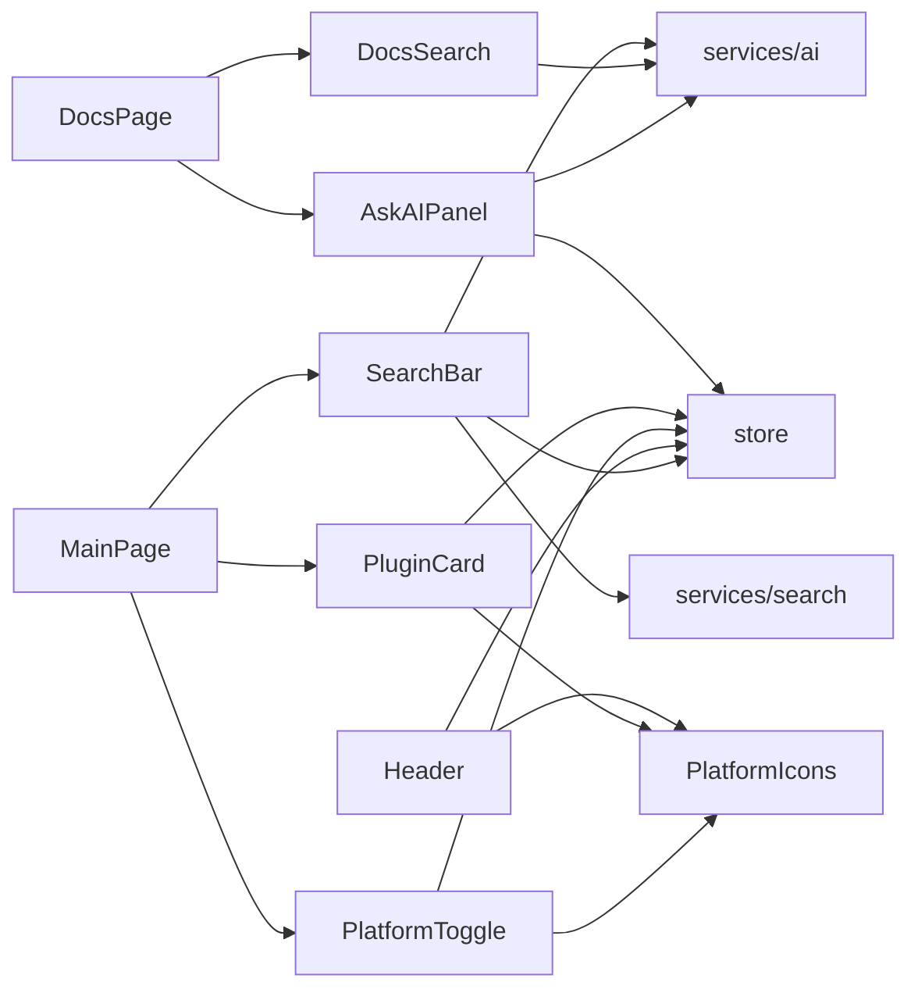
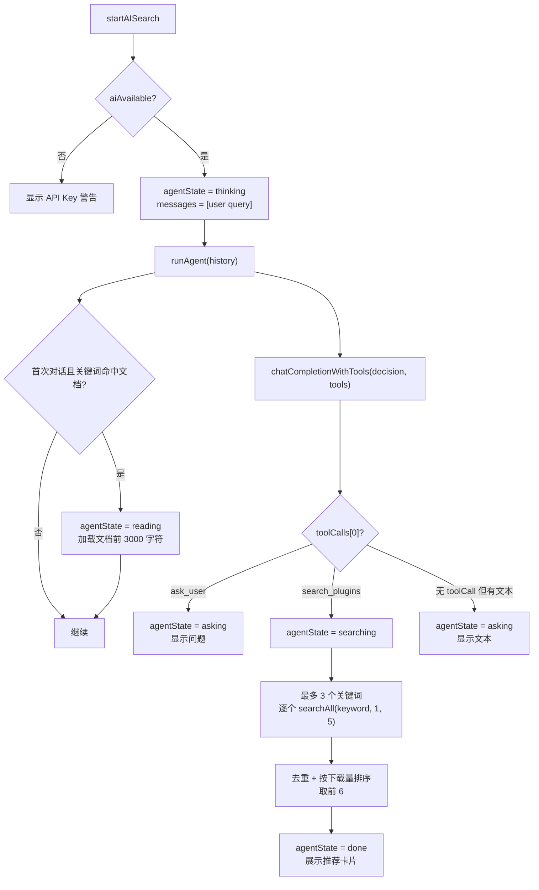

# 07 · 组件说明

组件目录：[src/components/](../../src/components)。其中 `SearchBar`、`DocsSearch`、`AskAIPanel` 承载了较多业务逻辑，是当前架构中“组件层偏重”的主要来源。

## 1. 组件总览

| 组件 | 文件 | 行数 | 职责 | 主要依赖 |
| --- | --- | --- | --- | --- |
| `Header` | [Header.tsx](../../src/components/Header.tsx) | 129 | 顶部导航、主题切换、移动端菜单、GitHub 入口 | Store、Router、lucide、`MinecraftBlockIcon` |
| `SearchBar` | [SearchBar.tsx](../../src/components/SearchBar.tsx) | 712 | 普通搜索、搜索历史、AI Agent 搜索、插件文档匹配 | Store、`searchAll`、`chatCompletionWithTools`、`src/data/docs.ts`、Router、Markdown |
| `DocsSearch` | [DocsSearch.tsx](../../src/components/DocsSearch.tsx) | 492 | 文档普通检索、AI 文档检索、结果下拉 | `chatCompletionWithTools`、`src/data/docs.ts`、react-markdown |
| `AskAIPanel` | [AskAIPanel.tsx](../../src/components/AskAIPanel.tsx) | 367 | 当前文档的 AI 问答、流式输出、中止、标题跳转 | `chatCompletionStream`、Store、SyntaxHighlighter |
| `PluginCard` | [PluginCard.tsx](../../src/components/PluginCard.tsx) | 137 | 插件卡片、收藏菜单、跳转详情 | Store、`formatDownloads`、`PlatformIcon` |
| `PlatformToggle` | [PlatformToggle.tsx](../../src/components/PlatformToggle.tsx) | 37 | 三平台启用开关 | Store、`PlatformIcon` |
| `PlatformIcons` | [PlatformIcons.tsx](../../src/components/PlatformIcons.tsx) | 107 | Spigot/Hangar/Modrinth/Minecraft 方块 SVG 与选择器 | 无 |



## 2. `Header`

### 2.1 结构

```tsx
const navItems = [
  { path: '/', label: '首页', icon: Home },
  { path: '/browse', label: '浏览', icon: Search },
  { path: '/docs', label: '开服手册', icon: BookOpen },
  { path: '/guide', label: '指导开服', icon: AIIcon },
  { path: '/favorites', label: '收藏', icon: Heart },
  { path: '/settings', label: '设置', icon: Settings },
]
```

`AIIcon` 是用 `<svg><text>AI</text></svg>` 自绘的文字图标，不属于 lucide。

### 2.2 行为

- `location.pathname === item.path` 精确匹配高亮；因此 `/browse?q=x` 仍算 `/browse`，但 `/plugin/...` 不会高亮任何导航项。
- 桌面端导航 + GitHub 链接 + 主题切换。
- 移动端（`md` 以下）显示 GitHub、主题切换、汉堡菜单；展开后逐项 50ms 入场动画。
- 主题按钮图标：暗色模式显示 `Sun`（点击切亮色），亮色模式显示 `Moon`。
- Logo 使用 `MinecraftBlockIcon`，悬停有浮动动画。
- 高度 `h-14`（3.5rem），`DocsPage` 的高度计算依赖此值：`h-[calc(100vh-3.5rem-3rem)]`。

### 2.3 Props

无。所有状态来自 `useLocation` 与 `useAppStore`。

## 3. `SearchBar`

文件：[SearchBar.tsx](../../src/components/SearchBar.tsx)

### 3.1 Props

```ts
interface Props {
  onSearch?: (query: string, filters?: SearchFilters) => void
  initialQuery?: string
}
```

| Prop | 说明 |
| --- | --- |
| `onSearch` | 提供时由父组件处理搜索（`MainPage`）；未提供时导航到 `/browse?<params>` |
| `initialQuery` | 输入框初始值，`MainPage` 传入 URL 的 `q` |

### 3.2 本地类型

```ts
export interface SearchFilters {
  category?: string
  serverType?: string
  version?: string
  platforms?: string[]
}
```

与 `types/index.ts` 中的 `SearchFilters` **不是同一类型**，后者未被使用。

### 3.3 状态

| 状态 | 类型 | 说明 |
| --- | --- | --- |
| `query` | `string` | 输入值 |
| `aiMode` | `boolean` | AI 搜索模式 |
| `agentState` | `'idle' \| 'thinking' \| 'asking' \| 'reading' \| 'searching' \| 'analyzing' \| 'done'` | Agent 状态机 |
| `messages` | `AgentMessage[]` | 对话与步骤 |
| `userInput` | `string` | 追问输入 |
| `showSuggestions` | `boolean` | 历史下拉 |
| `showApiKeyWarning` | `boolean` | Key 提示 |
| `searchResult` | `{ keywords, filters } \| null` | 完成状态数据 |

`AgentMessage` 含 `role`、`content` 与可选 `steps`；`SearchStep` 分为 `reading`、`searching`、`result`，`result` 携带 `PluginBase[]`。

### 3.4 常量

| 常量 | 内容 |
| --- | --- |
| `categoryMap` | 15 个分类英文 id → 中文名 |
| `serverTypes` | `paper/spigot/bukkit/folia/velocity/bungeecord/waterfall/fabric/forge/sponge` |
| `mcVersions` | `1.21` 到 `1.8` 共 11 个 |
| `pluginDocList` | 由 `PLUGIN_DOCS` 自动提供 `plugins/` 下的文档 |

### 3.5 普通搜索

```ts
const handleSearch = (q?: string, filters?: SearchFilters) => {
  const searchQuery = q || query
  if (!searchQuery.trim()) return
  addSearchHistory(searchQuery.trim())
  const params = new URLSearchParams()
  params.set('q', searchQuery.trim())
  if (filters?.category) params.set('category', filters.category)
  if (filters?.serverType) params.set('server', filters.serverType)
  if (filters?.version) params.set('version', filters.version)
  onSearch ? onSearch(searchQuery.trim(), filters) : navigate(`/browse?${params}`)
}
```

回车触发：AI 模式调用 `startAISearch()`，普通模式调用 `handleSearch()`。

### 3.6 AI Agent 搜索流程



关键实现细节（[L170-L451](../../src/components/SearchBar.tsx#L170-L451)）：

- **文档匹配是硬编码关键词**：只有“权限/经济/传送/保护/管理/基础”命中 `插件推荐.md`，“作弊/反作弊/外挂/anticheat/cheat”命中 `反作弊.md`；其他查询不读文档。
- 文档只取前 3000 字符注入 system prompt，避免 token 过多。
- 为展示“阅读”过程，故意 `await new Promise(resolve => setTimeout(resolve, 800))`；每个关键词搜索后延迟 500ms。
- 仅处理 `result.toolCalls[0]`，多个工具调用会被丢弃。
- 搜索固定 `size = 5`、`page = 1`；结果最多 6 个。
- `isAIAvailable('search') || isAIAvailable('decision')` 任一可用即可。
- `ConcurrencyLimitError` 显示 `⚠️ <message>`，其他错误显示“AI 搜索出错，请检查 API Key 设置”。

### 3.7 历史与状态 UI

- 聚焦时若历史非空且非 AI 模式，显示前 8 条历史；`onBlur` 延迟 200ms 关闭。
- 历史通过 Store `addSearchHistory` 写入，最多 20 条、去重。
- Agent 面板：
  - 头部“AI 搜索助手”与关闭按钮。
  - 消息气泡；assistant 可展示 `steps` 中的阅读/搜索进度、结果插件网格。
  - `asking` 状态显示追问输入框。
  - `searching` / `reading` / `analyzing` 显示底部加载提示。
  - `done` 显示“搜索完成，共搜索了 N 个关键词”和“查看更多结果”，点击执行 `handleSearch(keywords.join(' '), filters)`。
- 输入框在 `agentState !== 'idle'` 时禁用；AI 按钮在非 idle 时先 `resetAgent` 再切换。

### 3.8 已知限制

- 文档匹配逻辑不可扩展，新增文档需要修改 `if` 条件。
- `filters` 只在“查看更多结果”时使用，`MainPage` 不消费这些 URL 参数。
- Agent 只执行一轮工具，不支持多轮追问后的再搜索（追问后会重新 `runAgent`，但历史包含 assistant 文本）。
- `searchAll` 的分页/排序缺陷会传递到 Agent 结果。

## 4. `DocsSearch`

文件：[DocsSearch.tsx](../../src/components/DocsSearch.tsx)

### 4.1 Props

```ts
interface DocsSearchProps {
  onSelectDoc: (docId: string) => void
  getAllDocs: () => { id: string; title: string; content: string; path: string[] }[]
  onScrollToHeading?: (headingId: string) => void
}
```

### 4.2 普通搜索评分

`performNormalSearch(searchQuery)`（[L279-L330](../../src/components/DocsSearch.tsx#L279-L330)）：

1. 大小写不敏感；
2. 标题包含：`+10`；
3. 内容包含：`+5`，再累加出现次数；
4. 截取命中位置前后 `50 / 100` 字符作为摘要；
5. `stripMarkdown` 清理代码块、链接、标题、粗体/斜体、列表、表格、HTML；
6. 按分数降序取前 10。

`useDebounce(query, 300)` 控制普通搜索触发。AI 模式不使用防抖，回车触发。

### 4.3 AI 检索

- 依赖 `isAIAvailable('search')`；`useMemo(..., [])` 只计算一次，修改设置后需重新挂载页面才更新。
- prompt 包含 `DOC_INDEX_TEXT`（全部 72 篇文档路径，由 `src/data/docs.ts` 自动生成）与用户问题。
- 工具：

```ts
{
  name: 'search_docs',
  parameters: {
    results: { type: 'array', items: { doc_path, relevance } },
    summary: 'string',
  },
  required: ['results', 'summary']
}
```

- 强制 `toolChoice: { type: 'function', function: { name: 'search_docs' } }`。
- 解析 `results` 后两次匹配：
  1. 用 `文档父路径/标题` 与 `doc_path` 做包含匹配；
  2. 通过 `resolveDocEntry(doc_path)` 直接解析文档，失败则丢弃该推荐。
- 无法匹配的推荐被过滤；AI 回答（`summary`）支持 Markdown，标题可点击跳转。

### 4.4 状态与交互

| 状态 | 说明 |
| --- | --- |
| `query` | 输入 |
| `isAIMode` | AI 开关 |
| `isSearching` | AI 请求中 |
| `searchResults` | 普通结果 |
| `aiResult` | AI 回答 + 推荐文档 |
| `showResults` | 下拉显示 |
| `error` | AI 错误 |

- Enter：AI 模式执行 `performAISearch`。
- Escape：关闭并失焦。
- 点击外部关闭。
- 清空按钮重置所有状态。
- AI 未配置时仍可切换模式，但显示黄色提示。

### 4.5 已知限制

- `DOC_INDEX_TEXT` 由 `src/data/docs.ts` 自动生成，新增文档无需手动维护。
- `isAIConfigured` 不随 Store 更新。
- 普通搜索是朴素子串匹配，中文分词/同义词不支持。
- 普通检索覆盖全部 72 篇文档。

## 5. `AskAIPanel`

文件：[AskAIPanel.tsx](../../src/components/AskAIPanel.tsx)

### 5.1 Props

```ts
interface AskAIPanelProps {
  isOpen: boolean
  onClose: () => void
  docTitle: string
  docContent: string
  onScrollToHeading?: (headingId: string) => void
}
```

### 5.2 行为

- `isAIConfigured = isAIAvailable('chat')`，同样 `useMemo(..., [])`。
- 发送时构造 system prompt：

```text
你是一个 Minecraft 服务器文档助手。用户正在阅读以下文档，请根据文档内容回答用户的问题。
文档标题：<docTitle>
文档内容：<docContent>
...
```

- 调用 `chatCompletionStream('chat', messages, { signal })`，通过 `AbortController` 支持中止。
- 流式期间最后一条 assistant 消息逐步增长。
- 错误：
  - `AbortError` 直接忽略；
  - `ConcurrencyLimitError` 显示“AI 服务繁忙（并发限制：N）”；
  - 其他显示 `err.message`，并回滚消息列表到发送前。
- 文档切换（`docTitle` 变化）时 abort 并清空对话。
- 卸载时 abort。
- 手动清空按钮 abort 并重置。
- Enter 发送（`Shift+Enter` 换行）。
- AI 回答中的 `h1/h2/h3` 可点击，点击后调用 `onScrollToHeading(slug)`，由 `DocsPage` 滚动到文档对应锚点。
- 代码块用 `SyntaxHighlighter`，主题跟随 `darkMode`。
- `isOpen === false` 时返回 `null`，不会保留对话状态（重新打开会重新初始化）。

### 5.3 布局

- 全高、左边框、白/暗卡片背景。
- 顶部标题 `AI 助手 - <docTitle>`、清空、设置、关闭。
- 未配置时显示引导与“前往设置”。
- 消息区 user 右侧绿色、assistant 左侧灰色；空态有提示。
- 底部固定 2 行 textarea + 发送按钮。

## 6. `PluginCard`

### 6.1 Props

```ts
interface Props {
  plugin: PluginBase
}
```

### 6.2 行为

- 点击卡片：`navigate('/plugin/${platform}/${platformId}')`。
- 右上角菜单（hover 显示）：
  - 收藏/取消收藏：`stopPropagation` + `preventDefault`，调用 Store。
  - 原始页面：`window.open(plugin.sourceUrl, '_blank')`。
- 图标：有 `icon` 显示图片，加载失败隐藏；无图标显示平台图标。
- 高度固定 `180px`，描述 `line-clamp-2` 固定两行高度。
- 底部：下载量（`formatDownloads`）+ 平台徽章（颜色映射）。
- 分类：过滤空值后取前 3 个；无有效分类且有评分时显示 5 星（Spigot 常见）。
- 平台颜色映射：

```ts
const platformColors = { spigot: 'text-spigot', hangar: 'text-hangar', modrinth: 'text-modrinth' }
const platformBgColors = {
  spigot: 'bg-spigot/10 dark:bg-spigot/20',
  hangar: 'bg-hangar/10 dark:bg-hangar/20',
  modrinth: 'bg-modrinth/10 dark:bg-modrinth/20',
}
```

### 6.3 注意

- 卡片显示的是传入的 `plugin`；`MainPage` 在开启 AI 翻译时会传入改写后的 `name/tag`，收藏时会把 **译文** 一并存入收藏。
- 收藏快照不会自动更新。

## 7. `PlatformToggle`

- 常量 `platforms`：三个平台的 label、文字色、背景/边框色。
- 从 Store 读取 `enabledPlatforms` 与 `togglePlatform`。
- 已启用：平台色背景 + `Check` 图标；未启用：灰色、透明度 60%、hover 80%。
- 平台全部关闭时，`searchAll` 返回空数组，首页显示“暂无插件数据”。

## 8. `PlatformIcons`

### 8.1 导出

| 组件 | 说明 |
| --- | --- |
| `SpigotIcon` | simple-icons 的 SpigotMC 路径 |
| `HangarIcon` | 纸飞机造型路径 |
| `ModrinthIcon` | simple-icons 的 Modrinth 路径 |
| `MinecraftBlockIcon` | 自绘等距草地泥土方块，含渐变、纹理、高光 |
| `PlatformIcon` | 按 `platform` 选择上述图标，未知平台回退方块 |

### 8.2 Props

```ts
interface IconProps {
  className?: string
  size?: number  // 默认 24
}
```

`PlatformIcon` 额外接收 `platform: string`。

### 8.3 实现细节

- `MinecraftBlockIcon` 用 `Math.random()` 生成渐变 id，避免多实例 SVG 定义冲突；每次渲染 id 变化，会增加无意义的重渲染/内存开销，但解决了视觉冲突。
- 图标全部为内联 SVG，无外部图片依赖。

## 9. 组件层维护建议

1. **拆分重业务组件**：`SearchBar` 的 Agent 逻辑可抽到 `services/agent-search.ts`，`DocsSearch` 的评分与映射可抽到 `services/docs-search.ts`，`AskAIPanel` 的会话管理可抽 Hook。
2. **统一错误提示**：目前各组件各自处理 `ConcurrencyLimitError`，可提供共享的 `AIMessage` / `AIErrorNotice` 组件。
3. **统一 AI 可用性刷新**：`isAIAvailable` 在多个组件用空依赖 `useMemo`，设置变更后不刷新；建议订阅 Store 的 `models` / `roleAssignments`。
4. **复用平台视觉映射**：`PluginCard`、`PlatformToggle`、`PluginDetailPage` 各有一套颜色/名称映射，可收敛到 `PlatformIcons` 或 `services/search`。
5. **组件 Props 类型**：部分组件使用内联函数签名（如 `DocsSearch`），建议统一导出类型，便于文档与复用。
