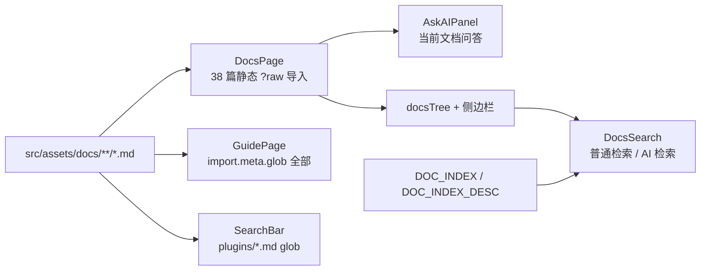

# 08 · 文档内容系统

项目内置一套 Minecraft 开服手册，放在 [src/assets/docs/](../../src/assets/docs)，共 **72 篇 Markdown**，合计约 **636 KB** 文本（目录占用约 832 KB）。它同时服务多种消费方式：侧边栏阅读、普通检索、AI 文档检索、AI 问答/Agent 阅读、AI 插件搜索。

## 1. 内容目录

| 目录 | 篇数 | 内容 |
| --- | --- | --- |
| `java/` | 2 | Java 环境配置、JVM 启动参数 |
| `core/`（顶层） | 18 | 服务端选择指南 + 插件端 6、模组端 4、混合端 4、代理端 2、跨平台 1 |
| `core/config/server-properties/` | 7 | 概述、网络、游戏规则、世界、玩家、性能安全、消息外观 |
| `core/config/bukkit-yml/` | 6 | 概述、基础、生物生成、区块存档、世界别名、完整示例 |
| `core/config/spigot-yml/` | 6 | 概述、基础、玩家、世界、性能、命令消息 |
| `core/config/paper-yml/` | 7 | 概述、全局、区块、网络数据包、反矿透、实体优化、世界默认 |
| `core/config/purpur-yml/` | 7 | 概述、全局、消息、生物、方块物品、游戏机制、世界 |
| `config/` | 3 | 权限管理、世界管理、性能优化 |
| `network/` | 7 | 概述、IPv4、IPv6、云服务器、域名、FRP、P2P |
| `ops/` | 4 | Linux、Windows、备份恢复、安全防护 |
| `plugins/` | 2 | 插件推荐、反作弊 |
| `mods/` | 1 | 模组推荐 |
| `faq/` | 1 | 常见问题 |
| 根目录 | 1 | `目录.md`（手册总目录） |
| **合计** | **72** | |

## 2. 四种消费路径



### 2.1 `DocsPage`：静态导入 + 目录树

`DocsPage` 使用 Vite 的 `?raw` 后缀，在编译期把 38 篇文档作为字符串打入 bundle：

```ts
import paper from '@/assets/docs/core/paper.md?raw'
```

其特点：

- **构建期确定**，运行时零请求，离线可用。
- 只有被显式 import 的文档才能进入 `docsTree`、侧边栏和普通搜索。
- 新增文档必须手动添加 import 与树节点。

未进入 `docsTree` 的内容：

| 内容 | 篇数 | 原因 |
| --- | --- | --- |
| `core/config/server-properties/*.md` | 7 | `DocsPage` 未导入 |
| `core/config/bukkit-yml/*.md` | 6 | 未导入 |
| `core/config/spigot-yml/*.md` | 6 | 未导入 |
| `core/config/paper-yml/*.md` | 7 | 未导入 |
| `core/config/purpur-yml/*.md` | 7 | 未导入 |
| `目录.md` | 1 | 未导入 |

因此侧边栏与 `DocsSearch` 普通模式只覆盖 **38 / 72** 篇。

### 2.2 `DocsSearch`：检索索引

`DocsSearch` 本身不加载文档，它接收 `DocsPage` 的 `getAllDocs()` 回调，回调基于 `docsTree` 扁平化。因此：

- 普通搜索范围 = `docsTree` 的 38 篇。
- AI 检索不直接读取全文，而是向模型提供 **手写的 `DOC_INDEX_DESC`**（关键词 → 路径映射），再让模型输出 `search_docs` 工具调用；最终映射回 `docsTree` 节点。
- `DOC_INDEX`（关键词 → 文件路径）也用于兜底匹配，但只能映射到 `docsTree` 中存在的文档 id/title，否则推荐被过滤。

结论：AI 检索的索引中包含少量 `core/config` 概述路径，但这些目标节点不在 `docsTree` 中，映射后会因找不到文档而被过滤。

### 2.3 `AskAIPanel`：当前文档问答

- 直接把 `DocsPage` 当前选中文档的全文放入 system prompt。
- 因此只对 `docsTree` 中的 38 篇有效。
- 文档越长，占用的上下文越多；没有截断或分段检索。
- AI 回答中的标题可点击跳转，锚点由 `generateHeadingSlug` 统一生成（`DocsPage` 与 `AskAIPanel` 各自实现了一份相同逻辑）。

### 2.4 `GuidePage`：动态 glob 全量加载

```ts
const docModules = import.meta.glob('../assets/docs/**/*.md', {
  query: '?raw',
  import: 'default',
  eager: false,
})

async function loadDoc(path: string): Promise<string> {
  for (const [key, loader] of Object.entries(docModules)) {
    if (key.endsWith(path) || key.includes(`/${path}`)) {
      return await loader() as string
    }
  }
  return `文档 ${path} 未找到`
}
```

- 懒加载，构建产物中每篇文档仍是独立 chunk。
- 覆盖全部 72 篇（包括 `core/config/` 与 `目录.md`）。
- `DOC_INDEX` 常量只列出 38 篇核心文档，因此 AI 只有被提示的路径才会主动读取；但模型若猜中其他路径，`loadDoc` 也能加载。
- 路径匹配依赖 `endsWith` / `includes`，同名文件可能被错误匹配（当前目录结构中未出现）。

### 2.5 `SearchBar`：仅插件文档

```ts
const pluginDocs = import.meta.glob('../assets/docs/plugins/*.md', {
  query: '?raw',
  import: 'default',
})
```

- 只加载 `plugins/插件推荐.md` 与 `plugins/反作弊.md`。
- 是否读取由硬编码关键词判断，且只取前 3000 字符。
- 用于 AI 插件搜索时提供“应该搜哪些插件名”的上下文。

## 3. 目录树结构

`DocsPage.docsTree` 是手写嵌套数组，节点结构：

```ts
interface DocItem {
  id: string          // 唯一 id，用于选中与搜索
  title: string       // 显示标题（可带 📚 / 📁 emoji）
  content?: string    // 文档原文；无 content 表示纯分组
  children?: DocItem[]
}
```

一级节点（8 个）：

```text
📚 Java 环境
📚 服务端核心
   └── 服务端选择指南
   └── 📁 插件端      Paper / Spigot / Purpur / Folia / Pufferfish / Leaves
   └── 📁 模组端      Forge / NeoForge / Fabric / Quilt
   └── 📁 混合端      Mohist / CatServer / Arclight / Banner
   └── 📁 代理端      BungeeCord / Velocity
   └── 📁 跨平台      Geyser
📚 服务器配置         权限管理 / 世界管理 / 性能优化
📚 网络配置           概述 / IPv4 / IPv6 / 云服务器 / 域名 / FRP / P2P
📚 运维管理           Linux / Windows / 备份恢复 / 安全防护
📚 插件               插件推荐 / 反作弊
📚 模组               模组推荐
📚 常见问题           FAQ
```

节点 id 约定：`java-env`、`jvm-args`、`core-guide`、`core-plugin`、`paper`、`network-ipv4`、`ops-linux`、`faq-main` 等。新增节点时需保证全局唯一。

### 3.1 侧边栏渲染

`TreeNode` 递归组件：

- 有子节点：点击切换展开，箭头 `ChevronRight` / `ChevronDown`；
- 无子节点：显示 `FileText` 图标；
- 纯分组：显示文件夹图标；
- 有内容节点：点击同时展开与选中；
- 选中态：绿色背景与文字；
- 展开动画通过 `max-h-0` ↔ `max-h-[2000px]` 过渡（超过约 2000px 的内容可能被裁剪，但目录项高度远小于该值）。

### 3.2 锚点生成规则

```ts
function generateHeadingSlug(text: string): string {
  return text
    .toLowerCase()
    .replace(/[^\w\u4e00-\u9fa5\s-]/g, '')
    .replace(/\s+/g, '-')
    .replace(/-+/g, '-')
    .trim()
}
```

`DocsPage` 在渲染 `h1`–`h4` 时注入 `id`；`DocsSearch`、`AskAIPanel` 用同一规则生成点击目标。注意：

- `\w` 在 JS 中只匹配 `[A-Za-z0-9_]`，中文由 `\u4e00-\u9fa5` 补充；
- Markdown 标题中的表情、标点会被移除；
- 标题重复时会产生重复 `id`，`querySelector` 只命中第一个。

## 4. Markdown 渲染能力

| 能力 | 实现 |
| --- | --- |
| GFM | `remark-gfm`：表格、删除线、任务列表、自动链接 |
| 原始 HTML | `rehype-raw`：文档中的 `<div>`、`` 等可渲染 |
| 代码高亮 | `react-syntax-highlighter` Prism，`language-*` class 决定语言 |
| 主题 | `oneDark` / `oneLight` 跟随 `darkMode` |
| 图片 | `max-width: 100%`、圆角（`.markdown-body img`） |
| 表格 | 自定义边框与表头背景（`index.css`） |
| 字体 | 文档正文使用系统无衬线字体；代码使用 Fira Code 等等宽字体 |
| 链接 | 文档内正常跳转；详情页/聊天中的链接统一 `target="_blank"` |

`DocsPage` 的 `markdownComponents` 只覆盖 `code` 与 `h1`–`h4`；其他元素交给 CSS。

## 5. 内容编写约定

根据现有文档与渲染器能力，建议遵循：

1. **标题层级**：每篇一个 `#` 一级标题，正文用 `##` / `###`，便于锚点与目录。
2. **代码块**：使用三反引号并标注语言（`yaml`、`properties`、`bash`、`ini` 等），否则不会高亮。
3. **文件名**：允许中文；同一目录下避免同名；引用时使用相对路径（`core/paper.md`）。
4. **Markdown 链接**：`目录.md` 使用相对路径；在应用内渲染时不会自动改写为 `#/docs`，点击会尝试浏览器导航而非应用路由（文档正文中的链接需注意）。
5. **原始 HTML**：可使用，但应保持简洁；`rehypeRaw` 不做消毒。
6. **图片**：尽量使用可公网访问的 URL；本地图片需放入 `public/` 或作为资源导入。
7. **篇幅**：单篇过长会挤占 `AskAIPanel` 的上下文；建议控制在合理长度，或拆分章节。
8. **敏感信息**：不要写入真实服务器 IP、密钥、玩家隐私。

## 6. 新增一篇文档的完整流程

以新增 `core/optimization/实体优化.md` 为例：

1. **创建文件**：放到 `src/assets/docs/core/optimization/实体优化.md`。
2. **同步总目录**：更新 `src/assets/docs/目录.md` 的链接。
3. **侧边栏展示（可选但推荐）**：
   - 在 `DocsPage.tsx` 顶部添加：
     ```ts
     import entityOptimization from '@/assets/docs/core/optimization/实体优化.md?raw'
     ```
   - 在 `docsTree` 对应分组添加：
     ```ts
     { id: 'entity-optimization', title: '实体优化', content: entityOptimization }
     ```
4. **普通/AI 文档搜索**：
   - 在 `DocsSearch.tsx` 的 `DOC_INDEX` 添加 `关键词: 'core/optimization/实体优化.md'`；
   - 在 `DOC_INDEX_DESC` 添加一行说明。
5. **开服 Agent / 简单开服**：
   - 文件已能被 `import.meta.glob` 自动发现；
   - 若希望 AI 主动读取，在 `GuidePage.tsx` 的 `DOC_INDEX` 字符串补充路径与说明。
6. **AI 插件搜索（仅插件类文档）**：
   - 在 `SearchBar.tsx` 的 `pluginDocList` 添加文件与描述；
   - 在 `runAgent` 的关键词匹配逻辑中添加命中条件。
7. **验证**：
   - `npm run dev` 打开 `/docs`，确认侧边栏、搜索、AI 面板；
   - 检查锚点跳转、代码高亮、暗色模式；
   - `npm run build` 确认 TypeScript 与打包通过。

## 7. 索引漂移风险

当前存在四套彼此独立的文档索引：

| 索引 | 位置 | 覆盖范围 | 维护方式 |
| --- | --- | --- | --- |
| `docsTree` | `DocsPage.tsx` | 38 篇 | 手写 import + 树节点 |
| `DOC_INDEX` | `DocsSearch.tsx` | 80 个关键词映射 | 手写对象 |
| `DOC_INDEX_DESC` | `DocsSearch.tsx` | 43 行说明 | 手写字符串 |
| `DOC_INDEX` | `GuidePage.tsx` | 38 行路径说明 | 手写字符串 |
| `pluginDocList` + 关键词 | `SearchBar.tsx` | 2 篇插件文档 | 手写数组 + if 条件 |

由此带来的实际问题：

- `core/config/` 的 33 篇文档存在于磁盘和 `import.meta.glob`，但无法从侧边栏打开、无法被普通搜索命中；AI 检索若推荐这些路径，映射会失败。
- 新增文档很容易只更新其中一两处，导致“搜得到但打不开”或“AI 说存在但侧边栏没有”。
- `目录.md` 与实际文件也需人工同步。

建议（作为后续改进方向）：

1. 以 `import.meta.glob('../assets/docs/**/*.md', { eager: true })` 自动生成 `docsTree` 与索引；
2. 从文件路径自动派生 `id`，避免手写唯一 id；
3. 用 frontmatter（`title`、`category`、`order`、`keywords`）驱动目录与搜索；
4. 将 `DOC_INDEX` 由文档 frontmatter 自动生成，消除三份重复索引。

## 8. 构建影响

- `?raw` 静态导入的 38 篇会进入主 bundle（或由 Rollup 拆分的 chunk），增加首屏体积。
- `import.meta.glob` 懒加载的文档会为每篇生成独立 chunk，进入路由时按需请求。
- 文档总量约 636 KB，当前规模可接受；若继续增长，建议全部改为懒加载 + 虚拟目录。

## 9. 文档与 AI 的结合点

| 功能 | 文档输入 | 截断策略 | 目的 |
| --- | --- | --- | --- |
| AI 插件搜索 | 插件推荐 / 反作弊前 3000 字符 | 3000 字符 | 提取插件名作为搜索关键词 |
| 文档 AI 检索（DocsSearch） | `DOC_INDEX_DESC` 摘要 | 仅索引，不含全文 | 选出最相关文档 |
| 文档问答（AskAIPanel） | 当前文档全文 | 无 | 基于当前文档回答 |
| 简单开服 | `read_docs` 指定文档全文 | 无 | 生成开服步骤 |
| 运维 Agent | `read_docs` 指定文档全文 | 无 | 配合本地文件诊断 |
| 插件详情对话 | 插件描述前 3000 字符 + 截图描述 | 3000 字符 | 回答插件使用问题 |

文档质量直接影响 AI 回答质量；同时，文档中的原始 HTML 与链接会原样进入模型上下文，需要注意提示词注入风险（详见 05 与 11）。
