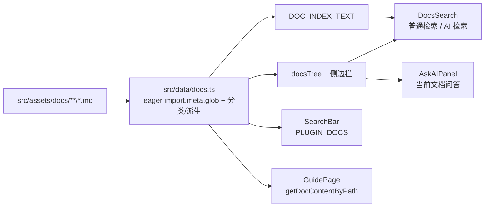

# 08 · 文档内容系统

项目内置一套 Minecraft 开服手册，放在 [src/assets/docs/](../../src/assets/docs)，共 **72 篇 Markdown**，合计约 **636 KB** 文本（目录占用约 832 KB）。它同时服务多种消费方式：侧边栏阅读、普通检索、AI 文档检索、AI 问答/Agent 阅读、AI 插件搜索。

## 1. 内容目录

| 目录 | 篇数 | 内容 |
| --- | --- | --- |
| `java/` | 2 | Java 环境配置、JVM 启动参数 |
| `core/`（顶层） | 18 | 服务端选择指南 + 插件端 6、模组端 4、混合端 4、代理端 2、跨平台 1 |
| `core/config/server-properties/` | 7 | 概述、网络、游戏规则、世界、玩家、性能安全、消息外观 |
| `core/config/bukkit-yml/` | 6 | 概述、基础、生物生成、区块存档、世界别名、完整示例 |
| `core/config/spigot-yml/` | 6 | 概述、基础、玩家、世界、性能、命令消息 |
| `core/config/paper-yml/` | 7 | 概述、全局、区块、网络数据包、反矿透、实体优化、世界默认 |
| `core/config/purpur-yml/` | 7 | 概述、全局、消息、生物、方块物品、游戏机制、世界 |
| `config/` | 3 | 权限管理、世界管理、性能优化 |
| `network/` | 7 | 概述、IPv4、IPv6、云服务器、域名、FRP、P2P |
| `ops/` | 4 | Linux、Windows、备份恢复、安全防护 |
| `plugins/` | 2 | 插件推荐、反作弊 |
| `mods/` | 1 | 模组推荐 |
| `faq/` | 1 | 常见问题 |
| 根目录 | 1 | `目录.md`（手册总目录） |
| **合计** | **72** | |

## 2. 统一文档数据源



### 2.1 `src/data/docs.ts`：单一事实来源

`src/data/docs.ts` 使用：

```ts
const rawDocs = import.meta.glob('../assets/docs/**/*.md', {
  query: '?raw',
  import: 'default',
  eager: true,
})
```

在编译期把 **全部 72 篇** 文档载入，并完成：

- 归一化 Vite glob key（兼容 `/src/assets/docs/...` 与 `../assets/docs/...`）。
- 从首个 `# 标题` 提取文档标题，回退到文件名。
- 根据目录/文件名分类到 9 个一级分组与 11 个子分组。
- 生成 `DOC_CATALOG`（元数据 + 原文）、`docsTree`（侧边栏树）、`DOC_INDEX_TEXT`（AI 文档清单）、`PLUGIN_DOCS`（插件文档子集）。
- 提供 `resolveDocEntry(path)` 与 `getDocContentByPath(path)`。

因此新增文档不再需要改 `DocsPage` import、`DOC_INDEX`、`DOC_INDEX_DESC` 或 `GuidePage.DOC_INDEX`。

### 2.2 `DocsPage`：统一树 + 全量阅读

- 只导入 `docsTree` 与 `DocItem` 类型，不再手写 38 个 `?raw` import。
- 侧边栏、普通搜索与文档阅读覆盖 **72 / 72** 篇。
- `getAllDocsFlat` 会把 `📚` / `📁` 从面包屑标题中移除。

### 2.3 `DocsSearch`：检索

- 普通搜索基于 `DocsPage` 传入的 `getAllDocs()`，范围是所有 72 篇。
- AI 检索 prompt 使用 `DOC_INDEX_TEXT`（由 `DOC_CATALOG` 自动生成）。
- 模型返回的 `doc_path` 通过 `resolveDocEntry` 直接解析为目录节点，不再依赖手写的关键词映射表。

### 2.4 `AskAIPanel`：当前文档问答

- 把当前文档全文放入 system prompt。
- 现在所有 72 篇文档都可选中并提问。
- 文档越长，占用上下文越多；没有截断或分段检索。
- AI 回答中的标题可点击跳转，锚点由 `generateHeadingSlug` 统一生成（`DocsPage` 与 `AskAIPanel` 各自实现了一份相同逻辑）。

### 2.5 `GuidePage`：Agent 阅读

`loadDoc` 直接调用 `getDocContentByPath(path)`：

```ts
async function loadDoc(path: string): Promise<string> {
  return getDocContentByPath(path) ?? `文档 ${path} 未找到`
}
```

- 不再维护第二套 `import.meta.glob` 与 `endsWith` 路径匹配。
- `SYSTEM_PROMPT` 与 `AGENT_SYSTEM_PROMPT` 共用 `DOC_INDEX_TEXT`，AI 能看到全部文档路径。
- 文档内容随 `src/data/docs.ts` 一起打包；Agent 读取时无需再次扫描模块。

### 2.6 `SearchBar`：插件文档子集

- 使用 `PLUGIN_DOCS`（从 `DOC_CATALOG` 过滤 `plugins/` 得到）。
- 使用 `getDocContentByPath` 读取文档，不再单独 `import.meta.glob`。
- 是否读取仍由硬编码关键词判断，且只取前 3000 字符。

## 3. 目录树结构

`docsTree` 由 `DOC_CATALOG` 自动构建，节点结构：

```ts
interface DocItem {
  id: string          // 由文档路径派生，例如 core-config-server-properties-概述
  title: string       // 首个 H1，或文件名
  content?: string    // 文档原文；无 content 表示分组
  children?: DocItem[]
}
```

一级节点（9 个）：

```text
📚 Java 环境
📚 服务端核心
   └── 服务端选择指南
   └── 📁 插件端      Paper / Spigot / Purpur / Folia / Pufferfish / Leaves
   └── 📁 模组端      Forge / NeoForge / Fabric / Quilt
   └── 📁 混合端      Mohist / CatServer / Arclight / Banner
   └── 📁 代理端      BungeeCord / Velocity
   └── 📁 跨平台      Geyser
📚 服务器配置
   └── 📁 通用配置          权限管理 / 世界管理 / 性能优化
   └── 📁 server.properties  7 篇
   └── 📁 bukkit.yml         6 篇
   └── 📁 spigot.yml         6 篇
   └── 📁 paper 配置         7 篇
   └── 📁 purpur.yml         7 篇
📚 网络配置           概述 / IPv4 / IPv6 / 云服务器 / 域名 / FRP / P2P
📚 运维管理           Linux / Windows / 备份恢复 / 安全防护
📚 插件               插件推荐 / 反作弊
📚 模组               模组推荐
📚 常见问题           FAQ
📚 手册目录           目录.md
```

节点 id 约定：分组节点为 `section-<section>` / `section-<section>-<subsection>`；文档节点由路径派生，如 `java-Java环境配置`、`core-paper`、`core-config-server-properties-概述`、`network-01-概述与前置知识`。

### 3.1 侧边栏渲染

`TreeNode` 递归组件：

- 有子节点：点击切换展开，箭头 `ChevronRight` / `ChevronDown`；
- 无子节点：显示 `FileText` 图标；
- 纯分组：显示文件夹图标；
- 有内容节点：点击同时展开与选中；
- 选中态：绿色背景与文字；
- 展开动画通过 `max-h-0` ↔ `max-h-[2000px]` 过渡（超过约 2000px 的内容可能被裁剪，但目录项高度远小于该值）。

### 3.2 锚点生成规则

```ts
function generateHeadingSlug(text: string): string {
  return text
    .toLowerCase()
    .replace(/[^\w\u4e00-\u9fa5\s-]/g, '')
    .replace(/\s+/g, '-')
    .replace(/-+/g, '-')
    .trim()
}
```

`DocsPage` 在渲染 `h1`–`h4` 时注入 `id`；`DocsSearch`、`AskAIPanel` 用同一规则生成点击目标。注意：

- `\w` 在 JS 中只匹配 `[A-Za-z0-9_]`，中文由 `\u4e00-\u9fa5` 补充；
- Markdown 标题中的表情、标点会被移除；
- 标题重复时会产生重复 `id`，`querySelector` 只命中第一个。

## 4. Markdown 渲染能力

| 能力 | 实现 |
| --- | --- |
| GFM | `remark-gfm`：表格、删除线、任务列表、自动链接 |
| 原始 HTML | `rehype-raw`：文档中的 `<div>`、`` 等可渲染 |
| 代码高亮 | `react-syntax-highlighter` Prism，`language-*` class 决定语言 |
| 主题 | `oneDark` / `oneLight` 跟随 `darkMode` |
| 图片 | `max-width: 100%`、圆角（`.markdown-body img`） |
| 表格 | 自定义边框与表头背景（`index.css`） |
| 字体 | 文档正文使用系统无衬线字体；代码使用 Fira Code 等等宽字体 |
| 链接 | 文档内正常跳转；详情页/聊天中的链接统一 `target="_blank"` |

`DocsPage` 的 `markdownComponents` 只覆盖 `code` 与 `h1`–`h4`；其他元素交给 CSS。

## 5. 内容编写约定

根据现有文档与渲染器能力，建议遵循：

1. **标题层级**：每篇一个 `#` 一级标题，正文用 `##` / `###`，便于锚点与目录。
2. **代码块**：使用三反引号并标注语言（`yaml`、`properties`、`bash`、`ini` 等），否则不会高亮。
3. **文件名**：允许中文；同一目录下避免同名；引用时使用相对路径（`core/paper.md`）。
4. **Markdown 链接**：`目录.md` 使用相对路径；在应用内渲染时不会自动改写为 `#/docs`，点击会尝试浏览器导航而非应用路由（文档正文中的链接需注意）。
5. **原始 HTML**：可使用，但应保持简洁；`rehypeRaw` 不做消毒。
6. **图片**：尽量使用可公网访问的 URL；本地图片需放入 `public/` 或作为资源导入。
7. **篇幅**：单篇过长会挤占 `AskAIPanel` 的上下文；建议控制在合理长度，或拆分章节。
8. **敏感信息**：不要写入真实服务器 IP、密钥、玩家隐私。

## 6. 新增一篇文档的完整流程

以新增 `core/optimization/实体优化.md` 为例：

1. **创建文件**：放到 `src/assets/docs/core/optimization/实体优化.md`，首行写 `# 实体优化`。
2. **同步总目录**：更新 `src/assets/docs/目录.md` 的链接。
3. **自动接入**：`src/data/docs.ts` 会在构建期自动发现该文件：
   - 生成 `DOC_CATALOG` 条目与 `docsTree` 节点（未匹配到子分组时归入对应一级分组）；
   - 出现在 `DOC_INDEX_TEXT`，AI 文档检索与开服 Agent 都能看到；
   - 可用 `getDocContentByPath('core/optimization/实体优化.md')` 读取。
4. **如需专有分组**：在 `src/data/docs.ts` 的 `SUBSECTION_TITLES` / `SUBSECTION_ORDER` 增加分组，并在 `classify()` 中补充匹配规则。
5. **AI 插件搜索（仅插件类文档）**：在 `SearchBar.tsx` 的 `runAgent` 关键词判断中补充命中条件；`PLUGIN_DOCS` 会自动包含 `plugins/` 下的新文件。
6. **验证**：
   - `npm run dev` 打开 `/docs`，确认侧边栏、搜索、AI 面板；
   - 检查锚点跳转、代码高亮、暗色模式；
   - `npm test` 中的 `docs.test.ts` 会校验文档总数与节点数一致；
   - `npm run build` 确认 TypeScript 与打包通过。

## 7. 索引一致性

统一数据源后，只剩一处需要人工同步：

| 内容 | 位置 | 维护方式 |
| --- | --- | --- |
| 文档目录、标题、分类 | `src/data/docs.ts` | 由文件路径与首个 H1 自动派生 |
| AI 文档清单 | `DOC_INDEX_TEXT` | 由 `DOC_CATALOG` 自动生成 |
| 侧边栏树 | `docsTree` | 由 `DOC_CATALOG` 自动生成 |
| 插件文档子集 | `PLUGIN_DOCS` | 由路径前缀过滤自动生成 |
| 手册总目录 | `src/assets/docs/目录.md` | 仍需人工维护 |
| 专有分组规则 | `SUBSECTION_TITLES` / `classify()` | 新增目录结构时人工补充 |

`src/data/docs.test.ts` 会断言 `DOC_CATALOG` 与 `docsTree` 的可阅读节点数一致，避免出现“列表有但树里没有”的漂移。

## 8. 构建影响

- `src/data/docs.ts` 使用 `eager: true`，72 篇文档会进入主 bundle，首屏体积增加（当前约 2 MB 未压缩）。
- 换取的收益是：侧边栏、检索与 AI Agent 共用同一份内容，无需运行期请求，也消除了四套手写索引。
- 文档继续增长时，建议改为按目录拆分 glob 并配合动态导入，或在 `manualChunks` 中单独拆分文档 chunk。

## 9. 文档与 AI 的结合点

| 功能 | 文档输入 | 截断策略 | 目的 |
| --- | --- | --- | --- |
| AI 插件搜索 | 插件推荐 / 反作弊前 3000 字符 | 3000 字符 | 提取插件名作为搜索关键词 |
| 文档 AI 检索（DocsSearch） | `DOC_INDEX_TEXT`（全部 72 篇路径） | 仅索引，不含全文 | 选出最相关文档 |
| 文档问答（AskAIPanel） | 当前文档全文 | 无 | 基于当前文档回答 |
| 简单开服 | `read_docs` 指定文档全文 | 无 | 生成开服步骤 |
| 运维 Agent | `read_docs` 指定文档全文 | 无 | 配合本地文件诊断 |
| 插件详情对话 | 插件描述前 3000 字符 + 截图描述 | 3000 字符 | 回答插件使用问题 |

文档质量直接影响 AI 回答质量；同时，文档中的原始 HTML 与链接会原样进入模型上下文，需要注意提示词注入风险（详见 05 与 11）。
