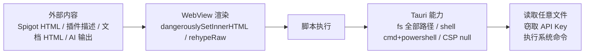

# 09 · Tauri 桌面端

桌面端的目标不是复刻 Web，而是补足两项 Web 无法提供的能力：

1. **打包为原生桌面应用**（Windows / macOS / Linux）。
2. **让 AI Agent 读取本地 Minecraft 服务器目录**（配置、日志、插件列表、截图）。

Rust 层非常薄：只初始化 Tauri Builder 并注册三个官方插件，没有自定义 command。所有业务仍在前端。

## 1. 工程结构

```text
src-tauri/
├── Cargo.toml                  # crate 元数据与依赖
├── Cargo.lock
├── build.rs                    # tauri_build::build()
├── tauri.conf.json             # 应用、窗口、构建、bundle、插件配置
├── capabilities/
│   └── default.json            # 主窗口权限与文件范围
├── gen/schemas/                # Tauri 生成的 ACL / capability schema
├── icons/                      # 各平台图标（PNG/ICO/ICNS/Android/iOS）
└── src/
    ├── main.rs                 # 可执行入口
    └── lib.rs                  # 共享库入口（mobile 入口点）
```

### 1.1 `Cargo.toml`

| 字段 | 值 |
| --- | --- |
| `package.name` | `mc-plugin-market` |
| `version` | `1.0.2` |
| `edition` | `2021` |
| `[lib].name` | `mc_plugin_market_lib` |
| `[lib].crate-type` | `["lib", "cdylib", "staticlib"]` |

依赖：

```toml
tauri = { version = "2", features = [] }
tauri-plugin-shell = "2"
tauri-plugin-dialog = "2"
tauri-plugin-fs = "2"
serde = { version = "1", features = ["derive"] }
serde_json = "1"
```

`serde` / `serde_json` 当前未被 Rust 源码直接使用；若移除需确认 `tauri` 间接依赖不会因此失败。

### 1.2 `main.rs`

```rust
#![cfg_attr(
    all(not(debug_assertions), target_os = "windows"),
    windows_subsystem = "windows"
)]

fn main() {
    mc_plugin_market_lib::run()
}
```

- Windows Release 构建隐藏控制台窗口。
- 调试构建保留控制台输出。
- 统一调用库的 `run()`，便于移动端复用。

### 1.3 `lib.rs`

```rust
#[cfg_attr(mobile, tauri::mobile_entry_point)]
pub fn run() {
    tauri::Builder::default()
        .plugin(tauri_plugin_shell::init())
        .plugin(tauri_plugin_dialog::init())
        .plugin(tauri_plugin_fs::init())
        .run(tauri::generate_context!())
        .expect("error while running tauri application");
}
```

插件顺序不影响功能；`generate_context!()` 读取 `tauri.conf.json`、图标与 capabilities。

## 2. 应用配置 `tauri.conf.json`

| 字段 | 值 | 说明 |
| --- | --- | --- |
| `productName` | `MC-Plugin-Market` | 安装包/应用显示名 |
| `version` | `1.0.2` | 与 `package.json`、`Cargo.toml` 保持一致 |
| `identifier` | `com.mc-plugin-market.app` | 唯一标识 |
| `build.beforeDevCommand` | `npm run dev` | `tauri dev` 前启动 Vite |
| `build.devUrl` | `http://localhost:5173` | Vite 默认端口，需与 `vite.config.ts` 保持一致 |
| `build.beforeBuildCommand` | `npm run build` | 打包前执行类型检查 + 前端构建 |
| `build.frontendDist` | `../dist` | 前端产物目录 |
| `app.windows[0].title` | `MC 插件市场` | 窗口标题 |
| `app.windows[0].width/height` | `1200 × 800` | 初始窗口 |
| `app.windows[0].resizable` | `true` | 可调整 |
| `app.windows[0].fullscreen` | `false` | 非全屏 |
| `app.security.csp` | `null` | **关闭 CSP** |
| `bundle.active` | `true` | 启用打包 |
| `bundle.targets` | `"all"` | 当前平台所有可用格式 |
| `bundle.icon` | 5 个图标 | 32/128/128@2x/icns/ico |
| `plugins.shell.open` | `true` | 允许 shell 插件打开链接 |

窗口没有显式 `label`，Tauri 默认标签为 `main`，与 capabilities 的 `"windows": ["main"]` 对应。

## 3. 权限与能力 `capabilities/default.json`

### 3.1 基础权限

| 权限 | 作用 |
| --- | --- |
| `core:default` | Tauri 核心默认能力 |
| `shell:allow-open` | 用系统默认程序打开 URL/文件 |
| `dialog:default` | 原生对话框（目录选择） |
| `fs:default` | 文件系统默认能力 |

### 3.2 Shell 执行权限

```json
{
  "identifier": "shell:allow-execute",
  "allow": [
    { "name": "cmd", "cmd": "cmd", "args": true },
    { "name": "powershell", "cmd": "powershell", "args": true }
  ]
}
```

- `args: true` 表示允许任意参数。
- 同时授予 `shell:allow-spawn`、`shell:allow-stdin-write`、`shell:allow-kill`。
- 前端仅使用 `Command.create('cmd', ['/c', 'type'|'dir', path])`，但权限本身远宽于实际用途。

### 3.3 FS 权限

授予了：

- `fs:allow-read` / `write` / `exists` / `mkdir` / `remove` / `rename` / `copy-file`
- `fs:allow-read-dir` / `read-file` / `read-text-file`
- `fs:allow-write-file` / `write-text-file`

文件范围：

```json
{
  "identifier": "fs:scope",
  "allow": [
    { "path": "$HOME/**" },
    { "path": "$APPDATA/**" },
    { "path": "$LOCALAPPDATA/**" },
    { "path": "$DOCUMENT/**" },
    { "path": "$DESKTOP/**" },
    { "path": "$DOWNLOAD/**" },
    { "path": "**" }
  ]
}
```

最后的 `"**"` 实际覆盖整个文件系统，使前面几个目录白名单失去限制意义。**应用可以读写任意用户有权限的文件**。前端目前只读，但权限并未收敛为只读。

### 3.4 CSP

`"csp": null` 表示不注入内容安全策略。结合：

- Spigot 详情使用 `dangerouslySetInnerHTML`；
- Markdown 文档启用 `rehypeRaw`；
- 应用拥有宽泛的 FS/Shell 权限；

一旦出现 XSS，攻击者可能读取 API Key、读取任意文件、执行命令。详见第 6 节。

## 4. 前端如何调用桌面能力

### 4.1 环境判定

```ts
// api-base.ts
export function isTauri(): boolean {
  return !!(window as any).__TAURI__
}

// GuidePage.tsx
const isTauri = '__TAURI__' in window || '__TAURI_INTERNALS__' in window
```

Tauri 2 默认注入 `__TAURI_INTERNALS__`，`withGlobalTauri` 配置才会注入 `__TAURI__`。当前 `tauri.conf.json` 未设置 `withGlobalTauri`，因此 `api-base.isTauri()` 在 Tauri 2 下可能返回 `false`，导致 API 走开发代理或生产 CORS 代理路径而不是直连。`GuidePage` 的判定更稳健。

> 这是一个潜在兼容性问题。如果桌面端出现 CORS 或代理依赖，应优先检查 `isTauri()`。

### 4.2 API 直连

Tauri 环境下 `api-base` 选择真实 API base，不经过 Vite 代理与 CORS 代理。这依赖 WebView 的网络栈和外部服务的 CORS 响应；桌面端通常不受浏览器同源策略限制，但仍可能被服务端策略拒绝。

### 4.3 目录与文件

```ts
const { open } = await import('@tauri-apps/plugin-dialog')
const result = await open({ directory: true, multiple: false, title: '选择 Minecraft 服务器根目录' })
```

```ts
const { readTextFile } = await import('@tauri-apps/plugin-fs')
const content = await readTextFile(fullPath)
```

```ts
const { Command } = await import('@tauri-apps/plugin-shell')
const command = Command.create('cmd', ['/c', 'type', fullPath])
const output = await command.execute()
```

- 动态 `import()` 保证 Web 构建不会因缺少原生环境而崩溃。
- 目录读取优先 `plugin-fs.readDir`。
- 路径拼接使用 `/` 后统一 `replace(/\//g, '\\')`，是 Windows 专用实现。
- Shell 兜底命令也是 Windows `cmd`，macOS/Linux 无法使用。

### 4.4 仅在桌面端开放的功能

| 功能 | 判定 | Web 行为 |
| --- | --- | --- |
| Agent 模式 | `!isTauri` 时卡片禁用 | 卡片显示“不可用” |
| 选择服务器目录 | `selectDirectory()` 返回 `null` | 用户可手动输入路径，但无法读取 |
| 读取/列目录 | 返回“仅 Tauri 可用”文本 | 功能不可用 |

## 5. 桌面端能力总结

| 能力 | 实现 | 使用方 |
| --- | --- | --- |
| 原生窗口 | `tauri.conf.json` | 全部页面 |
| 目录选择 | `plugin-dialog` | `GuidePage.AgentPreset` |
| 文本文件读取 | `plugin-fs.readTextFile` | Agent |
| 目录枚举 | `plugin-fs.readDir` | Agent 根目录/子目录 |
| Shell 兜底 | `plugin-shell.Command` | Agent（Windows） |
| 打开外部链接 | 前端 `<a target="_blank">` 或 `shell:allow-open` | 详情页、Header、设置页 |

未使用的能力：系统托盘、全局快捷键、自动更新、单实例、窗口状态持久化、深度链接、自定义协议、系统通知。

## 6. 安全模型与风险

### 6.1 攻击面



### 6.2 风险清单

| 风险 | 位置 | 影响 | 缓解 |
| --- | --- | --- | --- |
| Spigot HTML 未消毒 | `PluginDetailPage.tsx#L320-L324` | 恶意描述可执行脚本 | 使用已声明的 `dompurify` 消毒，或 sandbox iframe |
| 文档原始 HTML | `DocsPage` 的 `rehypeRaw` | 内置文档可信，但未来若引入外部文档有风险 | 对外部内容禁用 `rehypeRaw` |
| CSP 为空 | `tauri.conf.json` | 无浏览器层兜底 | 配置严格 CSP（`default-src 'self'` 等） |
| FS 范围 `"**"` | `capabilities/default.json` | 可读写任意文件 | 收敛为 `$HOME` 下特定目录或用户选择目录 |
| Shell 任意参数 | `allow-execute` / `spawn` | 命令注入风险 | 移除不必要的 shell 权限，或限定参数 |
| API Key 明文 | `localStorage` | XSS 后可直接窃取 | 桌面端使用系统密钥链插件；Web 端接受风险但应隔离 |
| 外部链接 | `target="_blank"` | 可能打开恶意页面 | `rel="noopener noreferrer"`（多数已添加） |

### 6.3 建议的最小权限版本

```json
{
  "windows": ["main"],
  "permissions": [
    "core:default",
    "dialog:allow-open",
    "fs:allow-read-text-file",
    "fs:allow-read-dir",
    {
      "identifier": "fs:scope",
      "allow": [{ "path": "$HOME/**" }]
    }
  ]
}
```

并在运行时仅允许用户通过目录选择器确认的路径（可通过 scope 动态扩展或自定义 command 校验路径前缀）。同时移除 `shell` 插件或仅保留 `shell:allow-open`。

## 7. 桌面端与 Web 端差异对照

| 维度 | Web | Tauri |
| --- | --- | --- |
| 路由 | HashRouter，`#/...` | 同左 |
| API 访问 | 开发代理 / 生产 CORS 代理 | 直连（取决于 `isTauri`） |
| 本地文件 | 仅 File API 上传 | 任意目录读取（权限允许） |
| Agent 模式 | 不可用 | 可用 |
| 命令执行 | 无 | `cmd` / `powershell` |
| 构建产物 | `dist/` | 平台安装包 |
| 安全边界 | 浏览器同源策略 | Tauri capabilities + WebView |
| 更新方式 | 重新部署 | 重新安装（无自动更新） |

## 8. 桌面端构建

```bash
npm run tauri dev     # 开发
npx tauri build       # 当前平台打包
npx tauri build --target x86_64-pc-windows-msvc
```

构建流程：

1. `beforeBuildCommand` 执行 `npm run build`（`tsc -b && vite build`）。
2. Tauri 读取 `frontendDist`（`../dist`）。
3. Rust 编译 `mc_plugin_market_lib` 与可执行文件。
4. 按 `bundle.targets = "all"` 生成当前平台支持的安装包。

各平台产物：

| 平台 | 产物 |
| --- | --- |
| Windows | `.msi`（WiX）、`.exe`（NSIS） |
| macOS | `.app`、`.dmg` |
| Linux | `.deb`、`.AppImage` |

图标清单必须覆盖 `32x32.png`、`128x128.png`、`128x128@2x.png`、`icon.icns`、`icon.ico`；`icons/` 下还包含 Android/iOS 资源，供移动端目标使用。

## 9. 桌面端已知限制

- `isTauri()` 与 `GuidePage` 判定不一致，Tauri 2 下可能误判。
- 文件路径与 Shell 兜底仅支持 Windows。
- 没有自动更新、崩溃上报、日志持久化。
- 没有窗口状态记忆。
- FS 权限过宽，且前端只做只读操作，权限与用途不匹配。
- 没有自定义 command 进行路径校验，模型可通过工具参数尝试读取任意路径（受 `serverPath` 前缀约束，但模型可构造 `..` 等相对路径）。
- `readDir` 返回的 `entry.name` 在部分平台可能为 `undefined`，代码已过滤。
