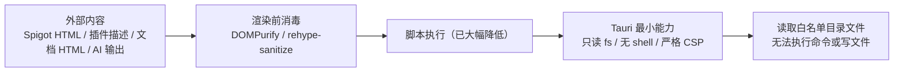

# 09 · Tauri 桌面端

桌面端的目标不是复刻 Web，而是补足两项 Web 无法提供的能力：

1. **打包为原生桌面应用**（Windows / macOS / Linux）。
2. **让 AI Agent 读取本地 Minecraft 服务器目录**（配置、日志、插件列表、截图）。

Rust 层非常薄：只初始化 Tauri Builder 并注册三个官方插件，没有自定义 command。所有业务仍在前端。

## 1. 工程结构

```text
src-tauri/
├── Cargo.toml                  # crate 元数据与依赖
├── Cargo.lock
├── build.rs                    # tauri_build::build()
├── tauri.conf.json             # 应用、窗口、构建、bundle、插件配置
├── capabilities/
│   └── default.json            # 主窗口权限与文件范围
├── gen/schemas/                # Tauri 生成的 ACL / capability schema
├── icons/                      # 各平台图标（PNG/ICO/ICNS/Android/iOS）
└── src/
    ├── main.rs                 # 可执行入口
    └── lib.rs                  # 共享库入口（mobile 入口点）
```

### 1.1 `Cargo.toml`

| 字段 | 值 |
| --- | --- |
| `package.name` | `mc-plugin-market` |
| `version` | `1.0.2` |
| `edition` | `2021` |
| `[lib].name` | `mc_plugin_market_lib` |
| `[lib].crate-type` | `["lib", "cdylib", "staticlib"]` |

依赖：

```toml
tauri = { version = "2", features = [] }
tauri-plugin-dialog = "2"
tauri-plugin-fs = "2"
serde = { version = "1", features = ["derive"] }
serde_json = "1"
```

`serde` / `serde_json` 当前未被 Rust 源码直接使用；若移除需确认 `tauri` 间接依赖不会因此失败。

### 1.2 `main.rs`

```rust
#![cfg_attr(
    all(not(debug_assertions), target_os = "windows"),
    windows_subsystem = "windows"
)]

fn main() {
    mc_plugin_market_lib::run()
}
```

- Windows Release 构建隐藏控制台窗口。
- 调试构建保留控制台输出。
- 统一调用库的 `run()`，便于移动端复用。

### 1.3 `lib.rs`

```rust
#[cfg_attr(mobile, tauri::mobile_entry_point)]
pub fn run() {
    tauri::Builder::default()
        .plugin(tauri_plugin_dialog::init())
        .plugin(tauri_plugin_fs::init())
        .run(tauri::generate_context!())
        .expect("error while running tauri application");
}
```

插件顺序不影响功能；`generate_context!()` 读取 `tauri.conf.json`、图标与 capabilities。

## 2. 应用配置 `tauri.conf.json`

| 字段 | 值 | 说明 |
| --- | --- | --- |
| `productName` | `MC-Plugin-Market` | 安装包/应用显示名 |
| `version` | `1.0.2` | 与 `package.json`、`Cargo.toml` 保持一致 |
| `identifier` | `com.mc-plugin-market.app` | 唯一标识 |
| `build.beforeDevCommand` | `npm run dev` | `tauri dev` 前启动 Vite |
| `build.devUrl` | `http://localhost:5173` | Vite 默认端口，需与 `vite.config.ts` 保持一致 |
| `build.beforeBuildCommand` | `npm run build` | 打包前执行类型检查 + 前端构建 |
| `build.frontendDist` | `../dist` | 前端产物目录 |
| `app.windows[0].title` | `MC 插件市场` | 窗口标题 |
| `app.windows[0].width/height` | `1200 × 800` | 初始窗口 |
| `app.windows[0].resizable` | `true` | 可调整 |
| `app.windows[0].fullscreen` | `false` | 非全屏 |
| `app.security.csp` | 严格 CSP 字符串 | 生产环境限制脚本、样式、图片、网络与框架来源 |
| `app.security.devCsp` | 开发 CSP 字符串 | 额外允许 `http://localhost:5173` 与 `ws://localhost:5173`，并允许 `unsafe-eval` 供开发热更新 |
| `bundle.active` | `true` | 启用打包 |
| `bundle.targets` | `"all"` | 当前平台所有可用格式 |
| `bundle.icon` | 5 个图标 | 32/128/128@2x/icns/ico |

窗口没有显式 `label`，Tauri 默认标签为 `main`，与 capabilities 的 `"windows": ["main"]` 对应。`plugins` 配置块已移除（不再加载 shell 插件）。

生产 CSP：

```text
default-src 'self'; script-src 'self'; style-src 'self' 'unsafe-inline';
img-src 'self' data: https:; font-src 'self' data:;
connect-src 'self' ipc: http://ipc.localhost https:;
object-src 'none'; base-uri 'self'; frame-src 'none'; form-action 'none'
```

`connect-src` 允许 `https:` 以访问插件 API 与大模型服务；`ipc:` 与 `http://ipc.localhost` 供 Tauri IPC 使用。

## 3. 权限与能力 `capabilities/default.json`

当前采用只读最小权限：

```json
{
  "identifier": "default",
  "windows": ["main"],
  "permissions": [
    "core:default",
    "dialog:allow-open",
    "fs:allow-read-text-file",
    "fs:allow-read-dir",
    {
      "identifier": "fs:scope",
      "allow": [
        { "path": "$HOME/**" },
        { "path": "$DOCUMENT/**" },
        { "path": "$DESKTOP/**" },
        { "path": "$DOWNLOAD/**" }
      ]
    }
  ]
}
```

| 权限 | 作用 |
| --- | --- |
| `core:default` | Tauri 核心默认能力 |
| `dialog:allow-open` | 仅允许打开目录/文件选择对话框 |
| `fs:allow-read-text-file` | 读取文本文件 |
| `fs:allow-read-dir` | 枚举目录 |
| `fs:scope` | 将可读范围限制在 HOME / DOCUMENT / DESKTOP / DOWNLOAD |

已移除的权限：

- `shell:allow-open`、`shell:allow-execute`、`shell:allow-spawn`、`shell:allow-stdin-write`、`shell:allow-kill`
- `fs:allow-write` / `write-file` / `write-text-file` / `remove` / `rename` / `copy-file` / `mkdir`
- 通配全盘范围 `"**"`

后果：

- Agent 只能读取、不能修改或删除文件。
- 用户选择 `$HOME` 等白名单之外的服务器目录时，读取会被 Tauri 拒绝；这是安全换来的限制。
- 应用不再具备执行系统命令的能力。

## 4. 前端如何调用桌面能力

### 4.1 环境判定

```ts
// api-base.ts
export function isTauri(): boolean {
  return !!(window as any).__TAURI__ || !!(window as any).__TAURI_INTERNALS__
}

// pages/guide/env.ts
const isTauri = '__TAURI__' in window || '__TAURI_INTERNALS__' in window
```

Tauri 2 默认注入 `__TAURI_INTERNALS__`，`withGlobalTauri` 配置才会注入 `__TAURI__`。`api-base` 与 `pages/guide/env.ts` 均兼容二者，避免桌面端被误判为 Web。

### 4.2 API 直连

Tauri 环境下 `api-base` 选择真实 API base，不经过 Vite 代理与 CORS 代理。这依赖 WebView 的网络栈和外部服务的 CORS 响应；桌面端通常不受浏览器同源策略限制，但仍可能被服务端策略拒绝。

### 4.3 目录与文件

```ts
const { open } = await import('@tauri-apps/plugin-dialog')
const result = await open({ directory: true, multiple: false, title: '选择 Minecraft 服务器根目录' })
```

```ts
const { readTextFile } = await import('@tauri-apps/plugin-fs')
const content = await readTextFile(fullPath)
```

- 动态 `import()` 保证 Web 构建不会因缺少原生环境而崩溃。
- 目录读取使用 `plugin-fs.readDir`。
- 读取前由 `resolveServerPath` 做路径规范化，拒绝绝对路径、`..` 穿越与 NUL 字符。
- 路径统一使用 `/` 拼接，Windows 与 macOS/Linux 均可解析。
- 已移除 shell 兜底；读取失败只返回错误文本，不再执行 `cmd` / `powershell`。

### 4.4 仅在桌面端开放的功能

| 功能 | 判定 | Web 行为 |
| --- | --- | --- |
| Agent 模式 | `!isTauri` 时卡片禁用 | 卡片显示“不可用” |
| 选择服务器目录 | `selectDirectory()` 返回 `null` | 用户可手动输入路径，但无法读取 |
| 读取/列目录 | 返回“仅 Tauri 可用”文本 | 功能不可用 |

## 5. 桌面端能力总结

| 能力 | 实现 | 使用方 |
| --- | --- | --- |
| 原生窗口 | `tauri.conf.json` | 全部页面 |
| 目录选择 | `plugin-dialog` | `GuidePage.AgentPreset` |
| 文本文件读取 | `plugin-fs.readTextFile` | Agent |
| 目录枚举 | `plugin-fs.readDir` | Agent 根目录/子目录 |
| 路径约束 | `resolveServerPath` | Agent 所有文件/目录工具 |
| 打开外部链接 | 前端 `<a target="_blank">` | 详情页、Header、设置页 |

未使用的能力：系统托盘、全局快捷键、自动更新、单实例、窗口状态持久化、深度链接、自定义协议、系统通知、Shell 命令执行。

## 6. 安全模型与风险

### 6.1 攻击面



### 6.2 已实施的安全措施

| 项目 | 位置 | 措施 |
| --- | --- | --- |
| Spigot HTML | `PluginDetailPage` + `utils/sanitize.ts` | DOMPurify 消毒，移除脚本、表单、iframe、object、embed 等 |
| Markdown 原始 HTML | `DocsPage`、`PluginDetailPage` | `rehype-raw` 后接 `rehype-sanitize`，脚本与事件属性被移除 |
| CSP | `tauri.conf.json` | 生产/开发分别配置 CSP，限制脚本、样式、图片、连接与框架来源 |
| FS 范围 | `capabilities/default.json` | 只读、仅 HOME/DOCUMENT/DESKTOP/DOWNLOAD，不再有 `"**"` |
| Shell | Rust / Cargo / capabilities / 前端 | 完整移除 shell 插件、权限与回退代码 |
| 目录穿越 | `pages/guide/AgentPreset.tsx` 的 `resolveServerPath` | 拒绝绝对路径与越界 `..`，所有工具只能访问 serverPath 子目录 |
| API Key | `services/secure-storage.ts` | AES-GCM 加密，密钥不可导出并存入 IndexedDB；非安全上下文仅内存 |
| 外部链接 | 多处 | `target="_blank"` 配合 `rel="noopener noreferrer"` |

### 6.3 剩余风险

| 风险 | 说明 | 建议 |
| --- | --- | --- |
| 符号链接逃逸 | 路径校验基于字符串，未 canonicalize | 在 Rust 侧使用 `std::fs::canonicalize` 并校验前缀 |
| 白名单限制过严 | 用户服务器位于白名单外时无法读取 | 提供“授权该目录”的自定义 command，动态扩展 scope |
| 加密密钥与数据同源 | IndexedDB 中的不可导出密钥仍可被同源脚本调用 | 桌面端可进一步接入系统密钥链 |
| 提示词注入 | 日志/配置内容进入模型上下文 | 明确分隔外部内容、限制工具范围 |
| Web 端无 CSP | GitHub Pages 无法设置响应头 | 使用支持自定义 Header 的托管平台，或添加 Vite 构建期 meta CSP |

## 7. 桌面端与 Web 端差异对照

| 维度 | Web | Tauri |
| --- | --- | --- |
| 路由 | HashRouter，`#/...` | 同左 |
| API 访问 | 开发代理 / 生产 CORS 代理 | 直连（`isTauri` 已兼容 `__TAURI_INTERNALS__`） |
| 本地文件 | 仅 File API 上传 | 只读、受 scope 与路径校验限制 |
| Agent 模式 | 不可用 | 可用 |
| 命令执行 | 无 | 无（已移除 shell） |
| 构建产物 | `dist/` | 平台安装包 |
| 安全边界 | 浏览器同源策略 + 内容消毒 | Tauri capabilities + CSP + WebView |
| 更新方式 | 重新部署 | 重新安装（无自动更新） |

## 8. 桌面端构建

```bash
npm run tauri dev     # 开发
npx tauri build       # 当前平台打包
npx tauri build --target x86_64-pc-windows-msvc
```

构建流程：

1. `beforeBuildCommand` 执行 `npm run build`（`tsc -b && vite build`）。
2. Tauri 读取 `frontendDist`（`../dist`）。
3. Rust 编译 `mc_plugin_market_lib` 与可执行文件。
4. 按 `bundle.targets = "all"` 生成当前平台支持的安装包。

各平台产物：

| 平台 | 产物 |
| --- | --- |
| Windows | `.msi`（WiX）、`.exe`（NSIS） |
| macOS | `.app`、`.dmg` |
| Linux | `.deb`、`.AppImage` |

图标清单必须覆盖 `32x32.png`、`128x128.png`、`128x128@2x.png`、`icon.icns`、`icon.ico`；`icons/` 下还包含 Android/iOS 资源，供移动端目标使用。

## 9. 桌面端已知限制

- `isTauri()` 已兼容 `__TAURI_INTERNALS__`，但 `withGlobalTauri` 仍为默认关闭。
- FS scope 仅覆盖 HOME/DOCUMENT/DESKTOP/DOWNLOAD，白名单外的服务器目录无法读取。
- 路径校验是字符串级，未在 Rust 侧 canonicalize，符号链接仍可能绕过目录前缀。
- 没有自动更新、崩溃上报、日志持久化。
- 没有窗口状态记忆。
- 没有自定义 command，无法动态授权用户选择的目录。
- `readDir` 返回的 `entry.name` 在部分平台可能为 `undefined`，代码已过滤。
