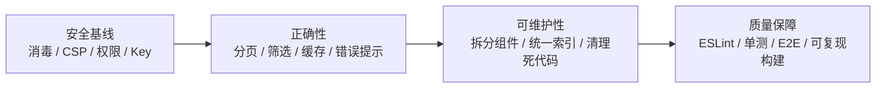

# 11 · 编码规范与已知问题

## 1. 编码规范

### 1.1 语言与风格

- **TypeScript strict**（`tsconfig.json` 中 `strict: true`），但 `noUnusedLocals` / `noUnusedParameters` 为 `false`。
- 无分号风格；单引号；2 空格缩进；尾随逗号；箭头函数为主。
- 页面/组件使用函数式组件 + Hooks；没有 class 组件。
- 中文用于 UI 文案与注释；变量、函数、类型使用英文。
- 所有跨目录导入使用 `@/` 别名（Vite 与 tsconfig 均已配置）。

### 1.2 文件与命名

| 类型 | 约定 | 示例 |
| --- | --- | --- |
| 页面 | `PascalCase.tsx`，默认导出 | `MainPage.tsx` → `export default function MainPage()` |
| 组件 | `PascalCase.tsx`；多数默认导出，少数具名导出 | `AskAIPanel.tsx` → `export function AskAIPanel` |
| 页面子组件 | 所属页面的子目录，按功能命名 | `pages/guide/TranslatePreset.tsx` |
| 服务 | 小写 `kebab-case.ts`，具名导出 | `api-base.ts`、`spiget.ts` |
| 类型 | 集中 `types/index.ts`，`interface` / `type` 具名导出 | `PluginBase` |
| Store | 单文件 `store/index.ts`，导出 `useAppStore` | — |
| 文档 | 中文文件名，按主题分目录 | `core/paper.md` |
| 图标 | 无独立文件，内联 SVG 在 `PlatformIcons.tsx` | `SpigotIcon` |

### 1.3 分层约定

1. **服务层不导入页面/组件**，避免反向依赖。
2. **所有平台适配器必须返回 `PluginBase`**，UI 不直接消费上游 JSON。
3. **全局共享状态只放 Store**；页面局部状态用 `useState`。
4. **AI 调用统一走 `services/ai.ts`**，不要在组件里直接 `fetch` 模型服务。
5. **文档加载有四种方式**，新增文档时需明确它属于哪一种（见 08）。
6. **持久化只经 Store**，不要在页面直接 `localStorage.setItem`。

### 1.4 样式约定

- Tailwind 原子类优先；复杂重复样式放 `index.css` 的自定义类。
- 暗色模式统一用 `dark:` 前缀，依赖 `<html class="dark">`。
- 主题色：
  - `mc-green` / `mc-green-dark` / `mc-gold` / `mc-bg` / `mc-border` / `mc-card`；
  - 平台色 `spigot`（橙）、`hangar`（蓝）、`modrinth`（绿）；
  - 暗色 `dark-bg` / `dark-card` / `dark-border` / `dark-text` / `dark-text-secondary`。
- 标题保留 `font-minecraft` 类名，但已映射为系统字体栈（不再加载 Minecraft-AE 字体）；文档正文同样使用系统字体。
- 动画类：`animate-fade-in`、`stagger-item`、`btn-press`、`card-hover`、`collapse-arrow`、`collapsible-content`、`loading-pulse`、`dropdown-animate`、`logo-animate`、`typing-dot`。

### 1.5 错误处理约定

- 服务层抛 `Error`；聚合搜索通过 `onError` 上报单平台失败，由 `MainPage` 展示提示。
- UI 层 `try/catch` + `console.error` + 用户可见兜底。
- AI 错误需区分 `ConcurrencyLimitError` 与普通错误；前者显示并发提示，后者显示 `err.message`。
- 加载态用 `Loader2` + `animate-spin`。
- 空态区分“无数据”和“未找到”。

### 1.6 Git / 提交

- 当前仓库没有 commit 规范文件；历史提交信息简短（如 `workflow`）。
- 建议采用 Conventional Commits：`feat:`、`fix:`、`docs:`、`refactor:`、`chore:`。
- 发布前同步三处版本号（`package.json`、`tauri.conf.json`、`Cargo.toml`）。

## 2. 扩展指南

### 2.1 新增页面

1. 在 `src/pages/NewPage.tsx` 创建默认导出组件。
2. 在 `App.tsx` 的 `<Routes>` 注册路由。
3. 若需导航入口，在 `Header.tsx` 的 `navItems` 添加。
4. 更新 06 页面文档与 02 依赖表。

### 2.2 新增平台

完整步骤见 [04 · 扩展新平台](04-services-and-api.md#7-扩展新平台)，摘要：

```text
types → adapter → api-base → vite proxy → searchAll → MainPage 热门
→ PluginDetailPage → AuthorPage → 图标/颜色/开关 → 文档
```

### 2.3 新增 AI 角色

1. `types/index.ts` 扩展 `AIRole`。
2. `store/index.ts` 的 `defaultRoleAssignments` 增加默认绑定。
3. `SettingsPage.tsx` 的 `roleLabels` 增加图标、名称、描述。
4. 调用处使用 `getModelForRole(newRole)` 或 `chatCompletion(newRole, ...)`。
5. `isAIAvailable(newRole)` 控制 UI 入口。

### 2.4 新增 AI 工具

1. 在 `ToolDefinition` 中声明 JSON Schema。
2. 在调用方的工具分发（如 `executeToolCall`）实现执行逻辑。
3. Agent 循环会把工具结果作为 `{ role: 'tool', tool_call_id, content }` 追加到消息。
4. 限制返回内容长度，避免撑爆上下文。
5. 对工具参数做校验（路径、范围、白名单）。

### 2.5 新增文档

见 [08 · 新增一篇文档的完整流程](08-docs-content.md#6-新增一篇文档的完整流程)。

### 2.6 新增设置项

1. 在 `types/index.ts` 增加类型（如需要）。
2. 在 `store/index.ts` 增加字段、默认值、`loadFromStorage` / `saveToStorage`。
3. 在 `SettingsPage.tsx` 增加表单区块。
4. 在使用方订阅对应字段。
5. 更新 03 状态表与 06 设置页说明。

## 3. 已知问题清单

严重度定义：**P0** 安全/数据风险；**P1** 功能正确性/稳定性；**P2** 可维护性/体验。

### 3.1 已修复的 P0 安全项

| # | 原问题 | 修复方式 | 关键位置 |
| --- | --- | --- | --- |
| 1 | Spigot 描述直接 `dangerouslySetInnerHTML` | 渲染前经 DOMPurify `sanitizeHtml`；Markdown 原始 HTML 统一接 `rehype-sanitize` | `PluginDetailPage.tsx`、`utils/sanitize.ts`、`DocsPage.tsx` |
| 2 | API Key 明文存 `localStorage` | AES-GCM 加密整个模型配置；密钥不可导出并存入 IndexedDB；旧明文自动迁移后删除；不支持 Web Crypto 时仅内存保留 | `services/secure-storage.ts`、`store/index.ts` |
| 3 | Tauri 权限过宽、CSP 为空 | capabilities 改为只读 FS + 限定 scope；移除全部 shell 权限与插件；配置生产/开发 CSP | `capabilities/default.json`、`tauri.conf.json`、`Cargo.toml`、`lib.rs` |
| 4 | 文档 `rehypeRaw` 无消毒 | `rehype-raw` 后接 `rehype-sanitize`；Tauri 侧增加 CSP 作为纵深防御 | `DocsPage.tsx`、`PluginDetailPage.tsx`、`tauri.conf.json` |
| 5 | Agent 可构造 `..` 路径 | 新增 `resolveServerPath`：拒绝绝对路径、UNC、NUL 与越界 `..`；仅允许 serverPath 子目录；移除 shell 回退 | `pages/guide/AgentPreset.tsx` |

同时修复的相关问题：

| 原 # | 问题 | 修复 |
| --- | --- | --- |
| 16 | `isTauri()` 仅检测 `__TAURI__` | 改为同时检测 `__TAURI_INTERNALS__` |
| 17 | Agent 路径强制 Windows 风格 | 统一使用 `/` 并支持跨平台；移除 `cmd` 兜底 |
| 18 | 设置“重置”执行 `localStorage.clear()` | 改为 `resetAppData()`，仅清理本应用键、密文与 IndexedDB 密钥库 |

### 3.2 已修复的 P1 问题

| # | 原问题 | 修复方式 | 关键位置 |
| --- | --- | --- | --- |
| 6 | MainPage 筛选未接入请求 | 新增 `services/filters.ts`，分类/服务端/版本/下载量/排序统一过滤；SearchBar 筛选参数写入 URL 并同步到 MainPage | `MainPage.tsx`、`services/filters.ts` |
| 7 | Modrinth 搜索分页二次乘法 | `searchAll` 统一使用 `getPlatformPage`，Hangar/Modrinth 传 0 基页码 | `services/search.ts` |
| 8 | 热门“换一批”偏移二次乘法 | Hangar/Modrinth 热门改为传 `randomPage - 1` | `MainPage.tsx` |
| 9 | Hangar 详情缓存键不匹配 | 缓存键按 `plugin.id` 规则生成：`hangar-<owner>-<slug>` | `PluginDetailPage.tsx` |
| 10 | 文档树仅 38/72、索引多套手写 | 新增 `src/data/docs.ts` 单一数据源，eager glob 全部 72 篇，自动生成 `docsTree`、`DOC_INDEX_TEXT`、`PLUGIN_DOCS` | `src/data/docs.ts`、`DocsPage.tsx`、`DocsSearch.tsx`、`GuidePage.tsx`、`SearchBar.tsx` |
| 11 | `searchAll` 吞掉平台错误 | `searchAll` 增加 `onError` 回调，MainPage 展示失败平台提示 | `services/search.ts`、`MainPage.tsx` |
| 12 | `apiFetch` 无超时/取消 | 增加默认 15 秒超时与外部 `AbortSignal` 透传 | `services/api-base.ts` |
| 13 | 并发上限固化 | `ConcurrencyLimiter.setMaxConcurrency` 在每次取模型时同步 | `services/ai.ts` |
| 14 | 跨标签页竞态 | 使用 Web Locks 串行化全局计数读改写；不可用时退化 | `services/ai.ts` |
| 15 | BroadcastChannel 无降级 | 构造失败时置空，仅依赖 localStorage | `services/ai.ts` |
| 19 | CI 删除 `package-lock.json` | 两个工作流改为 `npm ci` | `deploy.yml`、`release.yml` |
| 20 | 无测试、无 lint | 增加 ESLint flat config、Vitest 9 个单元测试与 `lint` / `test` / `typecheck` 脚本 | `eslint.config.js`、`*.test.ts`、`package.json` |
| 21 | Modrinth 详情作者为空 | `getModrinthProject` 通过团队接口补全作者与作者 ID | `services/modrinth.ts` |
| 22 | AI 请求绕过 CORS 代理 | 新增可配置 `aiProxy`，`buildUrl` 统一走代理前缀 | `store/index.ts`、`services/ai.ts`、`SettingsPage.tsx` |

### 3.3 已修复的 P2 问题

| # | 原问题 | 修复方式 | 关键位置 |
| --- | --- | --- | --- |
| 24 | 未使用的类型 `AIStreamChunk`、`AppSettings`、旧 `types/SearchFilters` | 删除前两者；`SearchFilters` 收敛到 `types/index.ts` 并被 `SearchBar` / `MainPage` 实际使用 | `types/index.ts` |
| 25 | 未使用的导出：`formatRating`、`getPlatformColor`、`getSpigetCategories`、`getSpigetCategoryResources`、`getSpigetNewResources`、`getSpigetAuthor`、`getModrinthCategories`、`translateLines`、`translateDocument`、`describeImage` | 全部删除；同时移除随之失效的 `SpigetCategory` / `SpigetAuthor` 类型 | `spiget.ts`、`modrinth.ts`、`search.ts`、`ai.ts` |
| 26 | 重复实现：三份锚点生成、两套翻译流程 | 新增 `utils/markdown.ts` 统一 slug 与去重规则；删除 `translateLines` / `translateDocument`，文档翻译只保留流式实现 | `utils/markdown.ts`、`ai.ts` |
| 27 | 组件过重 | 抽出 `FilterPanel`、`SearchAgentPanel`、`DocsSearchResults`；`GuidePage` 拆为 `guide/PresetSelector`、`TranslatePreset`、`SimpleServerPreset`、`AgentPreset` | `components/`、`pages/guide/` |
| 28 | 整体解构 Store | 改为字段级选择器订阅 | `MainPage`、`PluginDetailPage`、`SettingsPage`、`PluginCard` |
| 29 | 收藏保存译文快照 | `PluginCard` 新增 `favoritePlugin`，收藏时写入原始插件数据 | `PluginCard.tsx`、`MainPage.tsx` |
| 30 | `MinecraftBlockIcon` 每次渲染生成随机 id | 改用 `useId()` 并去掉冒号，id 稳定且唯一 | `PlatformIcons.tsx` |
| 31 | 重复请求：Spigot 详情与描述各请求一次；Modrinth 详情额外请求描述 | Spigot 详情一次请求即包含描述；Modrinth 复用 `project.body`。团队接口仅用于补全作者，Modrinth API 无单请求替代 | `PluginDetailPage.tsx`、`spiget.ts`、`modrinth.ts` |
| 32 | Hangar 描述最多 6 次请求 | `/pages` 只请求一次，失败时回退到已获取的项目简介 | `hangar.ts` |
| 33 | 重复翻译无缓存 | 新增 `translationsRef`，只对未翻译的插件发起 AI 请求 | `MainPage.tsx` |
| 34 | 锚点重复 id | `buildHeadingIdMap` 按源码行号预生成 id，同名标题追加 `-1`、`-2` | `utils/markdown.ts`、`DocsPage.tsx` |
| 35 | 主题历史选择器残留 | 移除 `body.dark-mode` 选择器 | `index.css` |
| 36 | 404 页面只保存不恢复 redirect | 删除无效的 `sessionStorage.redirect` 写入，保留回首页行为（HashRouter 下无深层路径可恢复） | `public/404.html` |
| 37 | `formatFileSize` 只处理 B/KB/MB | 增加 GB / TB 分支 | `guide/TranslatePreset.tsx` |
| 38 | 翻译预设并发 200 与模型限流叠加 | 并发数改为读取翻译模型的 `maxConcurrency`，预设文案同步 | `guide/TranslatePreset.tsx` |
| 39 | 首页首次加载重复请求热门 | 合并为一个 effect，用 `popularKeyRef`（平台列表 + 页码指纹）去重，StrictMode 下也只加载一次 | `MainPage.tsx` |
| 40 | 普通搜索重复请求 | `loadedQueryRef` 记录已发起的搜索词，`handleSearch` 与 query effect 不再重复 `doSearch` | `MainPage.tsx` |

### 3.4 剩余观察项（非缺陷）

| 项 | 说明 |
| --- | --- |
| `AgentPreset` 单文件仍约 1000 行 | 已完成页面级拆分，后续可继续把消息列表/输入区抽成展示组件 |
| Modrinth 团队接口请求 | Modrinth 项目响应不含作者名，补全作者必须额外请求；已做失败降级 |
| E2E / 依赖审计 | 目前只有 Vitest 单测与 ESLint，Playwright 与依赖审计仍待接入 |

## 4. 安全总览

| 资产/能力 | 当前保护 | 风险等级 |
| --- | --- | --- |
| AI API Key | AES-GCM 加密存储，密钥不可导出并置于 IndexedDB；旧明文自动迁移；不支持 Web Crypto 时仅内存 | 低–中（同源 XSS 仍可调用解密逻辑） |
| 插件/文档 HTML | Spigot 经 DOMPurify；Markdown 经 `rehype-sanitize` | 低 |
| 本地文件系统 | Tauri 只读 FS + HOME/DOCUMENT/DESKTOP/DOWNLOAD scope + 路径校验 | 中（符号链接未 canonicalize） |
| 系统命令 | 已移除 shell 插件、权限与前端回退 | 已消除 |
| CSP | Tauri 生产/开发 CSP 已配置 | 中（Web 端 GitHub Pages 无法设置响应头） |
| 外部链接 | 多数 `rel="noopener noreferrer"` | 低 |
| 网络传输 | HTTPS（默认 API 与模型服务） | 低 |
| 第三方 CORS 代理 | 默认公共代理，可替换 | 中 |

**已实施的 P0 修复**：

1. Spigot HTML 经 DOMPurify；Markdown 原始 HTML 经 `rehype-sanitize`。
2. API Key 改为 AES-GCM 加密存储，IndexedDB 保存不可导出密钥，旧明文迁移后删除。
3. Tauri capabilities 收敛为只读 FS；完整移除 shell 插件与权限；配置 CSP。
4. Agent 增加 `resolveServerPath` 路径校验，阻止 `..` 与绝对路径，仅访问 serverPath 子目录。
5. `isTauri()` 双检测、跨平台路径、应用级重置一并修复。

**剩余加固建议**：

- 在 Rust 侧 canonicalize 路径并校验前缀，防止符号链接逃逸。
- 为桌面端接入系统密钥链（keyring / stronghold）。
- 为 Web 托管平台配置 CSP 响应头，或增加构建期 meta CSP。
- 接入 Playwright E2E 与依赖审计（`npm audit` / Dependabot）。

## 5. 变更检查清单

提交 PR 前建议逐项确认：

- [ ] `npm run build` 通过（`tsc -b` + `vite build`）。
- [ ] 新增页面已在 `App.tsx` 注册，并在 06 文档补充。
- [ ] 新增平台已更新 `Platform`、适配器、`api-base`、Vite 代理、`searchAll`、首页/详情/作者、图标与颜色。
- [ ] 新增文档后运行 `npm test`（`docs.test.ts` 校验 72/树节点一致），并更新 `目录.md`；分组规则按需补充 `src/data/docs.ts`。
- [ ] 新增 AI 角色已同步类型、默认分配、设置页标签。
- [ ] 新增 Store 字段已加入持久化键表（03 文档）。
- [ ] 修改 Tauri 权限时已评估安全影响（09 文档）。
- [ ] 修改对外展示的 HTML/Markdown 时已确认消毒策略。
- [ ] 版本号三处一致（发布时）。
- [ ] 文档中的相对链接与代码位置仍然有效。

## 6. 建议的改进路线



| 阶段 | 目标 | 关键动作 |
| --- | --- | --- |
| 1 | 消除高危面（已完成） | DOMPurify、CSP、Tauri 最小权限、Key 加密存储、路径校验 |
| 2 | 修复核心功能（已完成） | 分页修正、热门偏移、筛选接入、缓存键、请求超时与错误提示、文档统一索引、AI 并发与代理、CI/测试 |
| 3 | 降低维护成本（已完成） | 拆分 SearchBar/DocsSearch/GuidePage/MainPage、统一锚点与翻译实现、清理未使用代码 |
| 4 | 建立质量门禁（部分完成） | ESLint 与 Vitest 已接入；待补 Prettier、Playwright、依赖审计与 PR 检查清单 |
