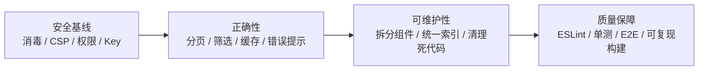

# 11 · 编码规范与已知问题

## 1. 编码规范

### 1.1 语言与风格

- **TypeScript strict**（`tsconfig.json` 中 `strict: true`），但 `noUnusedLocals` / `noUnusedParameters` 为 `false`。
- 无分号风格；单引号；2 空格缩进；尾随逗号；箭头函数为主。
- 页面/组件使用函数式组件 + Hooks；没有 class 组件。
- 中文用于 UI 文案与注释；变量、函数、类型使用英文。
- 所有跨目录导入使用 `@/` 别名（Vite 与 tsconfig 均已配置）。

### 1.2 文件与命名

| 类型 | 约定 | 示例 |
| --- | --- | --- |
| 页面 | `PascalCase.tsx`，默认导出 | `MainPage.tsx` → `export default function MainPage()` |
| 组件 | `PascalCase.tsx`；多数默认导出，少数具名导出 | `AskAIPanel.tsx` → `export function AskAIPanel` |
| 服务 | 小写 `kebab-case.ts`，具名导出 | `api-base.ts`、`spiget.ts` |
| 类型 | 集中 `types/index.ts`，`interface` / `type` 具名导出 | `PluginBase` |
| Store | 单文件 `store/index.ts`，导出 `useAppStore` | — |
| 文档 | 中文文件名，按主题分目录 | `core/paper.md` |
| 图标 | 无独立文件，内联 SVG 在 `PlatformIcons.tsx` | `SpigotIcon` |

### 1.3 分层约定

1. **服务层不导入页面/组件**，避免反向依赖。
2. **所有平台适配器必须返回 `PluginBase`**，UI 不直接消费上游 JSON。
3. **全局共享状态只放 Store**；页面局部状态用 `useState`。
4. **AI 调用统一走 `services/ai.ts`**，不要在组件里直接 `fetch` 模型服务。
5. **文档加载有四种方式**，新增文档时需明确它属于哪一种（见 08）。
6. **持久化只经 Store**，不要在页面直接 `localStorage.setItem`。

### 1.4 样式约定

- Tailwind 原子类优先；复杂重复样式放 `index.css` 的自定义类。
- 暗色模式统一用 `dark:` 前缀，依赖 `<html class="dark">`。
- 主题色：
  - `mc-green` / `mc-green-dark` / `mc-gold` / `mc-bg` / `mc-border` / `mc-card`；
  - 平台色 `spigot`（橙）、`hangar`（蓝）、`modrinth`（绿）；
  - 暗色 `dark-bg` / `dark-card` / `dark-border` / `dark-text` / `dark-text-secondary`。
- 标题使用 `font-minecraft`；文档正文用 `.docs-content` 覆盖为系统字体。
- 动画类：`animate-fade-in`、`stagger-item`、`btn-press`、`card-hover`、`collapse-arrow`、`collapsible-content`、`loading-pulse`、`dropdown-animate`、`logo-animate`、`typing-dot`。

### 1.5 错误处理约定

- 服务层抛 `Error`；聚合搜索吞掉单平台错误。
- UI 层 `try/catch` + `console.error` + 用户可见兜底。
- AI 错误需区分 `ConcurrencyLimitError` 与普通错误；前者显示并发提示，后者显示 `err.message`。
- 加载态用 `Loader2` + `animate-spin`。
- 空态区分“无数据”和“未找到”。

### 1.6 Git / 提交

- 当前仓库没有 commit 规范文件；历史提交信息简短（如 `workflow`）。
- 建议采用 Conventional Commits：`feat:`、`fix:`、`docs:`、`refactor:`、`chore:`。
- 发布前同步三处版本号（`package.json`、`tauri.conf.json`、`Cargo.toml`）。

## 2. 扩展指南

### 2.1 新增页面

1. 在 `src/pages/NewPage.tsx` 创建默认导出组件。
2. 在 `App.tsx` 的 `<Routes>` 注册路由。
3. 若需导航入口，在 `Header.tsx` 的 `navItems` 添加。
4. 更新 06 页面文档与 02 依赖表。

### 2.2 新增平台

完整步骤见 [04 · 扩展新平台](04-services-and-api.md#7-扩展新平台)，摘要：

```text
types → adapter → api-base → vite proxy → searchAll → MainPage 热门
→ PluginDetailPage → AuthorPage → 图标/颜色/开关 → 文档
```

### 2.3 新增 AI 角色

1. `types/index.ts` 扩展 `AIRole`。
2. `store/index.ts` 的 `defaultRoleAssignments` 增加默认绑定。
3. `SettingsPage.tsx` 的 `roleLabels` 增加图标、名称、描述。
4. 调用处使用 `getModelForRole(newRole)` 或 `chatCompletion(newRole, ...)`。
5. `isAIAvailable(newRole)` 控制 UI 入口。

### 2.4 新增 AI 工具

1. 在 `ToolDefinition` 中声明 JSON Schema。
2. 在调用方的工具分发（如 `executeToolCall`）实现执行逻辑。
3. Agent 循环会把工具结果作为 `{ role: 'tool', tool_call_id, content }` 追加到消息。
4. 限制返回内容长度，避免撑爆上下文。
5. 对工具参数做校验（路径、范围、白名单）。

### 2.5 新增文档

见 [08 · 新增一篇文档的完整流程](08-docs-content.md#6-新增一篇文档的完整流程)。

### 2.6 新增设置项

1. 在 `types/index.ts` 增加类型（如需要）。
2. 在 `store/index.ts` 增加字段、默认值、`loadFromStorage` / `saveToStorage`。
3. 在 `SettingsPage.tsx` 增加表单区块。
4. 在使用方订阅对应字段。
5. 更新 03 状态表与 06 设置页说明。

## 3. 已知问题清单

严重度定义：**P0** 安全/数据风险；**P1** 功能正确性/稳定性；**P2** 可维护性/体验。

### 3.1 已修复的 P0 安全项

| # | 原问题 | 修复方式 | 关键位置 |
| --- | --- | --- | --- |
| 1 | Spigot 描述直接 `dangerouslySetInnerHTML` | 渲染前经 DOMPurify `sanitizeHtml`；Markdown 原始 HTML 统一接 `rehype-sanitize` | `PluginDetailPage.tsx`、`utils/sanitize.ts`、`DocsPage.tsx` |
| 2 | API Key 明文存 `localStorage` | AES-GCM 加密整个模型配置；密钥不可导出并存入 IndexedDB；旧明文自动迁移后删除；不支持 Web Crypto 时仅内存保留 | `services/secure-storage.ts`、`store/index.ts` |
| 3 | Tauri 权限过宽、CSP 为空 | capabilities 改为只读 FS + 限定 scope；移除全部 shell 权限与插件；配置生产/开发 CSP | `capabilities/default.json`、`tauri.conf.json`、`Cargo.toml`、`lib.rs` |
| 4 | 文档 `rehypeRaw` 无消毒 | `rehype-raw` 后接 `rehype-sanitize`；Tauri 侧增加 CSP 作为纵深防御 | `DocsPage.tsx`、`PluginDetailPage.tsx`、`tauri.conf.json` |
| 5 | Agent 可构造 `..` 路径 | 新增 `resolveServerPath`：拒绝绝对路径、UNC、NUL 与越界 `..`；仅允许 serverPath 子目录；移除 shell 回退 | `GuidePage.tsx` |

同时修复的相关问题：

| 原 # | 问题 | 修复 |
| --- | --- | --- |
| 16 | `isTauri()` 仅检测 `__TAURI__` | 改为同时检测 `__TAURI_INTERNALS__` |
| 17 | Agent 路径强制 Windows 风格 | 统一使用 `/` 并支持跨平台；移除 `cmd` 兜底 |
| 18 | 设置“重置”执行 `localStorage.clear()` | 改为 `resetAppData()`，仅清理本应用键、密文与 IndexedDB 密钥库 |

### 3.2 P1（剩余）

| # | 问题 | 位置 | 影响 |
| --- | --- | --- | --- |
| 6 | MainPage 分类/服务端/排序筛选未接入请求 | `MainPage.tsx#L80-L89`、`#L206-L209` | 用户点击筛选无效，只有最低下载量生效 |
| 7 | Modrinth 搜索分页二次乘法 | `search.ts#L20-L22` + `modrinth.ts#L44` | “加载更多”跳过大量结果 |
| 8 | Hangar/Modrinth 热门“换一批”偏移二次乘法 | `MainPage.tsx#L112-L115` | 随机页实际跳到 100、200… |
| 9 | Hangar 详情缓存键不匹配 | `PluginDetailPage.tsx#L89` vs `store/index.ts#L214` | Hangar 永远不命中缓存，重复请求 |
| 10 | 文档树仅 38/72，索引三套手写 | `DocsPage.tsx`、`DocsSearch.tsx`、`GuidePage.tsx` | 33 篇配置文档无法从侧边栏打开、普通搜索不可见；索引易漂移 |
| 11 | `searchAll` 吞掉所有平台错误 | `search.ts#L14-L27` | 用户只看到结果变少，无失败提示 |
| 12 | `apiFetch` 无超时/取消 | `api-base.ts#L41-L72` | 弱网下长时间 loading，无法中止 |
| 13 | `ConcurrencyLimiter` 并发上限固化 | `ai.ts#L129-L136` | 设置页修改并发后需刷新才生效 |
| 14 | `ConcurrencyLimiter` 跨标签页竞态 | `ai.ts#L62-L101` | 多标签同时请求可能短暂超限 |
| 15 | `BroadcastChannel` 无兼容降级 | `ai.ts#L21-L31` | 不支持的 WebView 直接抛错 |
| 19 | CI 删除 `package-lock.json` | `deploy.yml#L31-L33`、`release.yml#L53-L57` | 构建不可复现，依赖可能漂移 |
| 20 | 无测试、无 lint | 全仓库 | 回归风险依赖人工与 `tsc` |
| 21 | Modrinth 详情作者为空 | `modrinth.ts#L30` | 作者链接空白、作者页空参数 |
| 22 | AI 请求不经过 CORS 代理 | `ai.ts#L168`、`#L243`、`#L295` | Web 生产环境可能被模型服务 CORS 拦截 |

### 3.3 P2

| # | 问题 | 位置 | 影响 |
| --- | --- | --- | --- |
| 24 | 未使用的类型 `AIStreamChunk`、`AppSettings`、`types/SearchFilters` | `types/index.ts` | 类型定义与实现漂移 |
| 25 | 未使用的导出：`formatRating`、`getPlatformColor`、`getSpigetCategories`、`getSpigetCategoryResources`、`getSpigetNewResources`、`getSpigetAuthor`、`getModrinthTeamMembers`、`getModrinthCategories`、`translateLines`、`translateDocument`、`describeImage`、`PlaceholderPreset` | 各服务/页面 | 死代码增加维护成本 |
| 26 | 重复实现：三份锚点生成、多套文档索引、两套翻译流程 | `DocsPage`/`AskAIPanel`/`DocsSearch`；`ai.ts`/`GuidePage` | 行为不一致风险 |
| 27 | 组件过重 | `SearchBar` 723 行、`DocsSearch` 653 行、`GuidePage` 2017 行 | 难测试、难复用 |
| 28 | 整体解构 Store | `MainPage`、`PluginDetailPage`、`SettingsPage` | 任意状态变化触发重渲染 |
| 29 | 收藏保存译文快照 | `MainPage` + `PluginCard` | 收藏卡显示 AI 译文而非原文 |
| 30 | `MinecraftBlockIcon` 每次渲染生成随机 id | `PlatformIcons.tsx#L36` | 无意义 DOM 变化与内存开销 |
| 31 | 重复请求：Spigot 详情与描述各请求一次 `/resources/{id}` | `PluginDetailPage` + `spiget.ts` | 增加延迟与限流风险 |
| 32 | Hangar 描述最多 6 次请求 | `hangar.ts#L35-L67` | 详情页变慢 |
| 33 | 重复翻译无缓存 | `MainPage.toggleTranslate` | 每次加载重新调用 AI |
| 34 | 锚点重复 id | `generateHeadingSlug` | 同名标题只跳第一个 |
| 35 | 主题历史选择器残留 | `index.css#L32-L36` | `body.dark-mode` 实际不再使用 |
| 36 | 404 页面只保存不恢复 redirect | `public/404.html` | 无效路径统一回首页 |
| 37 | `formatFileSize` 只处理 B/KB/MB | `GuidePage.tsx#L54-L58` | GB 级文件显示为 MB |
| 38 | 翻译预设并发 200 与模型限流叠加 | `GuidePage.tsx#L216-L240` + `ai.ts` | 实际并发受较小值限制，UI 描述可能误导 |
| 39 | 首页首次加载重复请求热门 | `MainPage.tsx#L212-L226` | 两个 `useEffect` 在挂载时都调用 `loadPopular`，产生双倍请求 |
| 40 | 普通搜索重复请求 | `MainPage.tsx#L149-L159` 与 `#L212-L220` | `handleSearch` 直接 `doSearch`，同时 `setSearchParams` 触发 query effect 再次 `doSearch` |

## 4. 安全总览

| 资产/能力 | 当前保护 | 风险等级 |
| --- | --- | --- |
| AI API Key | AES-GCM 加密存储，密钥不可导出并置于 IndexedDB；旧明文自动迁移；不支持 Web Crypto 时仅内存 | 低–中（同源 XSS 仍可调用解密逻辑） |
| 插件/文档 HTML | Spigot 经 DOMPurify；Markdown 经 `rehype-sanitize` | 低 |
| 本地文件系统 | Tauri 只读 FS + HOME/DOCUMENT/DESKTOP/DOWNLOAD scope + 路径校验 | 中（符号链接未 canonicalize） |
| 系统命令 | 已移除 shell 插件、权限与前端回退 | 已消除 |
| CSP | Tauri 生产/开发 CSP 已配置 | 中（Web 端 GitHub Pages 无法设置响应头） |
| 外部链接 | 多数 `rel="noopener noreferrer"` | 低 |
| 网络传输 | HTTPS（默认 API 与模型服务） | 低 |
| 第三方 CORS 代理 | 默认公共代理，可替换 | 中 |

**已实施的 P0 修复**：

1. Spigot HTML 经 DOMPurify；Markdown 原始 HTML 经 `rehype-sanitize`。
2. API Key 改为 AES-GCM 加密存储，IndexedDB 保存不可导出密钥，旧明文迁移后删除。
3. Tauri capabilities 收敛为只读 FS；完整移除 shell 插件与权限；配置 CSP。
4. Agent 增加 `resolveServerPath` 路径校验，阻止 `..` 与绝对路径，仅访问 serverPath 子目录。
5. `isTauri()` 双检测、跨平台路径、应用级重置一并修复。

**剩余加固建议**：

- 在 Rust 侧 canonicalize 路径并校验前缀，防止符号链接逃逸。
- 为桌面端接入系统密钥链（keyring / stronghold）。
- 为 Web 托管平台配置 CSP 响应头，或增加构建期 meta CSP。
- 增加 ESLint、Vitest、Playwright 与 `npm ci` 质量门禁。

## 5. 变更检查清单

提交 PR 前建议逐项确认：

- [ ] `npm run build` 通过（`tsc -b` + `vite build`）。
- [ ] 新增页面已在 `App.tsx` 注册，并在 06 文档补充。
- [ ] 新增平台已更新 `Platform`、适配器、`api-base`、Vite 代理、`searchAll`、首页/详情/作者、图标与颜色。
- [ ] 新增文档已同步 `docsTree`（如需侧边栏）、`DOC_INDEX`、`DOC_INDEX_DESC`、`GuidePage.DOC_INDEX`、`目录.md`。
- [ ] 新增 AI 角色已同步类型、默认分配、设置页标签。
- [ ] 新增 Store 字段已加入持久化键表（03 文档）。
- [ ] 修改 Tauri 权限时已评估安全影响（09 文档）。
- [ ] 修改对外展示的 HTML/Markdown 时已确认消毒策略。
- [ ] 版本号三处一致（发布时）。
- [ ] 文档中的相对链接与代码位置仍然有效。

## 6. 建议的改进路线



| 阶段 | 目标 | 关键动作 |
| --- | --- | --- |
| 1 | 消除高危面（已完成） | DOMPurify、CSP、Tauri 最小权限、Key 加密存储、路径校验 |
| 2 | 修复核心功能 | Modrinth 分页、热门偏移、筛选接入、Hangar 缓存键、请求超时与错误 UI |
| 3 | 降低维护成本 | 文档索引自动生成、拆分 SearchBar/DocsSearch/GuidePage、统一 AI 错误组件、清理未使用代码 |
| 4 | 建立质量门禁 | ESLint + Prettier、Vitest、Playwright、`npm ci`、依赖审计、PR 检查清单 |
